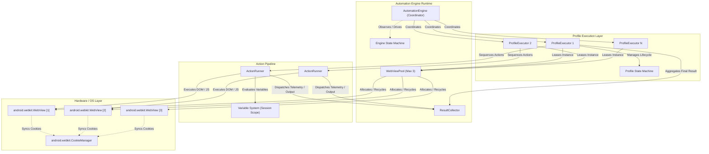
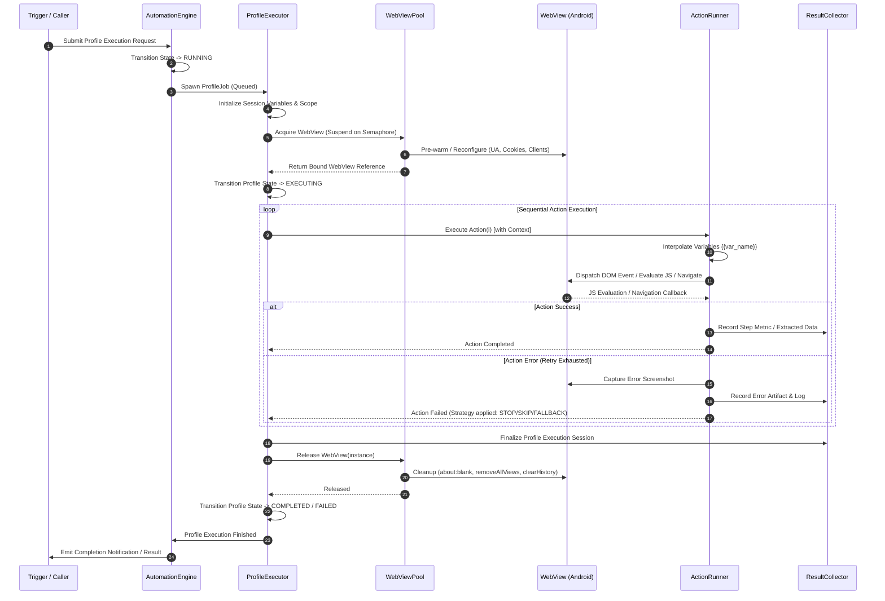
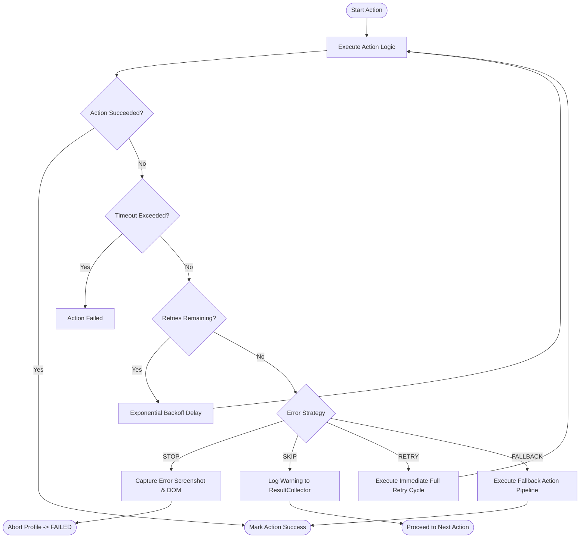
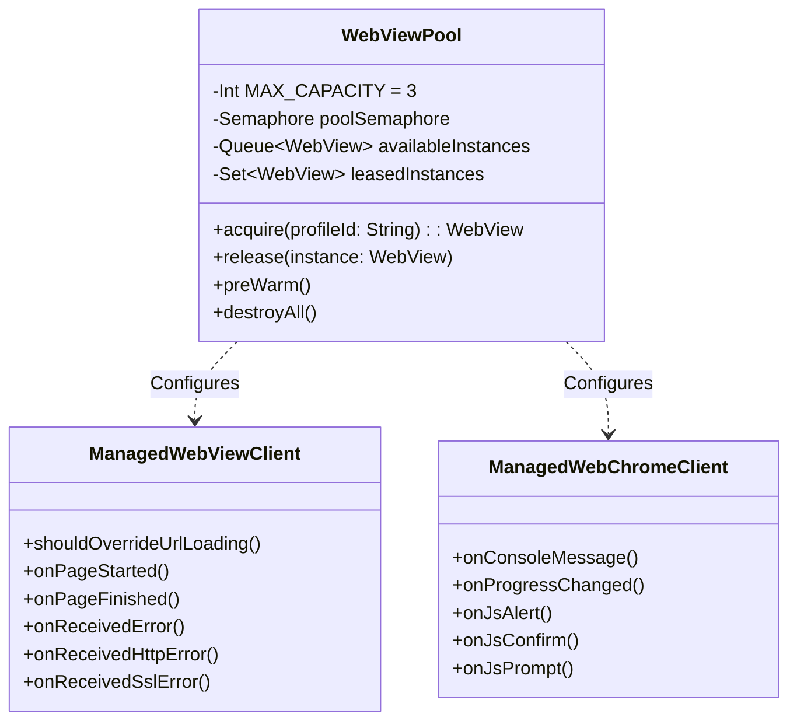
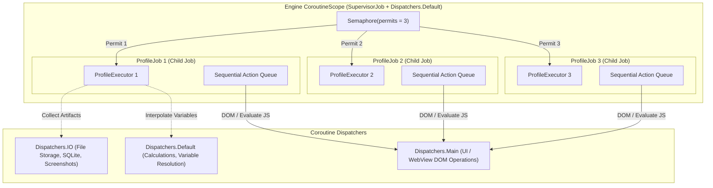
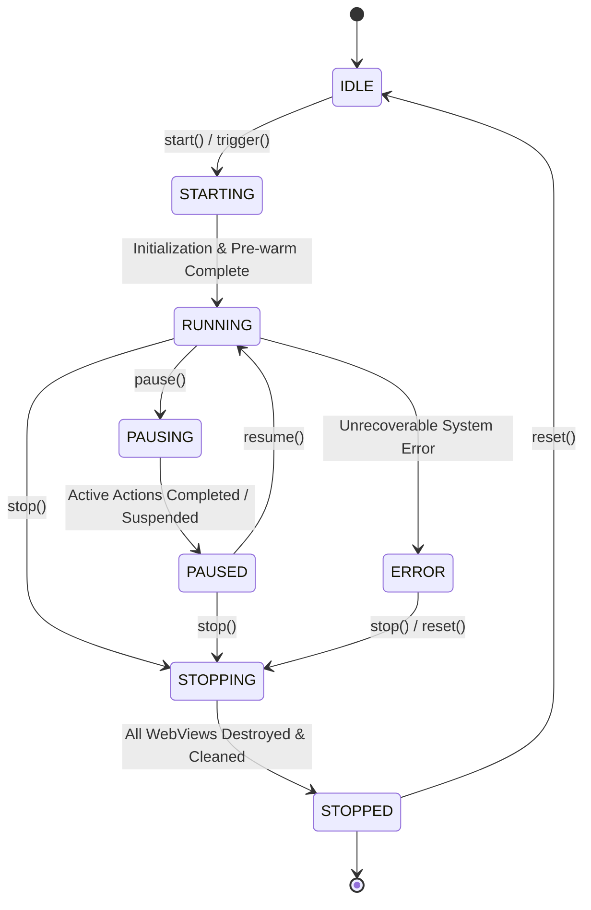
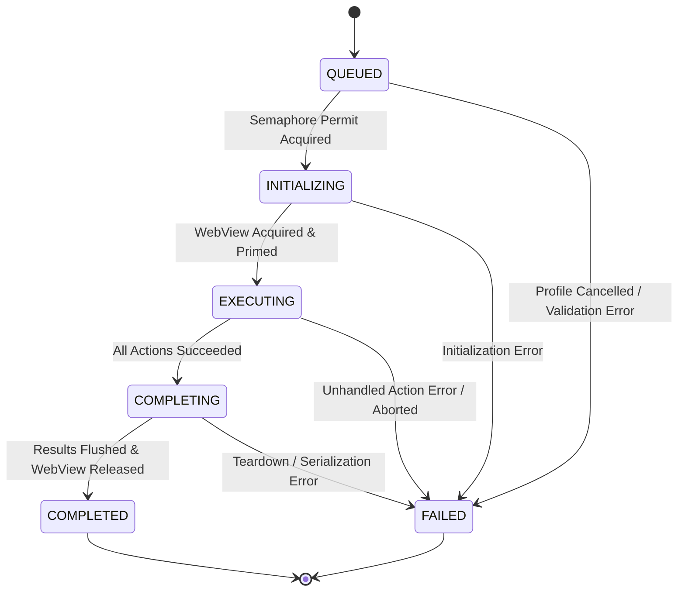

# BAutoPilot Automation Engine Specification

The **BAutoPilot Automation Engine** is an enterprise-grade Android WebView automation runtime designed for headless and visible browser-driven automation tasks. It provides deterministic profile execution, pooled multi-instance WebView management, resilient error handling, variable interpolation, and structured coroutine-based concurrency.

---

## 1. Engine Architecture

The engine is structured as a modular coordinator-worker architecture, delegating responsibilities across discrete components to ensure fault isolation, lifecycle safety, and predictable resource utilization.



### Core Components

| Component | Role | Key Responsibilities |
| :--- | :--- | :--- |
| **`AutomationEngine`** | Coordinator / Orchestrator | • Top-level engine lifecycle supervisor.<br>• Profile execution queuing, dispatching, and cancellation.<br>• Global concurrency control via bounded coroutine semaphores.<br>• System-wide state transitions and error escalation. |
| **`ProfileExecutor`** | Profile Session Manager | • Manages an isolated execution session for a single profile.<br>• Acquires and binds a leased `WebView` from `WebViewPool`.<br>• Initializes and scopes the session `VariableContext`.<br>• Iterates through the action list sequentially, enforcing action-level retries and profile recovery strategies.<br>• Dispatches execution milestones to `ResultCollector`. |
| **`ActionRunner`** | Low-Level Action Executor | • Direct interface between automation primitives and Android's `WebView`.<br>• Injects JavaScript bridges, evaluates XPath/CSS selectors, and triggers DOM events.<br>• Manages action-level timeouts, retry loops, and step-level screenshot captures on error.<br>• Resolves dynamic variables prior to command evaluation. |
| **`WebViewPool`** | Resource Pool Manager | • Enforces a strict hardware threshold of maximum 3 concurrent WebViews.<br>• Performs background instantiation and pre-warming on the Android UI/Main thread.<br>• Handles safe teardown (`removeAllViews`, history clearance, `destroy()`) to prevent native memory leaks.<br>• Manages client injection (`WebViewClient`, `WebChromeClient`) and custom User-Agent configuration. |
| **`ResultCollector`** | Metrics & Telemetry Aggregator | • In-memory and persistent aggregation of execution metrics (durations, status codes, step logs).<br>• Captures extracted variables, exported artifacts, and error screenshots.<br>• Dispatches real-time event notifications to external listeners and persistence stores. |

---

## 2. Execution Flow

The automation lifecycle follows a deterministic, pipeline-based execution flow. No action can run until hardware and profile resources are safely acquired and initialized.



### Detailed Execution Stages

1. **Trigger**:
   - Execution is initiated via UI interaction, cron schedule, webhook event, or internal worker queue.
   - The trigger payload supplies the profile definition, runtime overrides, and notification callbacks.
2. **Load Profile**:
   - The engine validates profile structure, compiles selector assertions, and instantiates an isolated `VariableContext`.
   - The profile is moved from `QUEUED` to `INITIALIZING`.
3. **Acquire WebView**:
   - The `ProfileExecutor` requests an active `WebView` instance from `WebViewPool`.
   - If the active count is at maximum capacity (3), the coroutine suspends non-blockingly until an instance is returned.
4. **Execute Actions Sequentially**:
   - The profile’s action array is executed in strict FIFO order by `ActionRunner`.
   - Variable expressions are evaluated immediately before action execution.
   - Flow control blocks (`CONDITIONAL`, `LOOP`) dynamically fork or repeat child action slices.
5. **Collect Results**:
   - Extracted text, attributes, screenshots, execution durations, and step statuses are continuously streamed to `ResultCollector`.
6. **Release WebView**:
   - The `WebView` is detached from any layout parent, purged of DOM and session residue (`about:blank`), reset to base state, and either returned to the warm idle pool or destroyed.
   - Semaphore permits are released.
7. **Notify**:
   - Engine aggregates the complete session manifest from `ResultCollector`.
   - Status callbacks, database updates, and UI broadcast notifications are dispatched.

---

## 3. Action Types Specification

Every automation profile is an ordered composite of concrete actions. The engine provides 10 core action primitives designed to support modern dynamic Single-Page Applications (SPAs).

### Action Primitives Summary

| Action Type | Primary Target | Primary Parameters | Resulting State / Output |
| :--- | :--- | :--- | :--- |
| **`NAVIGATE`** | Browser Location | `url`, `timeoutMs`, `waitForRedirects` | Document loaded, URL updated |
| **`CLICK`** | DOM Element | `selector`, `locatorType`, `waitTimeoutMs` | Native pointer/click event dispatched |
| **`FILL`** | Form Controls | `selector`, `value`, `isDropdown`, `clearFirst` | Input value set, change events triggered |
| **`EXTRACT`** | DOM Data | `selector`, `target` (TEXT/ATTR/HTML), `variableName` | Data stored in session variable context |
| **`WAIT`** | Synchronization | `conditionType` (DELAY/ELEMENT/NAV/JS), `timeoutMs` | Execution paused until condition met |
| **`SCROLL`** | Viewport / Element | `direction`, `xOffset`, `yOffset`, `selector` | Viewport or element position translated |
| **`SCREENSHOT`** | Rendering Surface | `captureTarget` (FULL/VIEWPORT/ELEMENT), `fileName` | Bitmap compressed to PNG/JPEG artifact |
| **`JS_EXECUTE`** | V8 Execution Context | `script`, `captureReturn`, `variableName` | JavaScript evaluated, return serialized |
| **`CONDITIONAL`** | Pipeline Branching | `condition`, `thenActions`, `elseActions` | Conditional sub-pipeline executed |
| **`LOOP`** | Pipeline Iteration | `loopType` (REPEAT/WHILE/ITERATE), `maxIterations` | Scoped sub-pipeline evaluated repeatedly |

---

### Detailed Action Specifications

#### 3.1 `NAVIGATE`
Navigates the WebView to a target HTTP/HTTPS destination or internal URI.
- **Parameters**:
  - `url` *(String)*: Destination URL supporting variable interpolation (e.g., `https://domain.com/user/{{userId}}`).
  - `waitForRedirects` *(Boolean, default: true)*: Awaits HTTP 3xx and client-side JavaScript redirects before returning.
  - `timeoutMs` *(Long, default: 30000)*: Maximum time allocated for the `onPageFinished` event to fire.
- **Behavior**:
  - Sets up an explicit navigation completion deferred promise.
  - Intercepts redirection loops via `WebViewClient.shouldOverrideUrlLoading`.

#### 3.2 `CLICK`
Locates an interactive DOM element and simulates a trusted click event.
- **Parameters**:
  - `selector` *(String)*: Target locator string.
  - `locatorType` *(Enum: `CSS`, `XPATH`)*: Selector evaluation strategy.
  - `waitTimeoutMs` *(Long, default: 10000)*: Time to wait for element to become visible and clickable.
  - `clickMethod` *(Enum: `SYNTHETIC_MOUSE`, `DISPATCH_EVENT`, `NATIVE_TOUCH`)*.
- **Behavior**:
  - Scrolls the element into the viewport if needed (`scrollIntoViewIfNeeded()`).
  - Dispatches `mousedown`, `mouseup`, and `click` sequence with correct client coordinates.

#### 3.3 `FILL`
Inputs textual data into `<input>`, `<textarea>`, or selects options in `<select>` dropdowns.
- **Parameters**:
  - `selector` *(String)*: CSS or XPath selector for the target field.
  - `value` *(String)*: Value to populate (supports `{{variable_name}}` substitution).
  - `isDropdown` *(Boolean, default: false)*: When true, targets `<select>` elements and chooses options by value, visible text, or index.
  - `clearFirst` *(Boolean, default: true)*: Clears existing content before typing.
  - `typingDelayMs` *(Long, default: 0)*: Introduces human-like delay between individual keystrokes.
- **Behavior**:
  - Dispatches `focus`, `keydown`, `keypress`, `input`, and `change` events to ensure reactive frameworks (React, Vue, Angular) register state changes.

#### 3.4 `EXTRACT`
Scrapes data from the live DOM and commits it into the session variable system.
- **Parameters**:
  - `selector` *(String)*: Target element locator.
  - `extractTarget` *(Enum: `TEXT`, `ATTRIBUTE`, `INNER_HTML`, `OUTER_HTML`)*.
  - `attributeName` *(String, optional)*: Required if `extractTarget == ATTRIBUTE` (e.g., `href`, `src`, `data-id`).
  - `variableName` *(String)*: Key under which the extracted value is stored.
  - `regex` *(String, optional)*: Regular expression extraction pattern with capture groups.
- **Behavior**:
  - Returns `null` or empty string if element is not found, or throws an error based on action error policy.

#### 3.5 `WAIT`
Pauses execution until an explicit temporal, DOM, or network condition is satisfied.
- **Parameters**:
  - `waitType`:
    - `DELAY`: Static pause for `delayMs`.
    - `ELEMENT_VISIBLE`: Waits until element exists and has non-zero width/height.
    - `ELEMENT_HIDDEN`: Waits until element is removed from DOM or styled `display: none` / `visibility: hidden`.
    - `NAVIGATION`: Waits until page navigation completes or target URL pattern matches.
    - `JS_CONDITION`: Continuously polls a custom JavaScript snippet until it evaluates to truthy (`true`, non-null object, non-empty string).
  - `timeoutMs` *(Long)*: Timeout duration before triggering a timeout failure.
  - `pollIntervalMs` *(Long, default: 250)*: Polling frequency for conditions.

#### 3.6 `SCROLL`
Translates the window viewport or an isolated scrollable DOM container.
- **Parameters**:
  - `direction` *(Enum: `UP`, `DOWN`, `TOP`, `BOTTOM`, `TO_ELEMENT`)*.
  - `xOffset` / `yOffset` *(Int)*: Pixel distance to translate.
  - `selector` *(String, optional)*: When defined, scrolls this specific container instead of the root window.
  - `smooth` *(Boolean, default: true)*: Applies CSS `behavior: smooth` or stepped programmatic scrolling.

#### 3.7 `SCREENSHOT`
Captures graphical raster data of the page or specific component.
- **Parameters**:
  - `captureTarget` *(Enum: `VIEWPORT`, `FULL_PAGE`, `ELEMENT`)*.
  - `selector` *(String, optional)*: Target element when `captureTarget == ELEMENT`.
  - `quality` *(Int, range: 10..100, default: 85)*.
  - `format` *(Enum: `JPEG`, `PNG`, `WEBP`)*.
  - `artifactName` *(String)*: Unique identifier/file key for storage.
- **Behavior**:
  - Utilizes Android `PixelCopy` API or WebView canvas drawing routines on the Main thread.

#### 3.8 `JS_EXECUTE`
Executes raw JavaScript within the page's V8 engine context.
- **Parameters**:
  - `script` *(String)*: JavaScript source code.
  - `captureReturn` *(Boolean, default: true)*: Awaits the evaluated result or resolved Promise.
  - `variableName` *(String, optional)*: Stores the stringified or parsed JSON result into the session context.
- **Behavior**:
  - Invokes `WebView.evaluateJavascript()`.
  - Handles asynchronous promises via an injected completion wrapper.

#### 3.9 `CONDITIONAL`
Introduces conditional branching into profile execution.
- **Parameters**:
  - `condition`:
    - `ELEMENT_EXISTS`: Checks if selector matches at least one element in DOM.
    - `VARIABLE_EQUALS`: Compares `{{var_name}}` against a constant or second variable.
    - `URL_MATCHES`: Regex or glob comparison against current page URL.
    - `JS_EXPRESSION`: Evaluates arbitrary JS logic returning boolean.
  - `thenActions` *(List<Action>)*: Action pipeline executed when condition evaluates to true.
  - `elseActions` *(List<Action>, optional)*: Action pipeline executed when condition evaluates to false.

#### 3.10 `LOOP`
Repeats an internal action block based on iterative or conditional criteria.
- **Parameters**:
  - `loopType`:
    - `REPEAT_N`: Runs the sub-pipeline an exact `count` number of times.
    - `WHILE_CONDITION`: Evaluates an element or JS condition prior to each iteration.
    - `ITERATE_ELEMENTS`: Finds all elements matching a selector and iterates over each element sequentially, injecting loop variables (e.g., `{{loop.index}}`, `{{loop.element_selector}}`).
  - `maxIterations` *(Int, default: 50)*: Safety boundary preventing infinite loops.
  - `actions` *(List<Action>)*: Sub-actions executed on every cycle.

---

## 4. Variable System

The Variable System provides state management, data passing between actions, and dynamic parameter resolution.

```
+--------------------------------------------------------------------------------+
|                        Profile Session Variable Scope                          |
|                                                                                |
|  +------------------------------+            +------------------------------+  |
|  |     Built-in System Vars     |            |      Extracted Variables     |  |
|  |  {{current_url}}             |            |  {{userId}} = "84920"        |  |
|  |  {{page_title}}              |            |  {{authToken}} = "x9s8d7..."  |  |
|  |  {{timestamp}}               |            |  {{itemPrice}} = "19.99"     |  |
|  |  {{profile_id}}              |            +------------------------------+  |
|  +------------------------------+                                              |
|                                                                                |
|                                 Interpolation Engine                           |
|            "https://api.example.com/items/{{userId}}?t={{timestamp}}"         |
|                                         |                                      |
|                                         v                                      |
|            "https://api.example.com/items/84920?t=1700000000000"              |
+--------------------------------------------------------------------------------+
```

### 4.1 Scope & Isolation
- **Session-Local Scope**: Every profile instance possesses an isolated `VariableContext`. Variables defined or mutated in Profile A are physically inaccessible to Profile B.
- **Lifecycle Scope**: Variables persist throughout the lifetime of the profile execution and are destroyed when the profile finishes and its `ResultCollector` extracts final outputs.
- **Thread Safety**: The variable map is backed by a thread-safe concurrent dictionary (`ConcurrentHashMap<String, Any>`) accessed across coroutine dispatchers.

### 4.2 Interpolation Syntax
Variables are referenced inside strings using double curly braces: `{{variable_name}}`.

- **Basic Interpolation**:
  ```json
  {
    "type": "NAVIGATE",
    "url": "https://service.internal/orders/{{order_id}}"
  }
  ```
- **Recursive / Nested Resolution**: Variables can be resolved within structured data payloads.
- **Missing Variable Policy**:
  - If a variable cannot be resolved:
    - Default behavior: Throws an `UnresolvedVariableException` and triggers action retry/failure.
    - Configurable fallback: Leave literal string intact or replace with empty string (`""`).

### 4.3 Built-in System Variables
The engine automatically calculates and exposes dynamic read-only system variables:

| Variable Name | Description | Example Output |
| :--- | :--- | :--- |
| `{{current_url}}` | The active, fully resolved URL in the WebView | `https://app.store.com/checkout/step2` |
| `{{page_title}}` | Current document title (`document.title`) | `Checkout - My Secure Store` |
| `{{timestamp}}` | Current Unix timestamp in milliseconds | `1700658324000` |
| `{{timestamp_iso}}` | ISO-8601 formatted UTC date-time string | `2026-11-22T12:45:24.000Z` |
| `{{profile_id}}` | Unique identifier of executing profile | `prof_marketing_lead_gen_01` |
| `{{step_index}}` | 0-based index of the currently executing action | `4` |
| `{{loop.index}}` | Current iteration index inside a `LOOP` construct | `0, 1, 2...` |

---

## 5. Error Handling & Resilience

To operate reliably in unstable network and DOM environments, the engine employs a multi-tiered resilience model.



### 5.1 Per-Action Retries & Backoff
- Each action definition accepts a `retryPolicy`:
  - `maxRetries` *(Int, default: 2)*: Number of retry attempts before executing the error strategy.
  - `initialDelayMs` *(Long, default: 1000)*: Initial pause before first retry.
  - `backoffMultiplier` *(Double, default: 2.0)*: Exponential multiplier for consecutive attempts.
  - `retryOn` *(List<ErrorType>)*: Filter for errors that qualify for retry (e.g., `ELEMENT_NOT_FOUND`, `PAGE_LOAD_TIMEOUT`). Fatal errors like `MALFORMED_URL` fail immediately.

### 5.2 Timeouts Hierarchy
1. **Network / Page Navigation Timeout** *(Default: 30s)*: Bound to individual `NAVIGATE` actions or page-load triggers.
2. **DOM Element Wait Timeout** *(Default: 10s)*: Max wait window for elements to mount and stabilize before an interaction.
3. **Action Execution Timeout** *(Default: 15s)*: Enforced via `kotlinx.coroutines.withTimeout` wrapping the entire action execution.
4. **Global Profile Timeout** *(Default: 300s)*: Safety limit terminating hung or infinitely looping profiles.

### 5.3 Error Strategies

| Strategy | Behavior | Use Case |
| :--- | :--- | :--- |
| **`STOP`** (Default) | Terminates the profile immediately. Captures failure artifacts and marks profile status as `FAILED`. | Critical checkout steps, authentication failures, data validation errors. |
| **`SKIP`** | Emits a warning to `ResultCollector`, ignores the error, and proceeds immediately to the next sequential action. | Dismissing optional promotional popups, non-essential tracking banners. |
| **`RETRY`** | Restarts the current action pipeline from the beginning of the action retry window. | Transient network blips, late-rendering DOM widgets. |
| **`FALLBACK`** | Diverts execution to an explicit array of fallback actions (`fallbackActions: [...]`). | Alternative selector options, legacy form submission paths. |

### 5.4 Automated Screenshot on Error
Whenever an action exhausts its retries and transitions to an unhandled failure state:
1. The engine automatically captures the current visual viewport via `WebViewPool.captureScreenshot()`.
2. Dumps the current DOM tree (`document.documentElement.outerHTML`) to an inspection string.
3. Attaches the bitmap artifact and DOM snapshot directly to the `ActionFailureEvent` recorded by `ResultCollector`.

---

## 6. WebView Management & Lifecycle

Android `WebView` instances are heavy native resources prone to memory leaks and GPU process crashes if not strictly managed. The `WebViewPool` isolates resource management from execution logic.



### 6.1 Pool Architecture (Max Capacity: 3)
- **Constraint**: To prevent Out-Of-Memory (OOM) faults and thermal throttling on mobile hardware, the pool enforces an absolute upper limit of **3 active instances**.
- **Acquire & Release**:
  - Profiles acquire instances using an asynchronous non-blocking permit.
  - When all 3 are in use, incoming profiles wait in the `QUEUED` state until an active profile completes and returns its instance.

### 6.2 Background Creation & Main-Thread Warm-Up
- WebViews must be created using the `ApplicationContext` or an unwrapped UI context on Android’s Main Thread (`Dispatchers.Main`).
- **Warm-Up Protocol**:
  - Initializes V8 JavaScript runtime and internal WebKit thread groups during engine startup.
  - Loads an empty page (`about:blank`) to prime hardware acceleration and compositing pipelines.
  - Minimizes cold-start latency for the first profile run.

### 6.3 Cleanup & Teardown Protocol
Improper destruction of a `WebView` causes severe activity and window context leaks. The pool enforces the following de-registration sequence upon release:

```kotlin
fun cleanUpAndRecycle(webView: WebView) {
    // 1. Halt all active processing
    webView.stopLoading()
    webView.loadUrl("about:blank")
    
    // 2. Clear transient navigation data
    webView.clearHistory()
    webView.clearSslPreferences()
    
    // 3. Detach listeners to unbind references
    webView.webViewClient = WebViewClient()
    webView.webChromeClient = WebChromeClient()
    
    // 4. Detach from layout view hierarchy
    (webView.parent as? ViewGroup)?.removeView(webView)
    
    // 5. Clean DOM & script state
    webView.evaluateJavascript(
        """
        try {
            window.localStorage.clear();
            window.sessionStorage.clear();
        } catch(e) {}
        """.trimIndent(), null
    )
}

fun hardDestroy(webView: WebView) {
    cleanUpAndRecycle(webView)
    webView.removeAllViews()
    webView.destroy()
}
```

### 6.4 Client Customization
- **Custom `WebViewClient`**:
  - `shouldOverrideUrlLoading`: Intercepts external intents, app-store redirects, and deep-links, forcing all navigation to remain within the controlled sandbox.
  - `onReceivedError` & `onReceivedHttpError`: Maps low-level WebKit errors (e.g., `net::ERR_CONNECTION_REFUSED`, HTTP 500) to structured engine exceptions.
  - `onReceivedSslError`: Strictly adheres to profile security policies (rejecting invalid certs by default, with opt-in debugging overrides).
- **Custom `WebChromeClient`**:
  - `onConsoleMessage`: Hooks into JavaScript `console.log/warn/error` calls, routing them directly into the engine's structured log pipeline.
  - `onJsAlert` / `onJsConfirm` / `onJsPrompt`: Intercepts blocking modal alerts, automatically answering them according to profile rules to avoid UI deadlock.
  - `onProgressChanged`: Provides sub-step progress metrics to `ResultCollector`.

### 6.5 CookieManager Synchronization
- Integrates with Android's singleton `android.webkit.CookieManager`.
- Supports profile-level session isolation by capturing cookies per session or clearing stored cookies before loading new profiles.
- Forces persistence to disk via `CookieManager.getInstance().flush()` upon completion of sensitive actions (e.g., login flows).

### 6.6 User-Agent (UA) Injection
- Custom User-Agent strings can be injected per profile via `WebSettings.userAgentString`.
- Emulates genuine Android mobile, desktop Chrome, or custom browser signatures.
- Evaluates client-hints injection script to maintain consistency between the HTTP `User-Agent` header and `navigator.userAgent` DOM properties.

---

## 7. Concurrency & Threading Model

The engine operates on a structured multi-threaded architecture leveraging Kotlin Coroutines, providing deterministic execution without blocking the Android UI thread.



### Concurrency Rules & Invariants

1. **One WebView per Profile (1:1 Binding)**:
   - A leased `WebView` instance is exclusively bound to a single `ProfileExecutor` for the duration of that profile’s run.
   - Cross-talk between profiles via shared WebViews is strictly impossible.
2. **Sequential Action Execution**:
   - Actions inside a profile execute strictly one at a time.
   - An action cannot start until the previous action has completed, failed, or timed out.
3. **Parallel Profiles with Semaphore**:
   - The engine allows up to **3 parallel profiles** to execute simultaneously.
   - A `kotlinx.coroutines.sync.Semaphore(3)` regulates profile execution.
   - If 10 profiles are triggered concurrently:
     - 3 enter `EXECUTING` immediately.
     - 7 remain in `QUEUED` state, waking up as active slots open.
4. **Structured Concurrency with `SupervisorJob`**:
   - The engine runs inside an `EngineScope` anchored by a `SupervisorJob`.
   - Failure or crash of an individual profile cancels only that profile's child coroutine job.
   - Sibling profiles and the engine itself continue running uninterrupted.
5. **Dispatcher Segregation**:
   - **`Dispatchers.Main`**: Reserved strictly for `WebView` instantiation, direct DOM manipulation, navigation calls, and screenshot canvas captures.
   - **`Dispatchers.Default`**: Variable interpolation, condition evaluation, JSON parsing, and profile state transitions.
   - **`Dispatchers.IO`**: Persistence of `ResultCollector` data, disk serialization, and image compression for screenshots.

---

## 8. State Machines

Both the overarching engine and individual profiles transition through explicit, observable state machines. All transitions emit immutable state change events.

### 8.1 Engine State Machine

The `AutomationEngine` coordinates system-level lifecycles, maintenance windows, and graceful shutdowns.



#### Engine States & Transitions

| State | Description | Allowed Triggers / Transitions |
| :--- | :--- | :--- |
| **`IDLE`** | Initialized, zero active executions, pool empty or cold. | `start()` → `STARTING` |
| **`STARTING`** | Allocating dispatcher threads, pre-warming `WebViewPool`. | Auto → `RUNNING` on initialization success;<br>`onError` → `ERROR` |
| **`RUNNING`** | Normal execution mode. Accepting and executing profiles. | `pause()` → `PAUSING`;<br>`stop()` → `STOPPING`;<br>`onError` → `ERROR` |
| **`PAUSING`** | Awaiting completion of currently executing atomic actions. | Auto → `PAUSED` once active actions reach safe checkpoint |
| **`PAUSED`** | Active profiles suspended. Queue preserved. No new actions dispatched. | `resume()` → `RUNNING`;<br>`stop()` → `STOPPING` |
| **`STOPPING`** | Canceling profile jobs, releasing semaphores, cleaning WebViews. | Auto → `STOPPED` when pool teardown completes |
| **`STOPPED`** | Terminal state for current cycle. Resources released. | `reset()` → `IDLE` |
| **`ERROR`** | Unrecoverable failure (e.g., V8 crash, OutOfMemoryError). | `stop()` / `reset()` → `STOPPING` |

---

### 8.2 Profile State Machine

Each profile dispatched to the engine is governed by a dedicated state machine tracked by `ProfileExecutor`.



#### Profile States & Transitions

| State | Description | Transitions |
| :--- | :--- | :--- |
| **`QUEUED`** | Profile definition validated and queued; waiting for an available permit in `WebViewPool`. | → `INITIALIZING` (permit obtained)<br>→ `FAILED` (canceled in queue) |
| **`INITIALIZING`** | Leased `WebView` is bound, session `VariableContext` instantiated, clients injected. | → `EXECUTING` (setup successful)<br>→ `FAILED` (binding/warm-up error) |
| **`EXECUTING`** | Sequential action pipeline is actively running through `ActionRunner`. | → `COMPLETING` (all actions completed)<br>→ `FAILED` (fatal action error / STOP strategy) |
| **`COMPLETING`** | Pipeline execution finished. Flushing logs, persisting outputs, executing cleanup. | → `COMPLETED` (telemetry committed)<br>→ `FAILED` (critical flush error) |
| **`COMPLETED`** | Terminal success state. Full result set available in `ResultCollector`. | None (Terminal) |
| **`FAILED`** | Terminal failure state. Error artifacts and failure screenshots compiled. | None (Terminal) |

---

## 9. Appendix: Profile & Action Schema Reference

Below is a reference JSON schema illustrating a complete profile definition conforming to the specifications above.

```json
{
  "profileId": "prof_checkout_smoke_01",
  "name": "E-Commerce Checkout Verification",
  "version": 1,
  "config": {
    "userAgent": "Mozilla/5.0 (Linux; Android 14; Pixel 8) AppleWebKit/537.36 (KHTML, like Gecko) Chrome/120.0 Mobile Safari/537.36",
    "clearCookiesBeforeRun": true,
    "globalTimeoutMs": 180000
  },
  "initialVariables": {
    "baseUrl": "https://shop.example.com",
    "searchQuery": "mechanical keyboard"
  },
  "actions": [
    {
      "id": "step_1_nav",
      "type": "NAVIGATE",
      "url": "{{baseUrl}}",
      "waitForRedirects": true,
      "timeoutMs": 30000,
      "errorStrategy": "STOP"
    },
    {
      "id": "step_2_search_input",
      "type": "FILL",
      "selector": "input[name='q']",
      "value": "{{searchQuery}}",
      "clearFirst": true,
      "typingDelayMs": 50,
      "retryPolicy": {
        "maxRetries": 3,
        "initialDelayMs": 1000,
        "backoffMultiplier": 2.0
      }
    },
    {
      "id": "step_3_search_click",
      "type": "CLICK",
      "selector": "button[type='submit']",
      "locatorType": "CSS",
      "waitTimeoutMs": 5000
    },
    {
      "id": "step_4_wait_results",
      "type": "WAIT",
      "waitType": "ELEMENT_VISIBLE",
      "selector": ".search-results-grid",
      "timeoutMs": 15000
    },
    {
      "id": "step_5_extract_first_item",
      "type": "EXTRACT",
      "selector": ".search-results-grid .item-title:first-child",
      "extractTarget": "TEXT",
      "variableName": "firstItemTitle"
    },
    {
      "id": "step_6_conditional_promotion",
      "type": "CONDITIONAL",
      "condition": {
        "type": "ELEMENT_EXISTS",
        "selector": ".newsletter-popup-dismiss"
      },
      "thenActions": [
        {
          "id": "step_6a_dismiss_popup",
          "type": "CLICK",
          "selector": ".newsletter-popup-dismiss",
          "errorStrategy": "SKIP"
        }
      ]
    },
    {
      "id": "step_7_capture_view",
      "type": "SCREENSHOT",
      "captureTarget": "VIEWPORT",
      "artifactName": "search_results_success",
      "format": "PNG",
      "quality": 90
    }
  ]
}
```
