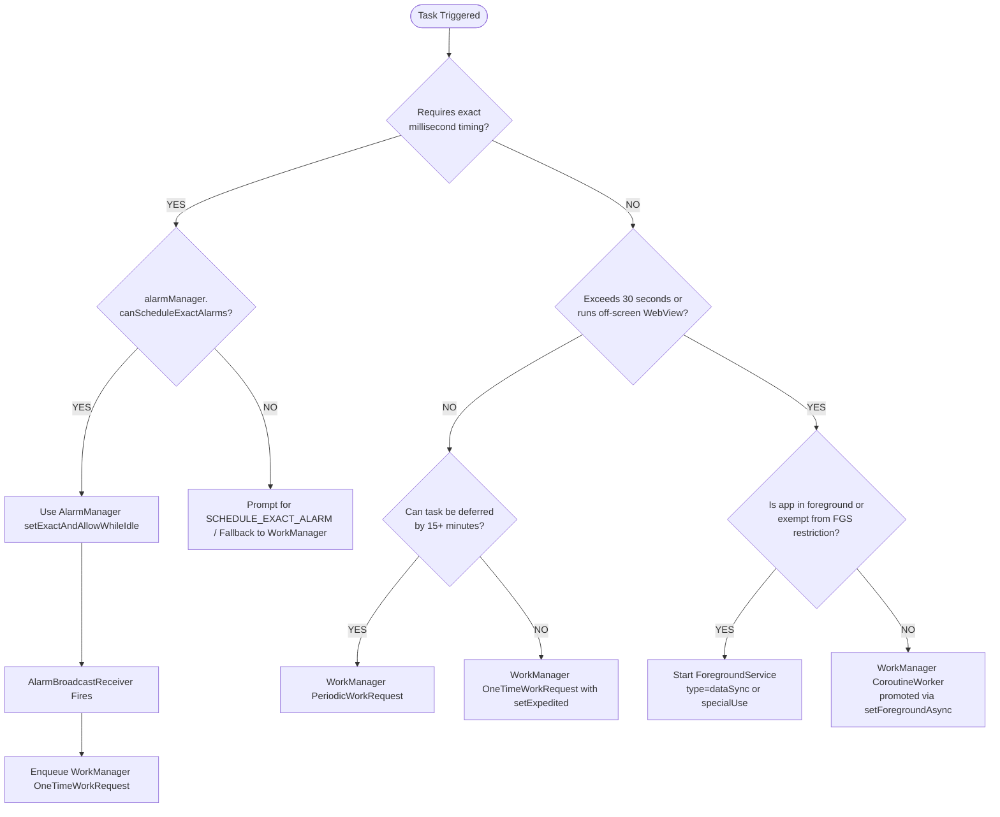

# Android Background Execution Architecture (API 26–37)

## Executive Summary & System Overview

In modern Android operating systems (API level 26 through API level 37+), executing persistent or periodic background tasks—especially those involving resource-heavy components like Chromium-based WebViews—is governed by stringent operating system constraints. The platform prioritizes battery endurance, memory preservation, thermal stability, and user transparency above app autonomy.

This architecture document defines the background execution strategy for **BAutoPilot**. It serves as the definitive technical standard for navigating service limitations, Doze mode, Foreground Service (FGS) types, exact alarm scheduling, device reboot recovery, Chromium JS engine throttling, Low Memory Killer (LMK) mitigation, and concurrency management across Android Oreo (API 26) through Android 15/16+ (API 35–37).

---

## 1. Background Execution Landscape (API 26–37)

The evolution of Android's background execution model reflects an ongoing shift from unrestricted background processes to strictly budgeted, user-visible, and platform-managed execution windows.

```
+--------------------------------------------------------------------------------------------------+
|                                     ANDROID PLATFORM TIMELINE                                    |
+--------------------------------------------------------------------------------------------------+
| API 26 (Android 8.0)  : Background Service Limits, startService() throws IllegalStateException    |
| API 28 (Android 9.0)  : App Standby Buckets, FOREGROUND_SERVICE permission required              |
| API 29 (Android 10.0) : FGS types introduced (location)                                          |
| API 31 (Android 12.0) : FGS background launch restrictions (ForegroundServiceStartNotAllowed)   |
| API 33 (Android 13.0) : SCHEDULE_EXACT_ALARM denied by default; POST_NOTIFICATIONS runtime perm   |
| API 34 (Android 14.0) : Mandatory FGS type declaration in manifest & code; USE_EXACT_ALARM policy|
| API 35 (Android 15.0) : dataSync 6-hour daily budget & onTimeout(); BOOT_COMPLETED FGS launch ban|
| API 36/37 (Android 16): Strict 16KB memory page alignment; aggressive App Standby throttling     |
+--------------------------------------------------------------------------------------------------+
```

### 1.1 Service Execution Limits (Android 8.0+, API 26)
Prior to API 26, applications could launch background services at will via `context.startService()`. In API 26+:
* An app cannot execute background services while in the background (defined as having no visible activity, no active foreground service, and no foreground client bound).
* Attempting `context.startService()` while the app is in the background immediately throws `IllegalStateException: Not allowed to start service Intent`.
* Apps must use `context.startForegroundService()` to initiate execution, transitioning the target service into the foreground within a 5-second window.

### 1.2 Doze Mode and App Standby
Introduced in Android 6.0 (API 23) and refined through subsequent releases:

| State | Trigger Conditions | Operating System Restrictions |
| :--- | :--- | :--- |
| **Light Doze** | Screen off, device stationary for a brief period, on battery. | Network access is suspended; synchronization jobs and jobs are deferred to light maintenance windows (every 10–15 minutes). |
| **Deep Doze** | Screen off, stationary, undisturbed on battery for extended period. | System ignores WakeLocks; standard `AlarmManager` alarms are deferred; network is blocked; Wi-Fi scans and sync adapters are disabled. Maintenance windows widen exponentially (from minutes to hours). |
| **App Standby** | App has not been actively launched or engaged with by the user. | App is categorized into buckets (Active, Working Set, Frequent, Rare, Restricted), with increasing restrictions on job executions, alarm triggers, and high-priority FCM messages. |

### 1.3 Mandatory Foreground Service Types (Android 14+, API 34)
Under Android 14+, every foreground service **must** explicitly declare its type in `AndroidManifest.xml` via `android:foregroundServiceType`, and specify matching types during the runtime invocation of `startForeground()`. Invoking `startForeground()` with undeclared types or omitting types on target SDK 34+ throws `MissingForegroundServiceTypeException` or `SecurityException`.

### 1.4 Android 15 (API 35) `dataSync` Timeout
Android 15 introduces hard operational time limits on specific foreground service types:
* **Cumulative 6-Hour Timeout**: Services declaring `foregroundServiceType="dataSync"` are granted a maximum cumulative runtime budget of **6 hours within any 24-hour rolling window**.
* **System Callback**: When the budget expires, the platform invokes `Service.onTimeout(int startId, int fgsType)`.
* **Enforcement**: If the service fails to invoke `stopSelf()` within a few seconds of `onTimeout()`, the platform terminates the process with an uncatchable `RemoteServiceException`.

### 1.5 Background Launch Restrictions (Android 12+, API 31)
Except for narrow exemptions (e.g., handling high-priority FCM push notifications, user interactions via notifications, device administrator actions, or companion device managers), apps cannot call `startForegroundService()` while running in the background. Attempting to do so throws `ForegroundServiceStartNotAllowedException`.

---

## 2. Foreground Service (FGS) Strategy

Foreground services represent the highest priority execution context for non-interactive app operations, guaranteeing that the hosting process receives `IMPORTANCE_FOREGROUND_SERVICE` (OOM adj score ~125), shielding it from standard background killing.

```
+------------------------------------------------------------------------------------------+
|                              FOREGROUND SERVICE LIFECYCLE (API 34+)                      |
+------------------------------------------------------------------------------------------+
|  User Action / Valid Exemption                                                           |
|       |                                                                                  |
|       v                                                                                  |
|  context.startForegroundService(intent)                                                  |
|       |                                                                                  |
|       | <--- 5-Second Window Begins (ForegroundServiceDidNotStartInTimeException)        |
|       v                                                                                  |
|  Service.onCreate()                                                                      |
|       |                                                                                  |
|       v                                                                                  |
|  Build Notification + Validate NotificationChannel (IMPORTANCE_LOW)                      |
|       |                                                                                  |
|       v                                                                                  |
|  Service.startForeground(NOTIFICATION_ID, notification, FOREGROUND_SERVICE_TYPE_...)     |
|       |                                                                                  |
|       | <--- 5-Second Window Cleared                                                     |
|       v                                                                                  |
|  Service.onStartCommand(intent, flags, startId)                                          |
|       |                                                                                  |
|       +---> [Execute Headless Task / WebView Automation via ServiceScope]                |
|       |                                                                                  |
|       +---> [Listen for onTimeout() - API 35 dataSync quota monitoring]                  |
|       |                                                                                  |
|       v                                                                                  |
|  Service.stopSelf(startId) -> Notification Removed -> Process returned to cached/empty   |
+------------------------------------------------------------------------------------------+
```

### 2.1 FGS Type Selection: `dataSync` vs `specialUse`
For BAutoPilot, the two primary candidate FGS types under Android 14+ are:

1. **`dataSync`**:
   * *Purpose*: Uploading, downloading, or synchronizing data with remote web endpoints.
   * *Permission*: `<uses-permission android:name="android.permission.FOREGROUND_SERVICE_DATA_SYNC" />`
   * *Constraint (API 35+)*: Governed by the strict **6-hour rolling timeout**.
   * *Google Play Suitability*: Accepted for web synchronization, data aggregation, and headless scrapers that exchange data with backend servers.

2. **`specialUse`**:
   * *Purpose*: Legitimate use cases that do not map to any predefined system FGS categories.
   * *Permission*: `<uses-permission android:name="android.permission.FOREGROUND_SERVICE_SPECIAL_USE" />`
   * *Declaration Requirement*: Must declare a subtype description in the manifest:
     ```xml
     <service
         android:name=".execution.service.AutomationForegroundService"
         android:foregroundServiceType="specialUse"
         android:exported="false">
         <property
             android:name="android.app.PROPERTY_SPECIAL_USE_FGS_SUBTYPE"
             android:value="Autonomous web workflow automation and scheduled robotic data extraction" />
     </service>
     ```
   * *Google Play Policy*: Undergoes strict manual review. If Google Play reviewers determine that the workload could be implemented via `WorkManager` or `dataSync`, the submission will be rejected.

**Strategic Recommendation**: Use `dataSync` as the default for batch network runs. For continuous automation operations requested explicitly by the user, configure `specialUse` accompanied by comprehensive policy declaration documentation.

### 2.2 Persistent Notification Architecture
The notification must provide clear user visibility and immediate control to satisfy Android's user awareness policies:

* **Channel Configuration**: `NotificationChannel` with `NotificationManager.IMPORTANCE_LOW` to avoid intrusive audio/vibration alerts during persistent execution.
* **Notification Flags**: `setOngoing(true)` prevents accidental dismissal by the user.
* **Action Buttons**: Direct intent controls (`Pause`, `Resume`, `Stop`) routed via `PendingIntent.getService()`.
* **Dynamic Progress**: Throttled updates (minimum 1000ms intervals) to avoid exceeding Android's notification update rate-limiter (which drops updates if flooded).

### 2.3 The 5-Second `startForeground()` Contract
From the moment `context.startForegroundService(intent)` is executed, an internal platform watchdog timer is armed. If the app fails to call `Service.startForeground(...)` within **5 seconds**, the system crashes the process with:
* `ForegroundServiceDidNotStartInTimeException` (Android 14+)
* `RemoteServiceException: Context.startForegroundService() did not then call Service.startForeground()` (API 26–33)

**Implementation Rule**: Call `startForeground()` synchronously inside `Service.onCreate()` or as the very first instruction in `Service.onStartCommand()`. Never defer `startForeground()` behind coroutine dispatches, thread switches, database queries, or network handshakes.

### 2.4 Android 15 Timeout Handling Implementation

```kotlin
package com.bautopilot.execution.service

import android.app.*
import android.content.Intent
import android.content.pm.ServiceInfo
import android.os.Build
import android.os.IBinder
import androidx.core.app.NotificationCompat
import kotlinx.coroutines.*

class AutomationForegroundService : Service() {

    private val serviceScope = CoroutineScope(SupervisorJob() + Dispatchers.Main.immediate)
    private val NOTIFICATION_ID = 4001
    private val CHANNEL_ID = "bautopilot_execution_channel"

    override fun onCreate() {
        super.onCreate()
        createNotificationChannel()
        promoteToForegroundImmediately()
    }

    private fun promoteToForegroundImmediately() {
        val notification = buildOngoingNotification("Initializing automation engine...")
        if (Build.VERSION.SDK_INT >= Build.VERSION_CODES.Q) {
            val fgsType = if (Build.VERSION.SDK_INT >= Build.VERSION_CODES.UPSIDE_DOWN_CAKE) {
                ServiceInfo.FOREGROUND_SERVICE_TYPE_DATA_SYNC
            } else {
                ServiceInfo.FOREGROUND_SERVICE_TYPE_DATA_SYNC
            }
            startForeground(NOTIFICATION_ID, notification, fgsType)
        } else {
            startForeground(NOTIFICATION_ID, notification)
        }
    }

    override fun onStartCommand(intent: Intent?, flags: Int, startId: Int): Int {
        val taskId = intent?.getStringExtra("EXTRA_TASK_ID") ?: return START_NOT_STICKY

        serviceScope.launch {
            try {
                executeAutomationWorkflow(taskId)
            } catch (e: CancellationException) {
                // Cooperative cancellation handled
            } catch (e: Exception) {
                // Log and update error state
            } finally {
                stopSelf(startId)
            }
        }

        return START_NOT_STICKY
    }

    // Android 15 (API 35) mandatory FGS dataSync timeout hook
    override fun onTimeout(startId: Int, fgsType: Int) {
        // Platform budget depleted (e.g. 6-hour dataSync limit exceeded)
        serviceScope.cancel(CancellationException("System budget timed out for FGS type: $fgsType"))
        persistWorkflowCheckpoint()
        stopSelf(startId)
    }

    private fun persistWorkflowCheckpoint() {
        // Synchronously save current step/DOM cursor into Room DB
    }

    private fun buildOngoingNotification(statusText: String): Notification {
        return NotificationCompat.Builder(this, CHANNEL_ID)
            .setContentTitle("BAutoPilot Automation Running")
            .setContentText(statusText)
            .setSmallIcon(android.R.drawable.stat_notify_sync)
            .setOngoing(true)
            .setOnlyAlertOnce(true)
            .setPriority(NotificationCompat.PRIORITY_LOW)
            .build()
    }

    private fun createNotificationChannel() {
        if (Build.VERSION.SDK_INT >= Build.VERSION_CODES.O) {
            val channel = NotificationChannel(
                CHANNEL_ID,
                "Automation Execution Service",
                NotificationManager.IMPORTANCE_LOW
            ).apply {
                description = "Displays ongoing status for background web automation tasks"
            }
            val manager = getSystemService(NotificationManager::class.java)
            manager?.createNotificationChannel(channel)
        }
    }

    override fun onDestroy() {
        serviceScope.cancel()
        super.onDestroy()
    }

    override fun onBind(intent: Intent?): IBinder? = null
}
```

---

## 3. WorkManager

`WorkManager` is the Google-recommended library for persistent, deferrable, guaranteed background processing. It abstracts Android platform versions, delegating internally to `JobScheduler` on API 23+, or alarms/broadcasts on older engines.

```
+---------------------------------------------------------------------------------------+
|                               WORKMANAGER TOPOLOGY IN BAUTOPILOT                      |
+---------------------------------------------------------------------------------------+
|                                                                                       |
|   +-----------------------+               +-----------------------+                   |
|   |  PeriodicWorkRequest  |               |   OneTimeWorkRequest  |                   |
|   |  (Min 15m cadence)    |               |   (Immediate/Chained) |                   |
|   +-----------+-----------+               +-----------+-----------+                   |
|               |                                       |                               |
|               v                                       v                               |
|     [Network / Battery Constraints Checked by OS JobScheduler]                        |
|                                       |                                               |
|                                       v                                               |
|               +-----------------------------------------------+                       |
|               |              CoroutineWorker                  |                       |
|               +-----------------------+-----------------------+                       |
|                                       |                                               |
|                     Is execution prolonged (> 30s)?                                   |
|                                    /     \                                            |
|                                  YES      NO                                          |
|                                  /         \                                          |
|                                 v           v                                         |
|                 setForegroundAsync(...)    Run in standard background worker pool     |
|             (Promoted to ForegroundService) (Completes within ~10 minutes max)        |
+---------------------------------------------------------------------------------------+
```

### 3.1 WorkRequest Types & Constraints
1. **PeriodicWorkRequest**:
   * Minimum repeat interval is hard-coded into the Android platform: `PeriodicWorkRequest.MIN_PERIODIC_INTERVAL_MILLIS = 15 * 60 * 1000L` (15 minutes).
   * Flex interval minimum: 5 minutes (`PeriodicWorkRequest.MIN_PERIODIC_FLEX_MILLIS`).
   * Attempting to schedule intervals lower than 15 minutes causes the runtime to clamp the interval to 15 minutes silently.

2. **OneTimeWorkRequest**:
   * Can be enqueued immediately or scheduled with an initial delay (`setInitialDelay`).
   * Can be chained sequentially via `WorkManager.beginWith(...).then(...).enqueue()`.

3. **System Constraints (`Constraints.Builder`)**:
   ```kotlin
   val constraints = Constraints.Builder()
       .setRequiredNetworkType(NetworkType.CONNECTED)
       .setRequiresBatteryNotLow(true)
       .setRequiresCharging(false)
       .setRequiresStorageNotLow(true)
       .build()
   ```

### 3.2 Unique Work Policies
To prevent redundant concurrent tasks, always use unique work identifiers:
* `ExistingWorkPolicy.KEEP`: Retains existing execution; discards new enqueue request.
* `ExistingWorkPolicy.REPLACE`: Cancels active/pending task and replaces it with the newly submitted request.
* `ExistingWorkPolicy.APPEND_OR_REPLACE`: If the current task failed or completed, starts a new chain; otherwise appends to the queue.

### 3.3 Expedited Work & Quota Allocation (Android 12+, API 31)
Expedited work allows urgent tasks to bypass standard App Standby buckets and start immediately without waiting for battery/network constraints to loosen.
* Configured using `.setExpedited(OutOfQuotaPolicy.RUN_AS_NON_EXPEDITED_WORK_REQUEST)`.
* Apps have a dynamic daily execution quota for expedited jobs managed by the platform.
* If the quota is exhausted, `OutOfQuotaPolicy` dictates whether the work fails or downgrades to regular deferred execution.
* Requires implementing `getForegroundInfo()` inside the worker to support execution on API < 31.

### 3.4 Foreground Promotion via `setForegroundAsync`
When a `CoroutineWorker` must execute a long-running, resource-intensive workflow (e.g., launching an off-screen WebView automation sequence), it must promote itself to a Foreground Service:

```kotlin
package com.bautopilot.execution.worker

import android.content.Context
import android.content.pm.ServiceInfo
import android.os.Build
import androidx.core.app.NotificationCompat
import androidx.work.*

class AutomationWorker(
    appContext: Context,
    workerParams: WorkerParameters
) : CoroutineWorker(appContext, workerParams) {

    override suspend fun doWork(): Result {
        val taskId = inputData.getString("KEY_TASK_ID") ?: return Result.failure()

        // Promote Worker to Foreground execution to avoid background execution termination
        try {
            setForeground(createForegroundInfo("Executing step: DOM Navigation"))
        } catch (e: IllegalStateException) {
            // Cannot promote to foreground due to background launch restrictions
            return Result.retry()
        }

        return try {
            // Execute automation logic
            Result.success()
        } catch (e: Exception) {
            if (runAttemptCount < 3) Result.retry() else Result.failure()
        }
    }

    override suspend fun getForegroundInfo(): ForegroundInfo {
        return createForegroundInfo("Automation task preparing...")
    }

    private fun createForegroundInfo(statusMessage: String): ForegroundInfo {
        val notification = NotificationCompat.Builder(applicationContext, "bautopilot_execution_channel")
            .setContentTitle("BAutoPilot Worker")
            .setContentText(statusMessage)
            .setSmallIcon(android.R.drawable.ic_dialog_info)
            .setOngoing(true)
            .build()

        return if (Build.VERSION.SDK_INT >= Build.VERSION_CODES.Q) {
            ForegroundInfo(
                5001,
                notification,
                ServiceInfo.FOREGROUND_SERVICE_TYPE_DATA_SYNC
            )
        } else {
            ForegroundInfo(5001, notification)
        }
    }
}
```

---

## 4. AlarmManager

`AlarmManager` provides access to the system alarm services, waking up the CPU even if the device is in Deep Doze. It is designed for precise, time-critical triggers rather than long execution blocks.

### 4.1 Exact vs Inexact Alarms
* **Inexact Alarms** (`set()`, `setInexactRepeating()`): System batches alarms across applications to reduce battery drain. Execution can be delayed by tens of minutes.
* **Exact Alarms** (`setExact()`, `setExactAndAllowWhileIdle()`, `setAlarmClock()`): Guaranteed execution at the exact millisecond requested, even during Doze mode.

### 4.2 Exact Alarm Permissions (`SCHEDULE_EXACT_ALARM` vs `USE_EXACT_ALARM`)

```
+-----------------------------------------------------------------------------------+
|                        EXACT ALARM PERMISSION SPECTRUM (API 31–37)                |
+-----------------------------------------------------------------------------------+
| Pre-API 31: Granted automatically via manifest declaration                        |
|                                                                                   |
| API 31-32 : Introduced SCHEDULE_EXACT_ALARM (Granted by default, user-revocable)  |
|                                                                                   |
| API 33+   : SCHEDULE_EXACT_ALARM DENIED BY DEFAULT on new app installs            |
|             Requires runtime check: alarmManager.canScheduleExactAlarms()         |
|             Must route user to Settings.ACTION_REQUEST_SCHEDULE_EXACT_ALARM       |
|                                                                                   |
| API 34+   : USE_EXACT_ALARM introduced for Alarm Clock / Timer apps ONLY.         |
|             Targeting USE_EXACT_ALARM for generic automation causes Google Play   |
|             store review rejection. BAutoPilot MUST use SCHEDULE_EXACT_ALARM.    |
+-----------------------------------------------------------------------------------+
```

### 4.3 Permission Validation & Execution Architecture
Because `SCHEDULE_EXACT_ALARM` can be denied or revoked by the user, applications must defensively query permission before invoking exact APIs:

```kotlin
package com.bautopilot.execution.alarm

import android.app.AlarmManager
import android.app.PendingIntent
import android.content.Context
import android.content.Intent
import android.os.Build
import android.provider.Settings
import androidx.core.net.toUri

object ExactAlarmScheduler {

    fun scheduleExactTask(context: Context, triggerTimeMillis: Long, taskId: String) {
        val alarmManager = context.getSystemService(Context.ALARM_SERVICE) as AlarmManager

        if (Build.VERSION.SDK_INT >= Build.VERSION_CODES.S) {
            if (!alarmManager.canScheduleExactAlarms()) {
                // Cannot schedule exact alarm; request user authorization
                val intent = Intent(Settings.ACTION_REQUEST_SCHEDULE_EXACT_ALARM).apply {
                    data = "package:${context.packageName}".toUri()
                    flags = Intent.FLAG_ACTIVITY_NEW_TASK
                }
                context.startActivity(intent)
                return
            }
        }

        val intent = Intent(context, AlarmBroadcastReceiver::class.java).apply {
            action = "com.bautopilot.ACTION_TRIGGER_EXACT_TASK"
            putExtra("EXTRA_TASK_ID", taskId)
        }

        val pendingIntent = PendingIntent.getBroadcast(
            context,
            taskId.hashCode(),
            intent,
            PendingIntent.FLAG_UPDATE_CURRENT or PendingIntent.FLAG_IMMUTABLE
        )

        // setExactAndAllowWhileIdle ensures execution inside Doze maintenance windows
        alarmManager.setExactAndAllowWhileIdle(
            AlarmManager.RTC_WAKEUP,
            triggerTimeMillis,
            pendingIntent
        )
    }
}
```

### 4.4 Doze Rate Limiting on `setExactAndAllowWhileIdle`
While `setExactAndAllowWhileIdle()` wakes the device in Doze mode, Android imposes platform-level rate limits:
* The system allows these alarms to fire at most once every **9 minutes per app** under normal Doze, and up to **15 minutes** under Deep Doze.
* Attempting to schedule alarms more frequently results in the OS batching them into the next available platform maintenance window.

---

## 5. Reboot Recovery Architecture

When an Android device restarts, all in-memory timers, services, and scheduled `AlarmManager` alarms are purged. A resilient background engine must reconstruct its operational state upon device startup.

```
+------------------------------------------------------------------------------------+
|                             DEVICE REBOOT RECOVERY FLOW                            |
+------------------------------------------------------------------------------------+
|  [Device Boots Up]                                                                 |
|       |                                                                            |
|       +---> ACTION_LOCKED_BOOT_COMPLETED (Direct Boot: credential-encrypted locked)|
|       |         |                                                                  |
|       |         v                                                                  |
|       |     Access Device-Protected Storage (DPS) only                             |
|       |                                                                            |
|       +---> ACTION_BOOT_COMPLETED (User Unlocks Device: credential-encrypted open) |
|                 |                                                                  |
|                 v                                                                  |
|             BootReceiver.onReceive(context, intent)                                |
|                 |                                                                  |
|                 | (CANNOT call startForegroundService on Android 15!)              |
|                 v                                                                  |
|             Enqueue OneTimeWorkRequest via WorkManager                             |
|                 |                                                                  |
|                 v                                                                  |
|             BootRecoveryWorker.doWork()                                            |
|                 |                                                                  |
|                 +---> Read persistent Task Registry from Room DB                   |
|                 +---> Re-register Exact Alarms via AlarmManager                    |
|                 +---> Reschedule Periodic Work Requests                            |
|                 +---> Mark stale in-progress tasks as FAILED_INTERRUPTED           |
+------------------------------------------------------------------------------------+
```

### 5.1 Direct Boot & Receiver Declarations
Android separates device storage into two realms:
1. **Credential Encrypted (CE) Storage**: Default storage; accessible only after the user enters their PIN, pattern, or password after reboot.
2. **Device Protected (DP) Storage**: Accessible immediately after the kernel boots via `context.createDeviceProtectedStorageContext()`.

To support robust reboot recovery across all device states:

```xml
<manifest xmlns:android="http://schemas.android.com/apk/res/android">

    <uses-permission android:name="android.permission.RECEIVE_BOOT_COMPLETED" />
    <uses-permission android:name="android.permission.FOREGROUND_SERVICE" />
    <uses-permission android:name="android.permission.FOREGROUND_SERVICE_DATA_SYNC" />
    <uses-permission android:name="android.permission.SCHEDULE_EXACT_ALARM" />

    <application>
        <receiver
            android:name=".execution.receiver.BootReceiver"
            android:enabled="true"
            android:exported="true"
            android:directBootAware="true">
            <intent-filter>
                <action android:name="android.intent.action.BOOT_COMPLETED" />
                <action android:name="android.intent.action.LOCKED_BOOT_COMPLETED" />
                <action android:name="android.intent.action.MY_PACKAGE_REPLACED" />
                <action android:name="android.intent.action.QUICKBOOT_POWERON" />
            </intent-filter>
        </receiver>
    </application>
</manifest>
```

### 5.2 Android 15 FGS Restrictions from Boot Receivers
Starting in Android 14 and strictly enforced in Android 15 (API 35+), **apps cannot launch a foreground service directly from a `BOOT_COMPLETED` broadcast receiver**. Calling `context.startForegroundService()` inside `onReceive()` throws `ForegroundServiceStartNotAllowedException`.

### 5.3 The Lightweight Receiver -> WorkManager Reschedule Pattern
The `BroadcastReceiver` must remain lightweight, executing in under 10 seconds to avoid Application Not Responding (ANR) flags, delegating actual restoration to `WorkManager`:

```kotlin
package com.bautopilot.execution.receiver

import android.content.BroadcastReceiver
import android.content.Context
import android.content.Intent
import androidx.work.*
import com.bautopilot.execution.worker.BootRecoveryWorker

class BootReceiver : BroadcastReceiver() {
    override fun onReceive(context: Context, intent: Intent?) {
        val action = intent?.action ?: return
        if (action == Intent.ACTION_BOOT_COMPLETED ||
            action == Intent.ACTION_LOCKED_BOOT_COMPLETED ||
            action == Intent.ACTION_MY_PACKAGE_REPLACED
        ) {
            // Delegate database reading and alarm re-registration to WorkManager
            val recoveryWorkRequest = OneTimeWorkRequestBuilder<BootRecoveryWorker>()
                .setExpedited(OutOfQuotaPolicy.RUN_AS_NON_EXPEDITED_WORK_REQUEST)
                .build()

            WorkManager.getInstance(context).enqueueUniqueWork(
                "bautopilot_boot_recovery",
                ExistingWorkPolicy.REPLACE,
                recoveryWorkRequest
            )
        }
    }
}
```

---

## 6. WebView Execution in Background Context

WebViews are built on the Chromium rendering engine (`libmonochrome`). They are designed primarily for visual layout inside an active window hierarchy. Executing WebViews headlessly or inside a background Foreground Service requires specific architectural interventions.

```
+--------------------------------------------------------------------------------------------------+
|                                    CHROMIUM WEBVIEW PROCESS MODEL                                |
+--------------------------------------------------------------------------------------------------+
|                                                                                                  |
|   App Process (Host)                              Isolated Sandboxed Process                     |
|   +------------------------------------+          +------------------------------------------+   |
|   |  Foreground Service Context        |          |  Chromium Renderer Process               |   |
|   |  - ServiceScope (Coroutines)       |  IPC     |  - Blink Rendering Engine                |   |
|   |  - Headless ViewGroup / DecorView  | <======> |  - V8 JavaScript Engine                  |   |
|   |  - WebView Java Proxy Object       |          |  - DOM Tree & Event Loops                |   |
|   +------------------------------------+          +------------------------------------------+   |
|                    |                                                    |                        |
|                    v                                                    v                        |
|       Host Process Priority: ~125                  Renderer OOM Score: Tracks Window Visibility  |
|       (Protected by FGS)                           (Vulnerable to LMK if view is unattached!)   |
+--------------------------------------------------------------------------------------------------+
```

### 6.1 Chromium JS Timer Throttling & Suspension
Chromium implements aggressive background throttling mechanisms:
* **Timer Clamping**: When a WebView is not attached to an active window or the host Activity is stopped, Chromium clamps all JavaScript timers (`setTimeout`, `setInterval`) to a minimum of **1000ms (1 Hz)** or halts them completely.
* **`requestAnimationFrame` Suspension**: `window.requestAnimationFrame()` callbacks stop firing entirely because the compositor disables frame generation for invisible surfaces.
* **Network Idle Throttling**: Background WebViews may have internal fetch requests deprioritized.

### 6.2 Preventing Renderer Suspension in FGS
To maintain JavaScript execution inside a background `ForegroundService`:
1. **Do NOT Call `webView.onPause()` or `webView.pauseTimers()`**: Calling `onPause()` halts Chromium's internal event loop and suspends all V8 threads.
2. **Attach to a Virtual View Hierarchy**: The WebView must be attached to an off-screen container to prevent Chromium from identifying it as fully detached:
   ```kotlin
   val windowManager = context.getSystemService(Context.WINDOW_SERVICE) as WindowManager
   // Using an off-screen 1x1 pixel view or headless container keeps the layout engine active
   ```
3. **Replace DOM Timers with Native Injections**: Never rely on long-running JS `setInterval` loops inside the web page. Drive automation from Kotlin coroutines using sequential `webView.evaluateJavascript(...)` calls with explicit delays governed by `Dispatchers.Main`.

### 6.3 Low Memory Killer (LMK) & Sandboxed Renderers
Starting in Android 8.0, WebView uses out-of-process (sandboxed) rendering:
* The browser process runs inside the host app, but the web page renders inside an isolated child process (`com.google.android.webview:sandboxed_process`).
* If the system experiences memory pressure, the Linux kernel Low Memory Killer (LMK) kills the child renderer process **before** touching the host foreground service.

### 6.4 `onRenderProcessGone` Recovery Contract
If the renderer process is terminated by LMK or crashes, calling any method on the dead `WebView` throws a fatal `RenderProcessGoneException`. The app **must** intercept this event:

```kotlin
package com.bautopilot.execution.webview

import android.webkit.RenderProcessGoneDetail
import android.webkit.WebView
import android.webkit.WebViewClient

class ResilientWebViewClient(
    private val onRendererCrashed: (didCrash: Boolean) -> Unit
) : WebViewClient() {

    override fun onRenderProcessGone(view: WebView?, detail: RenderProcessGoneDetail?): Boolean {
        val didCrash = detail?.didCrash() ?: false
        
        // 1. Teardown the dead WebView instance to prevent native leak
        view?.let { deadView ->
            deadView.stopLoading()
            deadView.loadUrl("about:blank")
            deadView.clearHistory()
            deadView.removeAllViews()
            deadView.destroy()
        }

        // 2. Notify coordinator to recreate WebView instance & resume checkpoint
        onRendererCrashed(didCrash)

        // Returning TRUE indicates host app handled the event gracefully;
        // returning FALSE causes the OS to terminate the host app process immediately.
        return true
    }
}
```

---

## 7. Battery Optimization & OEM Power Management

Even with valid Foreground Services and exact alarms, aggressive Original Equipment Manufacturer (OEM) battery management software can terminate background execution.

### 7.1 `REQUEST_IGNORE_BATTERY_OPTIMIZATIONS`
Android provides a platform-level battery optimization whitelist:

```xml
<uses-permission android:name="android.permission.REQUEST_IGNORE_BATTERY_OPTIMIZATIONS" />
```

```kotlin
fun requestBatteryOptimizationExemption(context: Context) {
    val powerManager = context.getSystemService(Context.POWER_SERVICE) as PowerManager
    val packageName = context.packageName

    if (!powerManager.isIgnoringBatteryOptimizations(packageName)) {
        val intent = Intent(Settings.ACTION_REQUEST_IGNORE_BATTERY_OPTIMIZATIONS).apply {
            data = "package:$packageName".toUri()
            flags = Intent.FLAG_ACTIVITY_NEW_TASK
        }
        context.startActivity(intent)
    }
}
```
* **Google Play Policy Note**: Directly prompting via `ACTION_REQUEST_IGNORE_BATTERY_OPTIMIZATIONS` is strictly restricted to apps whose primary use case cannot function without it. Alternatively, apps must navigate the user to the general settings panel via `Settings.ACTION_IGNORE_BATTERY_OPTIMIZATION_SETTINGS`.

### 7.2 OEM-Specific Background Constraints

```
+--------------------------------------------------------------------------------------------------+
|                                    OEM AGGRESSIVE TASK KILLING                                   |
+--------------------------------------------------------------------------------------------------+
|  OEM            Mechanism                            Consequence & Mitigation                    |
|  -------------  -----------------------------------  ------------------------------------------- |
|  Samsung        Device Care -> "Sleeping Apps"       Freezes FGS if user does not launch app for |
|                 "Put unused apps to sleep"           3 days. Direct user to "Never sleeping apps"|
|                                                                                                  |
|  Xiaomi / Poco  MIUI/HyperOS Battery Saver           Terminates network sockets in background.   |
|                 Autostart Permission Required        Must enable "Autostart" + "No Restrictions" |
|                                                                                                  |
|  Huawei         EMUI / HarmonyOS "PowerGenie"        Kills FGS regardless of ongoing notification|
|                 Manual Launch Management             Must toggle to "Manage Manually"            |
|                                                                                                  |
|  Oppo / Vivo    ColorOS / OriginOS Background Freeze Restricts socket wakeups and WebView threads|
|                 "Allow Background Activity"          Prompt user to disable background freeze    |
+--------------------------------------------------------------------------------------------------+
```

### 7.3 OEM Detection and User Guidance Dispatcher

```kotlin
package com.bautopilot.execution.oem

import android.content.ComponentName
import android.content.Context
import android.content.Intent
import android.os.Build

object OemSettingsRouter {

    fun openOemBackgroundSettings(context: Context): Boolean {
        val manufacturer = Build.MANUFACTURER.lowercase()
        val intent = Intent().apply { flags = Intent.FLAG_ACTIVITY_NEW_TASK }

        when {
            manufacturer.contains("xiaomi") -> {
                intent.component = ComponentName(
                    "com.miui.securitycenter",
                    "com.miui.permcenter.autostart.AutoStartManagementActivity"
                )
            }
            manufacturer.contains("huawei") -> {
                intent.component = ComponentName(
                    "com.huawei.systemmanager",
                    "com.huawei.systemmanager.optimize.process.ProtectActivity"
                )
            }
            manufacturer.contains("samsung") -> {
                intent.component = ComponentName(
                    "com.samsung.android.lool",
                    "com.samsung.android.sm.battery.ui.BatteryActivity"
                )
            }
            else -> return false
        }

        return try {
            context.startActivity(intent)
            true
        } catch (e: Exception) {
            false
        }
    }
}
```

---

## 8. Concurrency & Resource Management

Headless WebViews consume significant system resources. Each active instance spins up independent Blink layout structures, V8 memory heaps, and IPC channels.

```
+----------------------------------------------------------------------------------------+
|                                 CONCURRENCY ARCHITECTURE                              |
+----------------------------------------------------------------------------------------+
|                                                                                        |
|             Inbound Automation Requests (Queue)                                        |
|             [ Task 1 ] [ Task 2 ] [ Task 3 ] [ Task 4 ] [ Task N ]                     |
|                                  |                                                     |
|                                  v                                                     |
|             Coroutine Channel / Semaphore(permits = 2)                                 |
|                                  |                                                     |
|                  +---------------+---------------+                                     |
|                  |                               |                                     |
|                  v                               v                                     |
|        [WebView Slot 1]                 [WebView Slot 2]                               |
|        - Active DOM Session             - Active DOM Session                           |
|        - Dedicated Worker/FGS           - Dedicated Worker/FGS                         |
|        - Memory footprint ~60MB         - Memory footprint ~60MB                       |
|                  |                               |                                     |
|                  v                               v                                     |
|        [Clean & Teardown]               [Clean & Teardown]                             |
|        - view.destroy()                 - view.destroy()                               |
|        - Garbage collect                - Garbage collect                              |
+----------------------------------------------------------------------------------------+
```

### 8.1 Concurrency Limits
* **Maximum Concurrent Instances**: Strictly **2 to 3 WebViews** on devices with $\ge$ 4GB RAM.
* **Low-RAM Devices**: Strictly **1 active WebView** if `ActivityManager.isLowRamDevice()` returns `true` or total physical RAM is $< 3\text{GB}$.
* Exceeding these limits induces thrashing, causing the kernel LMK to terminate both the sandboxed renderers and the parent application.

### 8.2 Sequential Queue Engine with Kotlin Mutex / Channel

```kotlin
package com.bautopilot.execution.concurrency

import android.content.Context
import android.os.Handler
import android.os.Looper
import android.webkit.WebView
import kotlinx.coroutines.*
import kotlinx.coroutines.sync.Semaphore
import kotlinx.coroutines.sync.withPermit

class WebViewAutomationPool(
    private val context: Context,
    maxConcurrentWebViews: Int = 2
) {
    private val poolSemaphore = Semaphore(permits = maxConcurrentWebViews)
    private val mainHandler = Handler(Looper.getMainLooper())

    suspend fun <T> executeTask(block: suspend (WebView) -> T): T {
        return poolSemaphore.withPermit {
            val webView = allocateWebView()
            try {
                block(webView)
            } finally {
                releaseWebView(webView)
            }
        }
    }

    private suspend fun allocateWebView(): WebView = withContext(Dispatchers.Main) {
        WebView(context).apply {
            settings.javaScriptEnabled = true
            settings.domStorageEnabled = true
            settings.mediaPlaybackRequiresUserGesture = false
        }
    }

    private suspend fun releaseWebView(webView: WebView) = withContext(Dispatchers.Main) {
        webView.stopLoading()
        webView.loadUrl("about:blank")
        webView.clearHistory()
        webView.removeAllViews()
        webView.destroy()
    }
}
```

### 8.3 Coroutine Scope & Lifecycle Governance
* **Main Thread Affinity**: All interactions with `WebView` (instantiation, settings configuration, `loadUrl`, `evaluateJavascript`, and `destroy`) **must occur strictly on `Dispatchers.Main`**. Attempting to invoke WebView APIs from background threads throws an immediate runtime exception.
* **Supervised Scopes**: Use `CoroutineScope(SupervisorJob() + Dispatchers.Main.immediate)` within the Foreground Service. Failure of one web automation task must not cancel unrelated queued tasks.
* **Deterministic Teardown**: Always call `destroy()` inside a `finally` block to prevent native leakages in Chromium’s GPU and compositor pipelines.

---

## 9. Architectural Decision Matrix

The following decision matrix defines the component selection standard for all background operations within BAutoPilot:

| Architectural Metric | WorkManager (Standard) | WorkManager (Expedited / FGS) | AlarmManager (`setExactAndAllowWhileIdle`) | Foreground Service (FGS Direct) |
| :--- | :--- | :--- | :--- | :--- |
| **Execution Guarantee** | High (Persisted across reboots via Room) | High (Immediate or retry) | Low-Medium (Lost on reboot unless restored via receiver) | High (Subject to OS kills if memory critical) |
| **Timing Precision** | Inexact (Subject to 15m cadence or batching) | Near-immediate execution | Exact (Down to millisecond) | Immediate (Launched by user/action) |
| **Max Execution Duration** | ~10 minutes per window | Prolonged if promoted via `setForegroundAsync` | ~10–20 seconds inside BroadcastReceiver | Continuous (Subject to Android 15 `dataSync` 6h cap) |
| **User Visibility** | None (Runs silently) | Notification mandatory when promoted | None directly (Launches intent/receiver) | Persistent Notification Mandatory |
| **Doze Mode Behavior** | Deferred until maintenance window | Executes during Doze via quota | Fires during Doze (Rate-limited to 9–15m) | Continues running; network preserved |
| **Reboot Behavior** | Retained in DB, auto-rescheduled by OS | Retained in DB | Cancelled by kernel (Must rebuild in code) | Cancelled by kernel (Must launch anew) |
| **API 34/35 Constraints** | Fully compatible | Requires FGS type declaration in manifest | `SCHEDULE_EXACT_ALARM` denied by default | Hard 6h rolling cap on `dataSync` (API 35) |
| **Ideal BAutoPilot Use Case** | Nightly syncs, periodic telemetry, log purging | Triggered web scrape with network constraint | Exact scheduled runs (e.g. 08:00 AM sharp) | Active, continuous web workflow execution |

### 9.1 Component Selection Flowchart



---

## 10. Implementation Checklist for Engineers

1. [ ] **Manifest Completeness**: Ensure all required permissions (`FOREGROUND_SERVICE`, `FOREGROUND_SERVICE_DATA_SYNC`, `RECEIVE_BOOT_COMPLETED`, `SCHEDULE_EXACT_ALARM`) are declared.
2. [ ] **Notification Channel**: Create channel with `IMPORTANCE_LOW` before calling `startForeground()`.
3. [ ] **5-Second Rule Compliance**: Verify `Service.startForeground()` is called immediately within `onCreate()`.
4. [ ] **Android 15 Compatibility**: Implement `Service.onTimeout(startId, fgsType)` to cleanly persist state and stop when running `dataSync`.
5. [ ] **Boot Resilience**: Validate that `BootReceiver` delegates to `WorkManager` instead of attempting an illegal background `startForegroundService()`.
6. [ ] **WebView Protection**: Attach `WebViewClient` with an explicit `onRenderProcessGone()` override returning `true`.
7. [ ] **Main Thread Confinement**: Ensure all WebView construction, evaluation, and destruction operations run strictly on `Dispatchers.Main`.
8. [ ] **Memory Defense**: Cap simultaneous headless WebView instances at 2, and invoke `destroy()` in `finally` blocks.
9. [ ] **Battery Whitelist Fallback**: Provide an in-app flow guiding users on Samsung/Xiaomi devices to exempt BAutoPilot from OEM background killers.

---

## 11. Implemented Phase 3 Background Execution & Scheduling Architecture

In Phase 3, the complete background execution and task scheduling infrastructure was implemented and verified:

### 11.1 Core Components & Data Flow
1. **`AutomationScheduler`**:
   - Manages exact alarms with `AlarmManager.setExactAndAllowWhileIdle(RTC_WAKEUP, ...)` when `canScheduleExactAlarms()` is true, and inexact `setAndAllowWhileIdle()` fallback.
   - Computes unique request codes per schedule ID.
   - Provides `schedule(schedule)`, `cancel(scheduleId)`, and `rescheduleAll()`.
2. **`ScheduleReceiver` (`BroadcastReceiver`)**:
   - Registered for `com.autopilot.android.action.TRIGGER_SCHEDULE`.
   - Checks `AutomationCoordinator.canStartSession()` concurrency limits.
   - Transitions schedule status to `RUNNING` and launches `AutomationService` via `context.startForegroundService()`.
   - Automatically computes and schedules the next recurrence window via `ScheduleCalculator`.
   - Posts notifications through `ScheduleNotificationManager` (Channel ID: `autopilot_schedule_channel`, Importance: DEFAULT).
3. **`BootCompletedReceiver` (`BroadcastReceiver`)**:
   - Registered for `android.intent.action.BOOT_COMPLETED` and `android.intent.action.MY_PACKAGE_REPLACED`.
   - Reconciles stale `STARTING`/`RUNNING` executions to `CANCELLED`/`FAILED`.
   - Re-arms all active upcoming alarms in `AlarmManager`.
4. **`ScheduleReconciliationWorker` (`CoroutineWorker`)**:
   - Periodic 2-hour WorkManager maintenance task registered via `ExistingPeriodicWorkPolicy.KEEP`.
   - Re-scans active schedules to ensure alarms remain armed and detects missed executions.
5. **`ScheduleCalculator` & `ScheduleValidator`**:
   - Pure domain calculation for One-Time, Daily, Weekdays, Weekly, and Monthly schedules.
   - Enforces month-end boundary clamping (e.g., Jan 31 -> Feb 28/29) via `YearMonth.from(zonedDateTime)`.
   - Validates future dates, profile existence, timezone strings, and duration boundaries.
