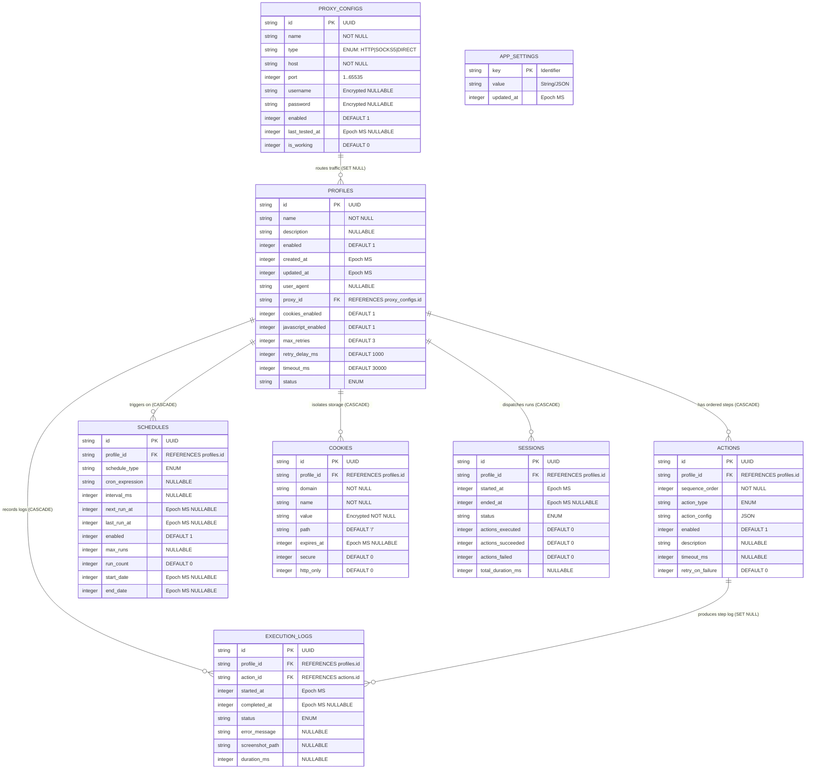

# BAutoPilot Database Schema Specification

## 1. Database Configuration & Architecture

### 1.1 Overview
The BAutoPilot persistence layer is built on the Android Jetpack Room persistence library, backed by an encrypted SQLite engine powered by SQLCipher for Android (`net.zetetic:sqlcipher-android`). This architecture provides compile-time verification of SQL queries, reactive data access via Kotlin Coroutines and Flow, and hardware-backed data-at-rest encryption.

```
+-----------------------------------------------------------------------+
|                         BAutoPilot Application                        |
+-----------------------------------------------------------------------+
|             Repositories & Use Cases (Coroutines / Flow)             |
+-----------------------------------------------------------------------+
|                     Room DAOs (Data Access Objects)                   |
+-----------------------------------------------------------------------+
|                        Room Database Engine                           |
|       - TypeConverters (UUID, Epoch, Enums, JSON Configs)             |
|       - Schema Validation & Migration Engine                          |
+-----------------------------------------------------------------------+
|            SQLCipher OpenSSL Engine (net.zetetic)                     |
|       - 256-bit AES-CBC / HMAC-SHA512                                 |
|       - Android Keystore Hardware-Backed Master Key                   |
+-----------------------------------------------------------------------+
|                     Android Encrypted SQLite File                     |
+-----------------------------------------------------------------------+
```

---

### 1.2 SQLCipher Encryption Architecture

BAutoPilot secures all stored browser profiles, authentication tokens, cookies, proxy credentials, and execution logs using transparent page-level 256-bit AES-CBC encryption with HMAC-SHA512 per-page integrity verification.

#### Cryptographic Parameters
* **Cipher Algorithm:** AES-256-CBC
* **Key Derivation Function:** PBKDF2 with HMAC-SHA512 (default 256,000 iterations)
* **Page Size:** 4096 bytes (4 KB) with 64 bytes per page reserved for HMAC and initialization vectors (IV).
* **KDF Salt:** Random 16-byte salt generated per database file upon creation and stored in the SQLite header.

#### Master Key Management & Android Keystore Integration
1. **Root of Trust:** The database encryption key is generated via the Android Keystore Provider using `KeyGenParameterSpec` with `KeyProperties.PURPOSE_ENCRYPT | KeyProperties.PURPOSE_DECRYPT`.
2. **Master Key Characteristics:**
   * Algorithm: AES/GCM/NoPadding (256-bit).
   * Hardware Backing: Hardware Security Module (StrongBox Keymint or TEE) when available.
   * Access Control: Requires device authentication or biometric verification if configured in app security policies.
3. **Passphrase Lifecycle in Memory:**
   * The database passphrase is decrypted in memory as a `ByteArray` / `CharArray` only during database initialization (`SupportFactory`).
   * Once the database connection pool is initialized, raw byte arrays holding key material are explicitly zeroed out (`Arrays.fill(bytes, 0.toByte())`) to prevent heap inspection vulnerabilities.
4. **Column-Level Auxiliary Encryption:**
   * Highly sensitive fields (such as `proxy_configs.password`, `proxy_configs.username`, and `cookies.value`) utilize an auxiliary AES-256-GCM envelope encryption layer prior to insertion. Even in memory-dump scenarios, individual credential payloads remain encrypted with unique IVs.

---

### 1.3 Versioning Strategy

BAutoPilot enforces a deterministic, auditable database versioning policy:

* **Database Version:** Monotonically increasing positive integer (`version = 1, 2, 3...`).
* **Schema Schema Export:** Room schema generation is enabled (`exportSchema = true`). Schema contract JSON files are committed to version control under `schemas/<database-package>/<version>.json`.
* **CI/CD Schema Validation:** Build pipelines perform automated schema consistency checks against previous versions using Room's schema verification tools.
* **Destructive Fallback:** Prohibited in production environments. `fallbackToDestructiveMigration()` is disabled in release builds to prevent silent data loss. Any unhandled migration triggers an explicit database exception that halts the pipeline and triggers backup recovery.

---

### 1.4 TypeConverters Specification

Room abstracts SQLite's primitive storage classes (INTEGER, REAL, TEXT, BLOB, NULL) using bidirectional TypeConverters. The following mapping matrix defines all system conversions:

| Domain / Kotlin Type | SQLite Column Type | Storage Representation | Converter Logic / Serialization Format |
|---|---|---|---|
| `java.util.UUID` | `TEXT` | Canonical 36-char string | Formatted as `8-4-4-4-12` lowercase hex (e.g., `550e8400-e29b-41d4-a716-446655440000`). |
| `java.time.Instant` / Date | `INTEGER` | 64-bit Unix Epoch Milliseconds | UTC epoch milliseconds (`System.currentTimeMillis()` equivalent). |
| `ActionType` (Enum) | `TEXT` | Uppercase String Constant | Direct enum name matching (e.g., `NAVIGATE`, `CLICK`, `FILL`). |
| `ScheduleType` (Enum) | `TEXT` | Uppercase String Constant | Direct enum name matching (`CRON`, `ONE_TIME`, `INTERVAL`). |
| `ProxyType` (Enum) | `TEXT` | Uppercase String Constant | Direct enum name matching (`HTTP`, `SOCKS5`, `DIRECT`). |
| `ProfileStatus` (Enum) | `TEXT` | Uppercase String Constant | Direct enum name matching (`IDLE`, `RUNNING`, `PAUSED`, `ERROR`, `COMPLETED`). |
| `SessionStatus` (Enum) | `TEXT` | Uppercase String Constant | Direct enum name matching (`RUNNING`, `COMPLETED`, `FAILED`, `TERMINATED`). |
| `ExecutionStatus` (Enum) | `TEXT` | Uppercase String Constant | Direct enum name matching (`PENDING`, `RUNNING`, `SUCCESS`, `FAILURE`, `SKIPPED`, `CANCELLED`). |
| `ActionConfig` (Object) | `TEXT` | Compact JSON String | Minified JSON string containing selectors, script bodies, timeout overrides, and extraction schemas. |
| Encrypted Payload | `TEXT` | Base64 Encoded Envelope | JSON/Base64 envelope containing `ciphertext`, `iv`, and `auth_tag`. |

---

## 2. Entity Specifications

### 2.1 Entity: `profiles`

The root automation execution profile. Represents an isolated browser configuration, identity footprint, runtime parameters, and default network routing.

#### SQLite DDL
```sql
CREATE TABLE IF NOT EXISTS `profiles` (
    `id` TEXT NOT NULL,
    `name` TEXT NOT NULL,
    `description` TEXT,
    `enabled` INTEGER NOT NULL DEFAULT 1,
    `created_at` INTEGER NOT NULL,
    `updated_at` INTEGER NOT NULL,
    `user_agent` TEXT,
    `proxy_id` TEXT,
    `cookies_enabled` INTEGER NOT NULL DEFAULT 1,
    `javascript_enabled` INTEGER NOT NULL DEFAULT 1,
    `max_retries` INTEGER NOT NULL DEFAULT 3,
    `retry_delay_ms` INTEGER NOT NULL DEFAULT 1000,
    `timeout_ms` INTEGER NOT NULL DEFAULT 30000,
    `status` TEXT NOT NULL DEFAULT 'IDLE',
    PRIMARY KEY(`id`),
    FOREIGN KEY(`proxy_id`) REFERENCES `proxy_configs`(`id`) ON UPDATE NO ACTION ON DELETE SET NULL
);

CREATE INDEX IF NOT EXISTS `idx_profiles_proxy_id` ON `profiles` (`proxy_id`);
CREATE INDEX IF NOT EXISTS `idx_profiles_status` ON `profiles` (`status`);
CREATE INDEX IF NOT EXISTS `idx_profiles_enabled` ON `profiles` (`enabled`);
```

#### Column Dictionary
| Column Name | SQLite Type | Domain Type | Nullable | Default | Description & Validation |
|---|---|---|---|---|---|
| `id` | `TEXT` | `UUID` | No | None | Primary key. Universally unique identifier. |
| `name` | `TEXT` | `String` | No | None | Human-readable name. Must not be blank (1..255 chars). |
| `description` | `TEXT` | `String?` | Yes | `NULL` | Optional metadata or purpose documentation. |
| `enabled` | `INTEGER` | `Boolean` | No | `1` | `1` for active profiles; `0` disables all scheduled executions. |
| `created_at` | `INTEGER` | `Instant` | No | None | UTC timestamp when profile was created. |
| `updated_at` | `INTEGER` | `Instant` | No | None | UTC timestamp of last modification. |
| `user_agent` | `TEXT` | `String?` | Yes | `NULL` | Custom User-Agent string. If null, runtime engine default applies. |
| `proxy_id` | `TEXT` | `UUID?` | Yes | `NULL` | Foreign key referencing `proxy_configs.id`. Null indicates direct connection. |
| `cookies_enabled` | `INTEGER` | `Boolean` | No | `1` | Toggles session and persistent cookie storage. |
| `javascript_enabled` | `INTEGER` | `Boolean` | No | `1` | Enables/disables JavaScript evaluation in webview/headless browser. |
| `max_retries` | `INTEGER` | `Int` | No | `3` | Max retry attempts for transient action failures (0..10). |
| `retry_delay_ms` | `INTEGER` | `Long` | No | `1000` | Backoff delay between action retries in milliseconds (min 0). |
| `timeout_ms` | `INTEGER` | `Long` | No | `30000` | Default navigation/action timeout in milliseconds (min 1000). |
| `status` | `TEXT` | `ProfileStatus`| No | `'IDLE'` | Current execution lifecycle status (`IDLE`, `RUNNING`, `PAUSED`, `ERROR`, `COMPLETED`). |

---

### 2.2 Entity: `actions`

Ordered workflow instructions executed within a browser profile. Defines web automation primitives, selectors, dynamic JavaScript evaluations, loops, and conditional control flows.

#### SQLite DDL
```sql
CREATE TABLE IF NOT EXISTS `actions` (
    `id` TEXT NOT NULL,
    `profile_id` TEXT NOT NULL,
    `sequence_order` INTEGER NOT NULL,
    `action_type` TEXT NOT NULL,
    `action_config` TEXT NOT NULL,
    `enabled` INTEGER NOT NULL DEFAULT 1,
    `description` TEXT,
    `timeout_ms` INTEGER,
    `retry_on_failure` INTEGER NOT NULL DEFAULT 0,
    PRIMARY KEY(`id`),
    FOREIGN KEY(`profile_id`) REFERENCES `profiles`(`id`) ON UPDATE NO ACTION ON DELETE CASCADE
);

CREATE UNIQUE INDEX IF NOT EXISTS `idx_actions_profile_sequence` ON `actions` (`profile_id`, `sequence_order`);
CREATE INDEX IF NOT EXISTS `idx_actions_profile_id` ON `actions` (`profile_id`);
CREATE INDEX IF NOT EXISTS `idx_actions_type` ON `actions` (`action_type`);
```

#### Column Dictionary
| Column Name | SQLite Type | Domain Type | Nullable | Default | Description & Validation |
|---|---|---|---|---|---|
| `id` | `TEXT` | `UUID` | No | None | Primary key. Unique action identifier. |
| `profile_id` | `TEXT` | `UUID` | No | None | Foreign key referencing parent `profiles.id`. Cascades on delete. |
| `sequence_order` | `INTEGER` | `Int` | No | None | Zero-based execution index. Enforces sequential execution order. |
| `action_type` | `TEXT` | `ActionType` | No | None | Type enum: `NAVIGATE`, `CLICK`, `FILL`, `EXTRACT`, `WAIT`, `SCROLL`, `SCREENSHOT`, `JS_EXECUTE`, `CONDITIONAL`, `LOOP`. |
| `action_config` | `TEXT` | `String` (JSON) | No | None | JSON payload containing target selectors, values, scripts, conditions. |
| `enabled` | `INTEGER` | `Boolean` | No | `1` | Allows temporarily bypassing an action without deleting it. |
| `description` | `TEXT` | `String?` | Yes | `NULL` | Developer note describing the action goal. |
| `timeout_ms` | `INTEGER` | `Long?` | Yes | `NULL` | Optional action-specific timeout override. If null, profile timeout applies. |
| `retry_on_failure` | `INTEGER` | `Boolean` | No | `0` | If `1`, profile retry budget is activated on step exception. |

---

### 2.3 Entity: `schedules`

Defines temporal triggering criteria for autonomous profile execution, supporting recurring cron schedules, fixed interval intervals, and one-off triggers.

#### SQLite DDL
```sql
CREATE TABLE IF NOT EXISTS `schedules` (
    `id` TEXT NOT NULL,
    `profile_id` TEXT NOT NULL,
    `schedule_type` TEXT NOT NULL,
    `cron_expression` TEXT,
    `interval_ms` INTEGER,
    `next_run_at` INTEGER,
    `last_run_at` INTEGER,
    `enabled` INTEGER NOT NULL DEFAULT 1,
    `max_runs` INTEGER,
    `run_count` INTEGER NOT NULL DEFAULT 0,
    `start_date` INTEGER,
    `end_date` INTEGER,
    PRIMARY KEY(`id`),
    FOREIGN KEY(`profile_id`) REFERENCES `profiles`(`id`) ON UPDATE NO ACTION ON DELETE CASCADE
);

CREATE INDEX IF NOT EXISTS `idx_schedules_profile_id` ON `schedules` (`profile_id`);
CREATE INDEX IF NOT EXISTS `idx_schedules_next_run` ON `schedules` (`enabled`, `next_run_at`);
CREATE INDEX IF NOT EXISTS `idx_schedules_type` ON `schedules` (`schedule_type`);
```

#### Column Dictionary
| Column Name | SQLite Type | Domain Type | Nullable | Default | Description & Validation |
|---|---|---|---|---|---|
| `id` | `TEXT` | `UUID` | No | None | Primary key. Unique schedule identifier. |
| `profile_id` | `TEXT` | `UUID` | No | None | Foreign key referencing target `profiles.id`. Cascades on delete. |
| `schedule_type` | `TEXT` | `ScheduleType` | No | None | Trigger class: `CRON`, `ONE_TIME`, `INTERVAL`. |
| `cron_expression` | `TEXT` | `String?` | Yes | `NULL` | Standard 5 or 6 field Cron syntax. Required if `schedule_type = 'CRON'`. |
| `interval_ms` | `INTEGER` | `Long?` | Yes | `NULL` | Millisecond cycle delay. Required if `schedule_type = 'INTERVAL'`. |
| `next_run_at` | `INTEGER` | `Instant?` | Yes | `NULL` | Computed next run timestamp (UTC epoch ms). Indexed for poll queries. |
| `last_run_at` | `INTEGER` | `Instant?` | Yes | `NULL` | Timestamp of most recent execution invocation. |
| `enabled` | `INTEGER` | `Boolean` | No | `1` | Enables or suspends schedule dispatching. |
| `max_runs` | `INTEGER` | `Int?` | Yes | `NULL` | Maximum allowed executions before auto-disabling. Null = unlimited. |
| `run_count` | `INTEGER` | `Int` | No | `0` | Cumulative execution dispatch counter. |
| `start_date` | `INTEGER` | `Instant?` | Yes | `NULL` | Active window boundary start timestamp. Null = immediate. |
| `end_date` | `INTEGER` | `Instant?` | Yes | `NULL` | Active window boundary expiration. Null = indefinite. |

---

### 2.4 Entity: `proxy_configs`

Encapsulates upstream proxy routing configurations, authentication credentials, protocol definitions, and network reachability health status.

#### SQLite DDL
```sql
CREATE TABLE IF NOT EXISTS `proxy_configs` (
    `id` TEXT NOT NULL,
    `name` TEXT NOT NULL,
    `type` TEXT NOT NULL,
    `host` TEXT NOT NULL,
    `port` INTEGER NOT NULL,
    `username` TEXT,
    `password` TEXT,
    `enabled` INTEGER NOT NULL DEFAULT 1,
    `last_tested_at` INTEGER,
    `is_working` INTEGER NOT NULL DEFAULT 0,
    PRIMARY KEY(`id`)
);

CREATE INDEX IF NOT EXISTS `idx_proxy_configs_enabled_working` ON `proxy_configs` (`enabled`, `is_working`);
CREATE UNIQUE INDEX IF NOT EXISTS `idx_proxy_configs_endpoint` ON `proxy_configs` (`type`, `host`, `port`, `username`);
```

#### Column Dictionary
| Column Name | SQLite Type | Domain Type | Nullable | Default | Description & Validation |
|---|---|---|---|---|---|
| `id` | `TEXT` | `UUID` | No | None | Primary key. Unique proxy identifier. |
| `name` | `TEXT` | `String` | No | None | User-assigned label (e.g., "US-East Residential Pool 01"). |
| `type` | `TEXT` | `ProxyType` | No | None | Protocol: `HTTP`, `SOCKS5`, or `DIRECT`. |
| `host` | `TEXT` | `String` | No | None | Hostname, FQDN, or IPv4/IPv6 address. |
| `port` | `INTEGER` | `Int` | No | None | Network port (1..65535). |
| `username` | `TEXT` | `String?` | Yes | `NULL` | Upstream proxy auth username. Stored encrypted. |
| `password` | `TEXT` | `String?` | Yes | `NULL` | Upstream proxy auth password. Stored encrypted. |
| `enabled` | `INTEGER` | `Boolean` | No | `1` | Available for allocation to browser profiles. |
| `last_tested_at` | `INTEGER` | `Instant?` | Yes | `NULL` | Timestamp of most recent ping/latency health check. |
| `is_working` | `INTEGER` | `Boolean` | No | `0` | Boolean flag updated by health monitoring subsystem. |

---

### 2.5 Entity: `execution_logs`

Granular diagnostic event logs recording each step executed by the automation runtime.

#### SQLite DDL
```sql
CREATE TABLE IF NOT EXISTS `execution_logs` (
    `id` TEXT NOT NULL,
    `profile_id` TEXT NOT NULL,
    `action_id` TEXT,
    `started_at` INTEGER NOT NULL,
    `completed_at` INTEGER,
    `status` TEXT NOT NULL,
    `error_message` TEXT,
    `screenshot_path` TEXT,
    `duration_ms` INTEGER,
    PRIMARY KEY(`id`),
    FOREIGN KEY(`profile_id`) REFERENCES `profiles`(`id`) ON UPDATE NO ACTION ON DELETE CASCADE,
    FOREIGN KEY(`action_id`) REFERENCES `actions`(`id`) ON UPDATE NO ACTION ON DELETE SET NULL
);

CREATE INDEX IF NOT EXISTS `idx_execution_logs_profile_started` ON `execution_logs` (`profile_id`, `started_at` DESC);
CREATE INDEX IF NOT EXISTS `idx_execution_logs_action_id` ON `execution_logs` (`action_id`);
CREATE INDEX IF NOT EXISTS `idx_execution_logs_status` ON `execution_logs` (`status`);
CREATE INDEX IF NOT EXISTS `idx_execution_logs_started_at` ON `execution_logs` (`started_at`);
```

#### Column Dictionary
| Column Name | SQLite Type | Domain Type | Nullable | Default | Description & Validation |
|---|---|---|---|---|---|
| `id` | `TEXT` | `UUID` | No | None | Primary key. Unique log record identifier. |
| `profile_id` | `TEXT` | `UUID` | No | None | Foreign key referencing `profiles.id`. Cascades on delete. |
| `action_id` | `TEXT` | `UUID?` | Yes | `NULL` | Foreign key referencing `actions.id`. Set to `NULL` if action is deleted. |
| `started_at` | `INTEGER` | `Instant` | No | None | Timestamp when action execution began. |
| `completed_at` | `INTEGER` | `Instant?` | Yes | `NULL` | Timestamp when action completed or failed. |
| `status` | `TEXT` | `ExecutionStatus` | No | None | State: `PENDING`, `RUNNING`, `SUCCESS`, `FAILURE`, `SKIPPED`, `CANCELLED`. |
| `error_message` | `TEXT` | `String?` | Yes | `NULL` | Exception stack trace or error diagnostic summary. |
| `screenshot_path`| `TEXT` | `String?` | Yes | `NULL` | File URI of failure/checkpoint screenshot on local disk. |
| `duration_ms` | `INTEGER` | `Long?` | Yes | `NULL` | Computed runtime duration in milliseconds. |

---

### 2.6 Entity: `cookies`

Stateful HTTP and browser cookie persistence store, supporting domain isolation per profile and encrypted cookie payload values.

#### SQLite DDL
```sql
CREATE TABLE IF NOT EXISTS `cookies` (
    `id` TEXT NOT NULL,
    `profile_id` TEXT NOT NULL,
    `domain` TEXT NOT NULL,
    `name` TEXT NOT NULL,
    `value` TEXT NOT NULL,
    `path` TEXT NOT NULL DEFAULT '/',
    `expires_at` INTEGER,
    `secure` INTEGER NOT NULL DEFAULT 0,
    `http_only` INTEGER NOT NULL DEFAULT 0,
    PRIMARY KEY(`id`),
    FOREIGN KEY(`profile_id`) REFERENCES `profiles`(`id`) ON UPDATE NO ACTION ON DELETE CASCADE
);

CREATE UNIQUE INDEX IF NOT EXISTS `idx_cookies_profile_domain_name_path` ON `cookies` (`profile_id`, `domain`, `name`, `path`);
CREATE INDEX IF NOT EXISTS `idx_cookies_profile_id` ON `cookies` (`profile_id`);
CREATE INDEX IF NOT EXISTS `idx_cookies_domain` ON `cookies` (`domain`);
CREATE INDEX IF NOT EXISTS `idx_cookies_expires_at` ON `cookies` (`expires_at`);
```

#### Column Dictionary
| Column Name | SQLite Type | Domain Type | Nullable | Default | Description & Validation |
|---|---|---|---|---|---|
| `id` | `TEXT` | `UUID` | No | None | Primary key. Unique cookie record identifier. |
| `profile_id` | `TEXT` | `UUID` | No | None | Foreign key referencing owning `profiles.id`. Cascades on delete. |
| `domain` | `TEXT` | `String` | No | None | Associated cookie host/domain (e.g., `.example.com`). |
| `name` | `TEXT` | `String` | No | None | Cookie key name (e.g., `session_token`). |
| `value` | `TEXT` | `String` | No | None | Cookie payload. Stored with auxiliary AES-256-GCM encryption. |
| `path` | `TEXT` | `String` | No | `'/'` | URL path scope for which cookie is valid. |
| `expires_at` | `INTEGER` | `Instant?` | Yes | `NULL` | Expiration UTC epoch timestamp. Null denotes session cookie. |
| `secure` | `INTEGER` | `Boolean` | No | `0` | If `1`, only transmitted across HTTPS connections. |
| `http_only` | `INTEGER` | `Boolean` | No | `0` | If `1`, inaccessible to client-side DOM JavaScript. |

---

### 2.7 Entity: `sessions`

High-level automation run session tracking. Aggregates end-to-end metrics, execution duration, and success/failure tallies for an entire workflow dispatch.

#### SQLite DDL
```sql
CREATE TABLE IF NOT EXISTS `sessions` (
    `id` TEXT NOT NULL,
    `profile_id` TEXT NOT NULL,
    `started_at` INTEGER NOT NULL,
    `ended_at` INTEGER,
    `status` TEXT NOT NULL,
    `actions_executed` INTEGER NOT NULL DEFAULT 0,
    `actions_succeeded` INTEGER NOT NULL DEFAULT 0,
    `actions_failed` INTEGER NOT NULL DEFAULT 0,
    `total_duration_ms` INTEGER,
    PRIMARY KEY(`id`),
    FOREIGN KEY(`profile_id`) REFERENCES `profiles`(`id`) ON UPDATE NO ACTION ON DELETE CASCADE
);

CREATE INDEX IF NOT EXISTS `idx_sessions_profile_started` ON `sessions` (`profile_id`, `started_at` DESC);
CREATE INDEX IF NOT EXISTS `idx_sessions_status` ON `sessions` (`status`);
CREATE INDEX IF NOT EXISTS `idx_sessions_started_at` ON `sessions` (`started_at`);
```

#### Column Dictionary
| Column Name | SQLite Type | Domain Type | Nullable | Default | Description & Validation |
|---|---|---|---|---|---|
| `id` | `TEXT` | `UUID` | No | None | Primary key. Unique session execution identifier. |
| `profile_id` | `TEXT` | `UUID` | No | None | Foreign key referencing `profiles.id`. Cascades on delete. |
| `started_at` | `INTEGER` | `Instant` | No | None | UTC epoch timestamp when session was initialized. |
| `ended_at` | `INTEGER` | `Instant?` | Yes | `NULL` | UTC epoch timestamp when session concluded. |
| `status` | `TEXT` | `SessionStatus` | No | None | Status: `RUNNING`, `COMPLETED`, `FAILED`, `TERMINATED`. |
| `actions_executed` | `INTEGER` | `Int` | No | `0` | Count of attempted actions during session. |
| `actions_succeeded`| `INTEGER` | `Int` | No | `0` | Count of successfully resolved actions. |
| `actions_failed` | `INTEGER` | `Int` | No | `0` | Count of failed actions. |
| `total_duration_ms`| `INTEGER` | `Long?` | Yes | `NULL` | Total wall-clock time from start to completion. |

---

### 2.8 Entity: `app_settings`

Key-value configuration store for system-wide flags, telemetry preferences, security thresholds, and automation engine runtime parameters.

#### SQLite DDL
```sql
CREATE TABLE IF NOT EXISTS `app_settings` (
    `key` TEXT NOT NULL,
    `value` TEXT NOT NULL,
    `updated_at` INTEGER NOT NULL,
    PRIMARY KEY(`key`)
);
```

#### Column Dictionary
| Column Name | SQLite Type | Domain Type | Nullable | Default | Description & Validation |
|---|---|---|---|---|---|
| `key` | `TEXT` | `String` | No | None | Primary key. Unique configuration key (e.g., `max_parallel_sessions`). |
| `value` | `TEXT` | `String` | No | None | Serialized configuration string (primitives or JSON objects). |
| `updated_at` | `INTEGER` | `Instant` | No | None | UTC epoch timestamp of last key update. |

---

## 3. Relationships & Entity-Relationship (ER) Diagram

### 3.1 Entity-Relationship Diagram



---

### 3.2 Relational Integrity & Cascade Rules

| Parent Entity | Child Entity | Foreign Key Column | Cardinality | ON DELETE Action | ON UPDATE Action | Business & Architectural Rationale |
|---|---|---|---|---|---|---|
| `proxy_configs` | `profiles` | `profiles.proxy_id` | 1 to 0..N | `SET NULL` | `NO ACTION` | Deleting a proxy must never delete associated profiles; the profile simply falls back to a direct network connection. |
| `profiles` | `actions` | `actions.profile_id` | 1 to 0..N | `CASCADE` | `NO ACTION` | Actions are intrinsically owned by a profile. Removing the profile cleans up all associated workflow steps. |
| `profiles` | `schedules` | `schedules.profile_id` | 1 to 0..N | `CASCADE` | `NO ACTION` | Triggers cannot exist without an automation target profile. |
| `profiles` | `cookies` | `cookies.profile_id` | 1 to 0..N | `CASCADE` | `NO ACTION` | Cookie jars are profile-isolated. Deleting a profile purges all associated credentials and session tokens. |
| `profiles` | `sessions` | `sessions.profile_id` | 1 to 0..N | `CASCADE` | `NO ACTION` | Session history belongs strictly to the profile lifetime. |
| `profiles` | `execution_logs` | `execution_logs.profile_id` | 1 to 0..N | `CASCADE` | `NO ACTION` | Detailed execution telemetry is purged when the parent profile is deleted. |
| `actions` | `execution_logs` | `execution_logs.action_id` | 1 to 0..N | `SET NULL` | `NO ACTION` | Deleting or refactoring an individual action must preserve historical telemetry; `action_id` becomes `NULL` while retaining execution stats. |

---

## 4. Data Access Objects (DAOs) Specification

Each entity is governed by a dedicated Room Data Access Object. DAOs enforce non-blocking asynchronous execution via Kotlin Coroutines (`suspend`) for write/single-shot operations and Kotlin `Flow` for reactive stream observers.

### 4.1 `ProfileDao`
* **Purpose:** CRUD operations, lifecycle status updates, and relational queries for automation execution.
* **Core Query Specifications:**
  * `observeAllProfiles(): Flow<List<ProfileEntity>>` - Reactive stream of all profiles sorted by `created_at DESC`.
  * `observeActiveProfiles(): Flow<List<ProfileEntity>>` - Emits profiles where `enabled = 1`.
  * `getProfileById(id: String): ProfileEntity?` - Single-shot retrieval for workflow startup.
  * `getProfileWithDetails(id: String): ProfileWithDetailsPOJO?` - Atomic `@Transaction` query fetching the profile alongside its ordered `actions`, `schedules`, and assigned `proxy_config`.
  * `updateStatus(id: String, status: String, updatedAt: Long): Int` - Updates lifecycle state (`IDLE`, `RUNNING`, etc.).
  * `insert(profile: ProfileEntity): Long` / `insertAll(profiles: List<ProfileEntity>)` - Profile creation with conflict resolution `OnConflictStrategy.ABORT`.
  * `update(profile: ProfileEntity): Int` - Full profile configuration modification.
  * `deleteById(id: String): Int` - Deletes profile (triggering cascades).

### 4.2 `ActionDao`
* **Purpose:** Manage ordered workflow sequences, step configurations, and sequence reordering.
* **Core Query Specifications:**
  * `getActionsForProfile(profileId: String): List<ActionEntity>` - Retrieves actions ordered by `sequence_order ASC`.
  * `observeActionsForProfile(profileId: String): Flow<List<ActionEntity>>` - Reactive observation for UI automation builders.
  * `reorderActions(profileId: String, updates: List<ActionOrderTuple>)` - Atomic `@Transaction` method updating `sequence_order` across multiple actions to maintain uniqueness.
  * `insertAction(action: ActionEntity): Long` - Appends a step with conflict handling.
  * `deleteActionById(id: String): Int` - Deletes action; application logic re-indexes remaining steps.
  * `deleteActionsForProfile(profileId: String): Int` - Batch cleanup of profile steps.

### 4.3 `ScheduleDao`
* **Purpose:** Scheduler dispatch queries, cron recurrence evaluation, and next-run window calculation.
* **Core Query Specifications:**
  * `getDueSchedules(currentTimeMs: Long): List<ScheduleEntity>` - Fetches schedules where `enabled = 1 AND next_run_at <= :currentTimeMs AND (end_date IS NULL OR end_date >= :currentTimeMs) AND (max_runs IS NULL OR run_count < max_runs)`.
  * `observeSchedulesForProfile(profileId: String): Flow<List<ScheduleEntity>>` - UI schedule observation.
  * `updateRunStats(id: String, lastRunAt: Long, nextRunAt: Long?): Int` - Increments `run_count` and updates execution timestamps.
  * `disableSchedule(id: String): Int` - Sets `enabled = 0` when `max_runs` is reached or end-date elapsed.
  * `upsert(schedule: ScheduleEntity): Long` - Inserts or updates scheduling rules.

### 4.4 `ProxyConfigDao`
* **Purpose:** Proxy inventory management, round-robin/least-used selection, and health tracking.
* **Core Query Specifications:**
  * `observeAllProxies(): Flow<List<ProxyConfigEntity>>` - Proxy inventory monitoring.
  * `getWorkingProxies(): List<ProxyConfigEntity>` - Queries where `enabled = 1 AND is_working = 1`.
  * `updateHealthStatus(id: String, isWorking: Boolean, testedAt: Long): Int` - Updates connectivity diagnostic results.
  * `getAssignedProfileCount(proxyId: String): Int` - Aggregates referencing profiles from `profiles` table to prevent orphaned references.
  * `insert(proxy: ProxyConfigEntity): Long` - OnConflictStrategy.REPLACE or ABORT.
  * `delete(proxy: ProxyConfigEntity): Int` - Removes proxy (profile `proxy_id` becomes NULL via foreign key).

### 4.5 `ExecutionLogDao`
* **Purpose:** Real-time log append, historical audit trails, pagination, and log retention pruning.
* **Core Query Specifications:**
  * `insertLog(log: ExecutionLogEntity): Long` - High-frequency log insertion.
  * `getLogsForProfilePaged(profileId: String): PagingSource<Int, ExecutionLogEntity>` - Jetpack Paging 3 source ordered by `started_at DESC`.
  * `getLogsForSession(profileId: String, fromTime: Long, toTime: Long): List<ExecutionLogEntity>` - Bounded log extraction for session report compilation.
  * `pruneLogsOlderThan(cutoffTimestamp: Long): Int` - Retention policy cleanup (e.g., delete logs older than 30 days) to prevent database bloat.
  * `clearLogsForProfile(profileId: String): Int` - User-initiated log purge.

### 4.6 `CookieDao`
* **Purpose:** Browser cookie jar synchronization, domain resolution, and expiration pruning.
* **Core Query Specifications:**
  * `getCookiesForDomain(profileId: String, targetDomain: String): List<CookieEntity>` - Retrieves cookies matching `domain` or parent domain wildcards.
  * `getAllCookiesForProfile(profileId: String): List<CookieEntity>` - Exports complete cookie jar for browser session initialization.
  * `upsertCookies(cookies: List<CookieEntity>)` - Batch upsert using `ON CONFLICT (profile_id, domain, name, path) DO UPDATE`.
  * `purgeExpiredCookies(currentTimeMs: Long): Int` - Deletes records where `expires_at IS NOT NULL AND expires_at < :currentTimeMs`.
  * `deleteCookiesForProfile(profileId: String): Int` - Clears session and authentication data for a profile.

### 4.7 `SessionDao`
* **Purpose:** Track profile automation sessions, durations, and success rates.
* **Core Query Specifications:**
  * `startSession(session: SessionEntity): Long` - Writes initial `RUNNING` session record.
  * `completeSession(id: String, endedAt: Long, status: String, executed: Int, succeeded: Int, failed: Int, durationMs: Long): Int` - Finalizes run metrics.
  * `observeRecentSessions(limit: Int): Flow<List<SessionEntity>>` - Live dashboard feed of automation runs.
  * `getAggregateProfileStats(profileId: String): SessionStatsTuple` - Aggregates `SUM(actions_executed)`, `SUM(actions_succeeded)`, and `AVG(total_duration_ms)`.

### 4.8 `AppSettingsDao`
* **Purpose:** Global application configuration key-value storage.
* **Core Query Specifications:**
  * `getSetting(key: String): String?` - Direct value lookup.
  * `observeSetting(key: String): Flow<String?>` - Live reactive updates on configuration change.
  * `setSetting(key: String, value: String, updatedAt: Long)` - Upsert configuration entry.
  * `deleteSetting(key: String): Int` - Remove configuration entry.

---

## 5. Indexing & Query Optimization Strategy

### 5.1 Index Matrix & Performance Rationale

Every index in the BAutoPilot schema is engineered to eliminate table scans on high-throughput query paths:

| Table | Index Identifier | Target Columns | Unique | Optimized Query Pattern | Rationale |
|---|---|---|---|---|---|
| `profiles` | `idx_profiles_proxy_id` | `proxy_id` | No | `WHERE proxy_id = ?` | Accelerates foreign key cascade/set-null validations and proxy deletion checks. |
| `profiles` | `idx_profiles_status` | `status` | No | `WHERE status = 'RUNNING'` | Speeds up scheduler concurrency checks and active profile filtering. |
| `profiles` | `idx_profiles_enabled` | `enabled` | No | `WHERE enabled = 1` | High-frequency polling by dispatcher. |
| `actions` | `idx_actions_profile_sequence` | `profile_id`, `sequence_order` | **Yes** | `WHERE profile_id = ? ORDER BY sequence_order ASC` | Guarantees sequence order uniqueness per profile while optimizing ordered pipeline retrieval. |
| `actions` | `idx_actions_profile_id` | `profile_id` | No | `WHERE profile_id = ?` | Fast foreign key cascades and profile action lookups. |
| `schedules` | `idx_schedules_next_run` | `enabled`, `next_run_at` | No | `WHERE enabled = 1 AND next_run_at <= ?` | Critical polling index for the automation worker dispatcher. Enables index-range scans. |
| `schedules` | `idx_schedules_profile_id` | `profile_id` | No | `WHERE profile_id = ?` | Accelerates profile deletion cascades and schedule management screens. |
| `proxy_configs` | `idx_proxy_configs_enabled_working` | `enabled`, `is_working` | No | `WHERE enabled = 1 AND is_working = 1` | Rapid retrieval of healthy proxies for profile assignments. |
| `proxy_configs` | `idx_proxy_configs_endpoint` | `type`, `host`, `port`, `username` | **Yes** | Duplicate proxy prevention | Prevents redundant proxy entries with identical protocols and endpoints. |
| `execution_logs` | `idx_execution_logs_profile_started` | `profile_id`, `started_at DESC` | No | `WHERE profile_id = ? ORDER BY started_at DESC` | Powers paginated log inspection UI without filesort operations. |
| `execution_logs` | `idx_execution_logs_action_id` | `action_id` | No | `WHERE action_id = ?` | Speeds up SET NULL cascade upon action deletion. |
| `execution_logs` | `idx_execution_logs_started_at` | `started_at` | No | `DELETE WHERE started_at < ?` | Accelerates maintenance pruning jobs over large log volumes. |
| `cookies` | `idx_cookies_profile_domain_name_path` | `profile_id`, `domain`, `name`, `path` | **Yes** | Cookie jar lookup & upsert | Strict HTTP RFC compliance ensuring unambiguous cookie resolution per profile. |
| `cookies` | `idx_cookies_expires_at` | `expires_at` | No | `DELETE WHERE expires_at < ?` | Enables rapid cleanup of expired cookie records. |
| `sessions` | `idx_sessions_profile_started` | `profile_id`, `started_at DESC` | No | `WHERE profile_id = ? ORDER BY started_at DESC` | Optimizes history screens and session auditing. |

---

### 5.2 Composite Index Optimization Principles

1. **Equality-First Rule:** In composite indices (e.g., `(enabled, next_run_at)` on `schedules`), the exact match column (`enabled`) leads, followed by the range condition (`next_run_at`). This enables SQLite's B-Tree to traverse directly to the candidate interval without scanning unrelated disabled rows.
2. **Covering Indexes:** Indices on small key pairs (e.g., `(profile_id, sequence_order)`) allow Room to satisfy index lookups directly from the index B-Tree leaf pages without performing additional table data page lookups.
3. **Index Maintenance Overhead:** Tables subject to high-frequency writes (such as `execution_logs`) are limited to four strategic indices. Over-indexing is deliberately avoided to minimize write amplification and page split overhead under heavy automation loads.

---

## 6. Migration & Database Lifecycle Management

### 6.1 Migration Lifecycle Principles

To maintain zero data loss and flawless schema evolution across app updates, BAutoPilot adheres to the following migration standards:

1. **Explicit Schema Migrations:** All production schema changes are implemented via concrete `Migration(from, to)` classes or validated `@AutoMigration` specs.
2. **Transactional Migration Execution:** SQLite executes migrations within an atomic transaction. If any DDL or data transformation statement fails, the entire transaction rolls back to the prior state.
3. **Foreign Key Integrity Check:** SQLite foreign keys are disabled during complex table recreations (`PRAGMA foreign_keys = OFF`), and re-enabled post-migration with `PRAGMA foreign_key_check` to prevent orphan records.

---

### 6.2 Auto-Migration vs. Manual Migration Matrix

| Schema Change Classification | Preferred Mechanism | Example | Room Strategy / Handling |
|---|---|---|---|
| Column addition (nullable or with default) | `@AutoMigration` | Adding `timeout_ms` to `actions` | Handled automatically via `@AutoMigration(from = 1, to = 2)`. |
| New independent table | `@AutoMigration` | Creating `app_settings` | Automatically creates table and default primary key indices. |
| Column renaming | `@AutoMigration` + `@RenameColumn` | Renaming `run_delay` to `retry_delay_ms` | Annotated with `@RenameColumn(tableName = "...", fromColumnName = "...", toColumnName = "...")`. |
| Column deletion | `@AutoMigration` + `@DeleteColumn` | Dropping legacy column | Annotated with `@DeleteColumn`. Recreates table under the hood. |
| Changing constraints / Foreign Keys | **Manual `Migration`** | Changing FK cascade behavior | Manual table recreation (12-step SQLite table swap pattern). |
| Data type conversion / Data migration | **Manual `Migration`** | Converting plain text passwords to encrypted format | Manual script utilizing temporary staging columns and data updates. |

---

### 6.3 Standard 12-Step SQLite Table Alteration Pattern

Because SQLite lacks native support for complex `ALTER TABLE` operations (such as modifying existing column types or foreign key cascade rules), manual migrations must follow the SQLite table swap pattern:

```sql
-- Step 1: Disable foreign key constraint enforcement
PRAGMA foreign_keys = OFF;

-- Step 2: Begin explicit migration transaction
BEGIN TRANSACTION;

-- Step 3: Create temporary table with updated schema and constraints
CREATE TABLE `profiles_new` (
    `id` TEXT NOT NULL,
    `name` TEXT NOT NULL,
    `description` TEXT,
    `enabled` INTEGER NOT NULL DEFAULT 1,
    `created_at` INTEGER NOT NULL,
    `updated_at` INTEGER NOT NULL,
    `user_agent` TEXT,
    `proxy_id` TEXT,
    `cookies_enabled` INTEGER NOT NULL DEFAULT 1,
    `javascript_enabled` INTEGER NOT NULL DEFAULT 1,
    `max_retries` INTEGER NOT NULL DEFAULT 3,
    `retry_delay_ms` INTEGER NOT NULL DEFAULT 1000,
    `timeout_ms` INTEGER NOT NULL DEFAULT 30000,
    `status` TEXT NOT NULL DEFAULT 'IDLE',
    PRIMARY KEY(`id`),
    FOREIGN KEY(`proxy_id`) REFERENCES `proxy_configs`(`id`) ON UPDATE NO ACTION ON DELETE SET NULL
);

-- Step 4: Transfer existing records into new table structure
INSERT INTO `profiles_new` (
    `id`, `name`, `description`, `enabled`, `created_at`, `updated_at`,
    `user_agent`, `proxy_id`, `cookies_enabled`, `javascript_enabled`,
    `max_retries`, `retry_delay_ms`, `timeout_ms`, `status`
)
SELECT
    `id`, `name`, `description`, `enabled`, `created_at`, `updated_at`,
    `user_agent`, `proxy_id`, `cookies_enabled`, `javascript_enabled`,
    `max_retries`, `retry_delay_ms`, `timeout_ms`, `status`
FROM `profiles`;

-- Step 5: Drop original table
DROP TABLE `profiles`;

-- Step 6: Rename temporary table to canonical table name
ALTER TABLE `profiles_new` RENAME TO `profiles`;

-- Step 7: Recreate all indices associated with the table
CREATE INDEX `idx_profiles_proxy_id` ON `profiles` (`proxy_id`);
CREATE INDEX `idx_profiles_status` ON `profiles` (`status`);
CREATE INDEX `idx_profiles_enabled` ON `profiles` (`enabled`);

-- Step 8: Verify referential integrity
PRAGMA foreign_key_check;

-- Step 9: Commit migration transaction
COMMIT;

-- Step 10: Re-enable foreign key enforcement
PRAGMA foreign_keys = ON;
```

---

### 6.4 Migration Verification with `MigrationTestHelper`

Room provides `MigrationTestHelper` to validate migration scripts against actual schema export artifacts:

1. **Automated Migration Tests:**
   * Create database at version `N` using the exported schema JSON.
   * Insert baseline test fixtures representing legacy data.
   * Execute migration to version `N + 1`.
   * Validate that all table schemas match the target schema specification.
   * Assert data integrity, column transformations, and constraint adherence.
2. **CI Pipeline Integration:**
   * Unit tests run on every pull request to ensure that introducing a schema version increment includes a passing migration test.

---

### 6.5 Encrypted Database Key Rotation & Backup Strategy

#### SQLCipher Key Rotation Procedure
To rotate the database encryption key (e.g., following a security policy update or credential reset), SQLCipher's native `PRAGMA rekey` command is executed:

```sql
-- Authenticate with current valid master key
PRAGMA key = "x'CURRENT_HEX_ENCODED_KEY_MATERIAL'";

-- Re-encrypt entire database file with new master key
PRAGMA rekey = "x'NEW_HEX_ENCODED_KEY_MATERIAL'";
```
* During `rekey`, SQLCipher iteratively decrypts each page with the old key and re-encrypts it with the newly derived key in an atomic transaction.
* Memory containing the old key is cleared immediately after the operation succeeds.

#### Secure Database Backup & Export
For disaster recovery and user data portability:
1. **Encrypted Snapshot Export:**
   * The database is duplicated using SQLCipher's `sqlcipher_export()` API, allowing backup to a separate encrypted destination file with an export-specific user password.
2. **Encrypted Backup DDL Execution:**
   ```sql
   -- Attach target backup database with backup passphrase
   ATTACH DATABASE '/path/to/backup_bautopilot.db' AS backup KEY 'backup_passphrase';
   
   -- Export all schemas, tables, and records
   SELECT sqlcipher_export('backup');
   
   -- Detach backup storage
   DETACH DATABASE backup;
   ```
3. **Restoration Protocol:**
   * During restore, the backup file is opened, its HMAC and header verified, and the data imported back into the app's encrypted database file following clean migration checks.
