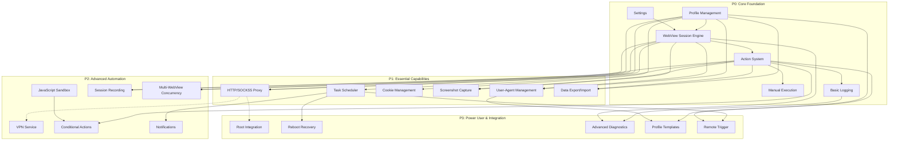

# BAutoPilot Feature Specification

This document provides a comprehensive specification of all architectural and functional capabilities for **BAutoPilot**—an automated browser and WebView orchestration engine designed for high-reliability mobile automation.

---

## 1. Feature Classification Matrix

| Feature | Priority | Complexity | Dependencies | Status |
| :--- | :--- | :--- | :--- | :--- |
| **Profile Management** | P0 Core | Medium (M) | Room DB, Jetpack Coroutines | Implemented (Phase 1 & 2) |
| **WebView Session Engine** | P0 Core | Large (L) | Android System WebView, Profile Management | Implemented (Phase 2) |
| **Action System** | P0 Core | Extra Large (XL) | WebView Session Engine | Implemented (Phase 2) |
| **Manual Execution** | P0 Core | Medium (M) | Action System, WebView Session Engine | Implemented (Phase 2) |
| **Basic Logging** | P0 Core | Small (S) | Room DB, Coroutines Flow | Implemented (Phase 2) |
| **Settings** | P0 Core | Small (S) | Jetpack DataStore | Planned |
| **Task Scheduler** | P1 Essential | Large (L) | WorkManager, AlarmManager, Action System | Implemented (Phase 3) |
| **HTTP/SOCKS5 Proxy** | P1 Essential | Medium (M) | AndroidX Webkit ProxyController, Profile Management | Planned (Phase 4) |
| **Cookie/Session Management** | P1 Essential | Medium (M) | Android CookieManager, Room DB, Profile Management | Implemented (Phase 2) |
| **Screenshot Capture** | P1 Essential | Medium (M) | WebView Session Engine, Action System | Planned (Phase 5) |
| **User-Agent Management** | P1 Essential | Small (S) | WebSettings, Profile Management | Planned |
| **Data Export/Import** | P1 Essential | Medium (M) | Profile Management, Action System, Room DB | Planned |
| **VPN Service** | P2 Advanced | Extra Large (XL) | Android VpnService, Tun2Socks / WireGuard Core | Planned (Phase 4) |
| **JavaScript Sandbox** | P2 Advanced | Large (L) | AndroidX JavaScriptEngine / QuickJS | Implemented (Phase 2) |
| **Conditional Actions** | P2 Advanced | Large (L) | Action System, JavaScript Sandbox | Planned |
| **Notifications** | P2 Advanced | Small (S) | NotificationManagerCompat, Task Scheduler | Implemented (Phase 3) |
| **Session Recording** | P2 Advanced | Extra Large (XL) | WebView Session Engine, Action System | Planned |
| **Multi-WebView Concurrency** | P2 Advanced | Large (L) | WebView Session Engine, Profile Management, Settings | Implemented (Phase 2 & 3) |
| **Root Integration** | P3 Power User | Extra Large (XL) | Magisk / KernelSU, libsu, iptables | Planned (Phase 6) |
| **Reboot Recovery** | P3 Power User | Medium (M) | Task Scheduler, BroadcastReceiver (`BOOT_COMPLETED`) | Implemented (Phase 3) |
| **Advanced Diagnostics** | P3 Power User | Large (L) | Basic Logging, WebView Session Engine, DevTools API | Planned (Phase 5) |
| **Profile Templates** | P3 Power User | Medium (M) | Profile Management, User-Agent Management | Planned |
| **Remote Trigger** | P3 Power User | Large (L) | Task Scheduler, Action System, Ktor/Netty Server | Planned |

---

## 2. P0: Core Features

### 2.1 Profile Management
- **Description**: Isolates browser contexts into distinct profiles, segregating persistent cookies, local storage, indexedDB, HTTP cache, credentials, screen dimensions, and execution parameters.
- **User Value**: Allows users to manage and run workflows across multiple segregated accounts and identities without cross-session pollution, state bleed, or tracking correlation.
- **Technical Approach**:
  - Implement `ProfileEntity` and `ProfileDao` backed by Room database.
  - Utilize Android's multi-profile data isolation via `WebView.setDataDirectorySuffix(profileId)` (API 28+) to physically separate underlying data stores on disk.
  - Maintain profile-scoped directories in the application sandbox (`app_webview_<profileId>/`).
- **Dependencies**: Room Database, Jetpack ViewModel, Kotlin Coroutines.
- **Complexity**: Medium (M)
- **Priority**: P0
- **Status**: Planned

---

### 2.2 WebView Session Engine
- **Description**: Hosts, manages, and orchestrates the lifecycle of Android `WebView` instances, providing lifecycle event dispatch, DOM ready hooks, crash recovery, and memory recycling.
- **User Value**: Serves as the primary web execution runtime, ensuring smooth, memory-managed, and stable web browsing sessions in both visible and headless modes.
- **Technical Approach**:
  - Encapsulate `WebView` instances inside a managed wrapper class implementing custom `WebViewClient` and `WebChromeClient`.
  - Listen for page lifecycle signals: `onPageStarted`, `onPageCommitVisible`, `onPageFinished`, and HTTP failure events (`onReceivedError`, `onReceivedHttpError`).
  - Implement render process crash detection and self-healing through `onRenderProcessGone`.
  - Provide hardware acceleration toggles and offscreen rendering buffers.
- **Dependencies**: Android System WebView, Profile Management, Android Webkit API.
- **Complexity**: Large (L)
- **Priority**: P0
- **Status**: Planned

---

### 2.3 Action System
- **Description**: A comprehensive automation command engine supporting eight fundamental browser primitives:
  1. `NAVIGATE`: Loads target URLs with customizable HTTP headers, timeout thresholds, and referrer policies.
  2. `CLICK`: Dispatches synthetic touch, mouse, and DOM click events to elements identified via CSS selectors or XPath.
  3. `FILL`: Injects text, handles form controls, triggers `input`/`change` events, and supports character-by-character typing emulation.
  4. `EXTRACT`: Scrapes element attributes, text content, or inner/outer HTML into structured memory registers or variables.
  5. `WAIT`: Pauses execution via fixed timeouts, DOM state polling (`element_present`, `element_visible`, `element_clickable`), or network idle status.
  6. `SCROLL`: Executes coordinate-based scrolls, element-into-view alignment, and infinite-scroll page bottom triggers.
  7. `SCREENSHOT`: Captures viewport or full-page render passes and outputs to compressed raster formats.
  8. `JS_EXECUTE`: Executes arbitrary JavaScript snippets via `evaluateJavascript()` and marshals JSON return values back to the native host.
- **User Value**: Gives users a complete, composable Domain-Specific Language (DSL) to script any user interaction or scraping scenario on web applications.
- **Technical Approach**:
  - Implement a Command Pattern using a sealed class hierarchy (`sealed interface AutomationAction`).
  - Bundle a minified JavaScript injection bridge (`bautopilot-bridge.js`) injected into pages at `document_start`.
  - Implement asynchronous dispatch with timeout cancellation using Kotlin `withTimeoutOrNull` and Coroutine continuation.
- **Dependencies**: WebView Session Engine.
- **Complexity**: Extra Large (XL)
- **Priority**: P0
- **Status**: Planned

---

### 2.4 Manual Execution
- **Description**: Interactive runner interface that allows users to step through action sequences manually, inspect DOM element matches in real time, and trigger single ad-hoc actions.
- **User Value**: Drastically reduces automation authoring time by providing immediate visual feedback, step-by-step debugging, and verification before running unattended batches.
- **Technical Approach**:
  - State machine runner exposing `PLAY`, `PAUSE`, `STEP_NEXT`, `RETRY`, and `ABORT` controls via Kotlin `StateFlow`.
  - Real-time DOM overlay injected into the WebView showing bounding boxes and selector match counts for elements targeted by the current active step.
- **Dependencies**: Action System, WebView Session Engine.
- **Complexity**: Medium (M)
- **Priority**: P0
- **Status**: Planned

---

### 2.5 Basic Logging
- **Description**: Lightweight in-memory and persistent logging engine that captures timestamps, log levels (DEBUG, INFO, WARN, ERROR), action inputs, DOM execution results, and stack traces.
- **User Value**: Provides transparent visibility into execution progress, error diagnostics, and script performance bottlenecks.
- **Technical Approach**:
  - Structured logger abstraction using `Timber` with custom tree sinks.
  - Disk persistence using Room database `ExecutionLogEntity` with automatic log rotation and retention policies (e.g., auto-prune logs older than 7 days).
  - Reactive log emission via Kotlin `SharedFlow` feeding the real-time in-app log viewer UI.
- **Dependencies**: Room Database, Kotlin Coroutines Flow.
- **Complexity**: Small (S)
- **Priority**: P0
- **Status**: Planned

---

### 2.6 Settings
- **Description**: Central configuration repository governing application-wide parameters including default timeouts, network concurrency limits, battery optimizations, and data storage maintenance.
- **User Value**: Allows users to fine-tune automation behavior to fit device specifications, battery budgets, and network constraints.
- **Technical Approach**:
  - Implement preferences using Android Jetpack `Preferences DataStore`.
  - Expose configuration as observable flows with typed default fallbacks.
  - Implement one-tap storage cleanup routines (clearing orphaned WebView caches and temporary bitmaps).
- **Dependencies**: Jetpack DataStore.
- **Complexity**: Small (S)
- **Priority**: P0
- **Status**: Planned

---

## 3. P1: Essential Features

### 3.1 Task Scheduler (cron/WorkManager/AlarmManager)
- **Description**: Automated execution orchestrator supporting recurring schedules (cron syntax), periodic intervals, and precise one-off scheduled task execution.
- **User Value**: Enables fully autonomous, unattended web automation and continuous data monitoring without manual user intervention.
- **Technical Approach**:
  - Two-tier scheduling architecture:
    - **WorkManager**: Handles flexible, deferrable background execution with system constraints (network type, charging status, battery not low).
    - **AlarmManager (`setExactAndAllowWhileIdle`)**: Handles high-precision, time-sensitive execution that must trigger despite Android Doze mode.
  - Integrated cron parser (POSIX and quartz formats) converting cron expressions to target trigger epochs.
  - Foreground Service binding with partial wake locks (`PARTIAL_WAKE_LOCK`) during active automation tasks.
- **Dependencies**: Android WorkManager, AlarmManager, Action System, Profile Management.
- **Complexity**: Large (L)
- **Priority**: P1
- **Status**: Planned

---

### 3.2 HTTP/SOCKS5 Proxy
- **Description**: Network proxy routing layer enabling per-profile and per-task traffic proxying over HTTP, HTTPS, and SOCKS5 protocols with username and password authentication.
- **User Value**: Protects user privacy, supports geo-distributed operations, prevents IP-based rate limiting, and allows accessing location-restricted web services.
- **Technical Approach**:
  - Use `androidx.webkit.ProxyController` API to apply proxy configurations directly to the WebView runtime without affecting global device networking.
  - Support proxy authorization schemes via `WebViewClient.onReceivedHttpAuthRequest()`.
  - Fallback local SOCKS5 tunnel forwarder using loopback sockets when SOCKS authentication is not natively supported by the device's Chromium engine.
- **Dependencies**: `androidx.webkit:webkit` (`ProxyController`), Profile Management.
- **Complexity**: Medium (M)
- **Priority**: P1
- **Status**: Planned

---

### 3.3 Cookie/Session Management
- **Description**: Complete lifecycle management for browser cookies, session storage, and local storage tokens, including export, import (Netscape and JSON formats), inspection, and selective deletion.
- **User Value**: Enables seamless session reuse, automated login state restoration, and transferring authentication tokens between profiles or external tools.
- **Technical Approach**:
  - Bridge to Android's `CookieManager` singleton with thread-safe synchronization and explicit `flush()` invocations.
  - Custom parser and serializer supporting standard Netscape HTTP Cookie format and JSON arrays.
  - Database-backed cookie snapshot storage linked to profile IDs, enabling snapshot/restore mechanics before and after task runs.
- **Dependencies**: Android Webkit CookieManager, Room DB, Profile Management.
- **Complexity**: Medium (M)
- **Priority**: P1
- **Status**: Planned

---

### 3.4 Screenshot Capture
- **Description**: Automated rendering capture pipeline capable of grabbing visible viewports or stitching entire scrollable web pages into compressed image formats (WebP, PNG, JPEG).
- **User Value**: Delivers visual proof of automation completion, audit trails, and instant visual debugging artifacts for failed steps.
- **Technical Approach**:
  - Standard viewport capture using `PixelCopy` or `WebView.draw(Canvas)` targeting software/hardware bitmaps.
  - Full-page capture utilizing `WebView.enableSlowWholeDocumentDraw()` combined with dynamic scroll-and-stitch fallback algorithms for memory-constrained devices.
  - Asynchronous background encoding to WebP/PNG written to app storage with auto-generated metadata headers.
- **Dependencies**: WebView Session Engine, Action System, Android Graphics Pipeline.
- **Complexity**: Medium (M)
- **Priority**: P1
- **Status**: Planned

---

### 3.5 User-Agent Management
- **Description**: Configurable User-Agent spoofing and header modification engine supporting predefined catalog presets (popular Android, iOS, Chrome, Safari, Firefox variants) and custom strings.
- **User Value**: Prevents bot fingerprint detection, forces desktop or mobile layouts on demand, and eliminates browser-specific display incompatibilities.
- **Technical Approach**:
  - Configure `WebSettings.setUserAgentString()` per WebView session.
  - Override Client Hints (`Sec-CH-UA`, `Sec-CH-UA-Mobile`, `Sec-CH-UA-Platform`) via HTTP request header interception (`shouldInterceptRequest`) and early JavaScript prototype modification.
- **Dependencies**: Profile Management, WebView Session Engine.
- **Complexity**: Small (S)
- **Priority**: P1
- **Status**: Planned

---

### 3.6 Data Export/Import
- **Description**: System for backing up and restoring profile configurations, task workflow scripts, captured cookies, and extracted tabular data in standard formats (JSON, CSV, ZIP).
- **User Value**: Safeguards automation workflows against data loss, simplifies migration to new devices, and enables exporting scraped data directly to spreadsheets or external pipelines.
- **Technical Approach**:
  - Android Storage Access Framework (SAF) integration for user-selected file destinations (`Intent.ACTION_CREATE_DOCUMENT`, `Intent.ACTION_OPEN_DOCUMENT`).
  - Schema-versioned JSON serialization using `Kotlinx Serialization`.
  - Transactional import validation verifying schema integrity before writing to Room database.
- **Dependencies**: Profile Management, Action System, Room DB, Kotlinx Serialization.
- **Complexity**: Medium (M)
- **Priority**: P1
- **Status**: Planned

---

## 4. P2: Advanced Features

### 4.1 VPN Service
- **Description**: Device-level or per-app virtual network adapter that tunnels outbound network packets through configured proxy endpoints, WireGuard peers, or OpenVPN servers.
- **User Value**: Ensures zero-leak network masking (DNS, WebRTC, UDP) that bypasses WebView proxy limitations, securing all network traffic emitted during automation sessions.
- **Technical Approach**:
  - Implement Android `VpnService` with virtual network interface creation via `Builder.establish()`.
  - Integrate an embedded `tun2socks` native engine (Go/Rust/C) to transform Layer 3 IP packets from the TUN interface into Layer 5 SOCKS5/HTTP proxy traffic.
  - Support per-app split tunneling (`addAllowedApplication`) to restrict VPN routing exclusively to the BAutoPilot package.
- **Dependencies**: Android VpnService (`BIND_VPN_SERVICE`), Embedded `tun2socks` / WireGuard core.
- **Complexity**: Extra Large (XL)
- **Priority**: P2
- **Status**: Planned

---

### 4.2 JavaScript Sandbox
- **Description**: Secure, isolated JavaScript execution environment running outside the DOM context for data transformation, math calculations, cryptographic hashing, and variable evaluation.
- **User Value**: Enables advanced scripting logic, custom payload calculations, token hashing, and string sanitization without risking page DOM corruption.
- **Technical Approach**:
  - Integrate `androidx.javascriptengine:javascriptengine` (powered by V8) or an embedded lightweight `QuickJS` engine.
  - Provide a clean request/response bridge passing input variables and returning serialized primitives.
  - Enforce CPU execution time limits (e.g., 2000 ms max) and memory heap caps to prevent runaway scripts.
- **Dependencies**: `androidx.javascriptengine` or QuickJS native library.
- **Complexity**: Large (L)
- **Priority**: P2
- **Status**: Planned

---

### 4.3 Conditional Actions (if/else/loops)
- **Description**: Control flow primitives integrated directly into the action pipeline, supporting condition evaluation (`IF_ELEMENT_EXISTS`, `IF_TEXT_CONTAINS`, `IF_JS_TRUE`), loop constructs (while, for-each, repeat N times), and error break/continue semantics.
- **User Value**: Allows automation scripts to handle real-world dynamic web behaviors such as pagination, dynamic pop-up dismissal, cookie consent banners, and variable retry logic.
- **Technical Approach**:
  - Extend the action graph from a flat list to an Abstract Syntax Tree (AST) / Directed Acyclic Graph (DAG) structure.
  - Implement an Execution Context holding runtime variables, loop iteration counters, and call stack pointers.
  - Safety constraints: maximum recursion depth and hard loop iteration caps to prevent infinite cycles.
- **Dependencies**: Action System, JavaScript Sandbox.
- **Complexity**: Large (L)
- **Priority**: P2
- **Status**: Planned

---

### 4.4 Notifications
- **Description**: Rich system notification dispatcher alerting users to task milestones, execution errors, CAPTCHA challenges, or extracted data thresholds, accompanied by actionable quick buttons.
- **User Value**: Keeps users informed in real time while tasks execute in the background without requiring the application to remain open on screen.
- **Technical Approach**:
  - Android `NotificationManagerCompat` utilizing categorized Notification Channels (e.g., `Task Status`, `Alerts`, `Failures`).
  - Progress bar notifications for long-running workflows with ETA updates.
  - Actionable `PendingIntent` buttons (e.g., "Take Over Manually", "Abort Task", "View Log").
- **Dependencies**: Task Scheduler, Basic Logging, Android Notification API.
- **Complexity**: Small (S)
- **Priority**: P2
- **Status**: Planned

---

### 4.5 Session Recording
- **Description**: An interactive recording mode where user navigation, clicks, keystrokes, and scroll events inside a live WebView are captured and automatically synthesized into an editable action sequence.
- **User Value**: Enables no-code automation authoring—users simply browse the web application naturally, and BAutoPilot generates the complete automated workflow.
- **Technical Approach**:
  - Injected JavaScript recorder script attaching delegated event listeners (`click`, `input`, `change`, `submit`, `scroll`) to `window`.
  - Heuristic selector synthesis engine evaluating:
    1. Unique element ID (`#id`)
    2. Stable data attributes (`data-testid`, `data-qa`)
    3. ARIA accessibility labels
    4. Optimal CSS selector paths
    5. Fallback full XPath
  - Event debouncing and input aggregation to collapse rapid keystrokes into single `FILL` commands.
- **Dependencies**: WebView Session Engine, Action System.
- **Complexity**: Extra Large (XL)
- **Priority**: P2
- **Status**: Planned

---

### 4.6 Multi-WebView Concurrency
- **Description**: Orchestration coordinator managing multiple simultaneous WebView instances executing different profiles and tasks in parallel with resource pooling and RAM throttling.
- **User Value**: Multiplies productivity and task throughput by executing concurrent scraping tasks or multi-account actions at the same time.
- **Technical Approach**:
  - Concurrency manager controlling a pool of active `WebView` sessions bounded by device RAM heuristics (`ActivityManager.getMemoryInfo()`).
  - Offscreen virtual display or hidden view attachment to prevent render pipeline suspension.
  - Priority queue dispatcher prioritizing foreground/interactive sessions over background workers.
- **Dependencies**: WebView Session Engine, Profile Management, Settings.
- **Complexity**: Large (L)
- **Priority**: P2
- **Status**: Planned

---

## 5. P3: Power User Features

### 5.1 Root Integration (Magisk/libsu/iptables)
- **Description**: Advanced root privilege integration utilizing `libsu` to interact with Magisk/KernelSU su-daemons, manipulate system-level identifiers, and configure direct `iptables` packet redirection.
- **User Value**: Enables elite anti-detection capabilities, system-wide transparent proxying without occupying the Android VPN slot, and deep device fingerprint spoofing (IMEI, MAC, Android ID).
- **Technical Approach**:
  - Integrate `com.github.topjohnwu.libsu:core` for asynchronous, root shell connection management.
  - Programmatic `iptables` table modifications (`PREROUTING`, `OUTPUT`) for transparent TCP/UDP packet redirection to local proxy daemons (e.g., Redsocks / Tun2Socks).
  - System property manipulation via `setprop` and private framework hooks to align build properties (`ro.product.model`, `ro.build.version.release`).
- **Dependencies**: Root Access (Magisk/KernelSU), `libsu` library, Android `iptables` binary.
- **Complexity**: Extra Large (XL)
- **Priority**: P3
- **Status**: Planned

---

### 5.2 Reboot Recovery (BOOT_COMPLETED)
- **Description**: Auto-initialization receiver that triggers upon system restart to re-arm scheduled tasks, reconcile in-flight workflows that were interrupted, and start persistent automation daemons.
- **User Value**: Essential for unattended 24/7 automation devices, Android TV boxes, Raspberry Pi Android builds, and remote farm emulators.
- **Technical Approach**:
  - Manifest-registered `BroadcastReceiver` listening for `android.intent.action.BOOT_COMPLETED` and `android.intent.action.LOCKED_BOOT_COMPLETED`.
  - Database state reconciliation querying for tasks marked `IN_PROGRESS` at time of shutdown, resetting them or scheduling immediate recovery runs.
  - Programmatic re-registration of exact alarms and WorkManager triggers.
- **Dependencies**: Task Scheduler, Room DB, Android Manifest receiver permissions.
- **Complexity**: Medium (M)
- **Priority**: P3
- **Status**: Planned

---

### 5.3 Advanced Diagnostics
- **Description**: Comprehensive diagnostic dashboard offering HAR (HTTP Archive) network traffic logs, real-time DOM tree inspection, memory/CPU performance telemetry, and Chromium crash dump analysis.
- **User Value**: Invaluable for diagnosing complex bot-detection challenges, tracking down subtle network failures, analyzing memory spikes, and optimizing automation execution times.
- **Technical Approach**:
  - Remote debugging server enablement via `WebView.setWebContentsDebuggingEnabled(true)`.
  - Network interception via `shouldInterceptRequest` combined with `OkHttp` instrumentation to log complete request/response headers, status codes, timings, and payloads into standard HAR format.
  - Android runtime profiling tracking memory consumption (`Debug.getNativeHeapAllocatedSize()`) and thread count.
- **Dependencies**: Basic Logging, WebView Session Engine, Android WebKit Remote Debugging.
- **Complexity**: Large (L)
- **Priority**: P3
- **Status**: Planned

---

### 5.4 Profile Templates
- **Description**: Curated repository of pre-configured browser fingerprint templates (e.g., "Pixel 8 Pro Mobile Chrome", "MacBook Pro Safari", "Windows 11 Edge", "Clean Stealth Scraper") providing instant profile generation.
- **User Value**: Eliminates the complex manual configuration of User-Agents, viewport resolutions, color depths, and client hints, allowing users to spin up realistic profiles in seconds.
- **Technical Approach**:
  - Bundled JSON profile template catalog defining consistent combinations of User-Agent, screen width/height, device scale factor, language headers, and WebGL renderer overrides.
  - Template factory creating fully populated `ProfileEntity` instances.
  - Import/export capability for custom user-created profile templates.
- **Dependencies**: Profile Management, User-Agent Management, Data Export/Import.
- **Complexity**: Medium (M)
- **Priority**: P3
- **Status**: Planned

---

### 5.5 Remote Trigger
- **Description**: Remote control interface enabling workflows and tasks to be triggered, monitored, and aborted via external HTTP webhooks, local WebSocket server, or Firebase Cloud Messaging (FCM).
- **User Value**: Connects BAutoPilot to external ecosystems, allowing CI/CD pipelines, Discord/Telegram bots, serverless functions, or custom backend services to control mobile automation on demand.
- **Technical Approach**:
  - Embedded lightweight HTTP/WebSocket daemon (powered by Ktor Embedded Server or Netty) running within an Android Foreground Service.
  - RESTful control API endpoints:
    - `POST /api/v1/tasks/{id}/start`
    - `POST /api/v1/tasks/{id}/stop`
    - `GET /api/v1/tasks/{id}/status`
    - `GET /api/v1/logs`
  - Authentication layer enforcing API key / Bearer token validation for all incoming triggers.
  - Optional push receiver integration for Google Cloud Messaging / FCM.
- **Dependencies**: Task Scheduler, Action System, Ktor/Netty Server, Network Permissions.
- **Complexity**: Large (L)
- **Priority**: P3
- **Status**: Planned

---

## 6. Architectural Dependencies & Component Graph

The diagram below outlines how the core layers interact, demonstrating how P0 primitives serve as the structural foundation for P1, P2, and P3 capabilities:

