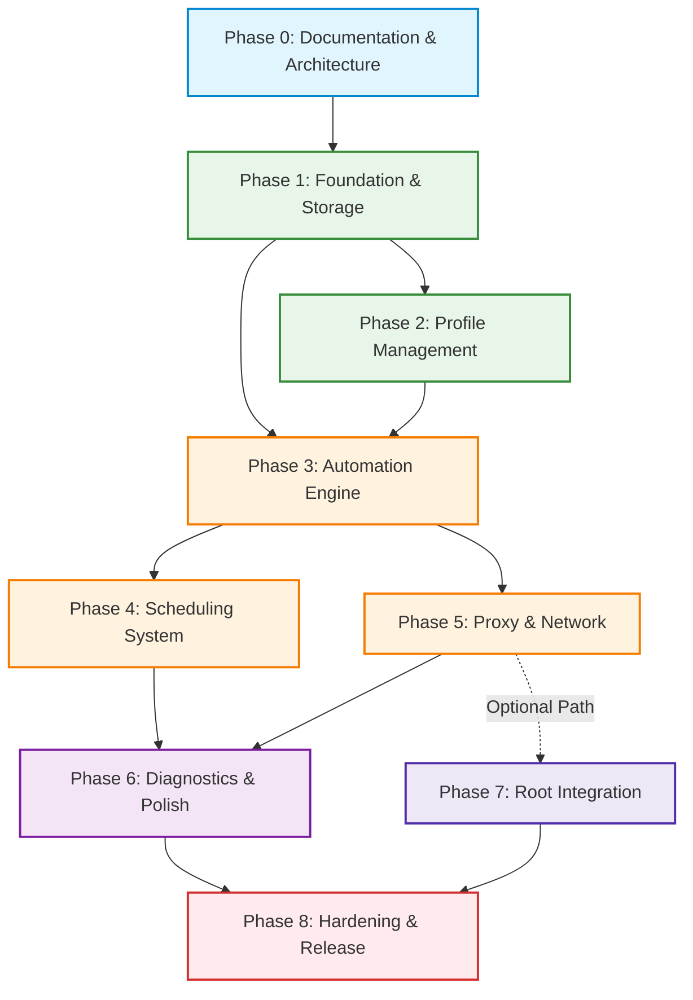

# BAutoPilot: Technical Product & Engineering Roadmap

> **Document Version:** 1.0.0  
> **Target Platform:** Android 8.0+ (API Level 26–35)  
> **Architecture Pattern:** Multi-Module Clean Architecture with Jetpack Compose & Kotlin Coroutines  
> **Status:** Active / Production Plan  
> **Date:** November 2026  

---

## 1. Executive Summary & Vision

**BAutoPilot** is an autonomous, enterprise-grade Android background automation platform engineered to execute orchestrated browser workflows using sandboxed, isolated WebViews. Designed for operational resilience, privacy, and precision, BAutoPilot integrates deep system capabilities—such as foreground service execution, exact alarm orchestration, transparent network proxying (via Android WebView Proxy APIs and `VpnService`), hardware-backed database encryption via Room with SQLCipher, and optional superuser (`libsu`) capabilities for root-level network control (`iptables` and hosts manipulation).

This Roadmap defines the 9-phase engineering sequence (Phase 0 through Phase 8), detailing technical deliverables, architectural milestones, inter-phase dependencies, risk mitigations, and formal **Go/No-Go quality gates** required to guide BAutoPilot from architectural inception to production-grade release.

---

## 2. Master Phase Schedule & Timeline

```
+--------------------------------------------------------------------------------------------------------------------+
| Phase 0: Architecture & Documentation (Current)                                                                    |
+--------------------------+-----------------------------------------------------------------------------------------+
                           |
                           v
+----------------------------------------------------+
| Phase 1: Foundation (Weeks 1-3)                    |
+--------------------------+-------------------------+
                           |
                           v
+----------------------------------------------------+
| Phase 2: Profile Management (Weeks 4-5)            |
+--------------------------+-------------------------+
                           |
                           v
+----------------------------------------------------+
| Phase 3: Automation Engine (Weeks 6-9)             |
+--------------------------+-------------------------+
                           |
              +------------+------------+
              |                         |
              v                         v
+---------------------------+ +----------------------------+
| Phase 4: Scheduling       | | Phase 5: Proxy & Network   |
| (Weeks 10-11)             | | (Weeks 10-12)              |
+-------------+-------------+ +--------------+-------------+
              |                              |
              +--------------+---------------+
                             |
                             v
+----------------------------------------------------+
| Phase 6: Diagnostics & Polish (Weeks 13-14)        |
+--------------------------+-------------------------+
                           |
                           v
+----------------------------------------------------+
| Phase 7: Root Integration (Weeks 15-16)            |
+--------------------------+-------------------------+
                           |
                           v
+----------------------------------------------------+
| Phase 8: Hardening & Release (Weeks 17-18)         |
+----------------------------------------------------+
```

### 2.1 Timeline Overview

| Phase | Title | Duration | Focus Area | Primary Artifact |
| :--- | :--- | :--- | :--- | :--- |
| **Phase 0** | Documentation & Architecture | **Complete** | Specification, feasibility, ADRs, blueprints | 15 Core System Documents |
| **Phase 1** | Foundation & Core Infrastructure | **Complete** | Gradle modules, Room, Hilt, Navigation Shell | Modular Android Scaffold & Data Layer |
| **Phase 2** | Profile Management & Actions | **Complete** | Profile CRUD, 4 Automation Modes, WebView Engine | Automation Core & Browser Execution |
| **Phase 3** | Background Execution & Scheduling | **Complete** | Room Migration v2, AlarmManager, WorkManager, UI | Background Execution & Scheduling Engine |
| **Phase 4** | Proxy & Network Isolation | **Complete** | HTTP/HTTPS/SOCKS5, health check, encrypted credentials, isolation | Per-profile Network Tunneling Engine |
| **Phase 5** | Diagnostics, Backup & Data Recovery | **Complete** | Diagnostics Center, event tracking, .autopilot backup, self-healing recovery | 86/86 Passing Tests, LDPlayer Verified |
| **Phase 6** | Root Integration (Optional Path) | **Next** | `libsu`, iptables, root detection, hosts | Low-Level System Control Layer |
| **Phase 7** | Hardening & Release Candidate | **Planned** | Security audit, profiling, R8, RC builds | Production Signed Release Candidate |

---

## 3. Detailed Phase Breakdown

---

### Phase 0: Documentation & Architecture (Current)

**Objective:** Establish complete technical alignment, prove foundational feasibility on target Android platform versions (Android 8.0 through 15+), formalize Architectural Decision Records (ADRs), and establish rigorous component specifications across all sub-systems.

#### Key Deliverables
1. **15 Core System Documents:**
   - `ARCHITECTURE.md`: Clean architecture, multi-module boundaries, unidirectional data flow (UDF).
   - `SYSTEM_DESIGN.md`: Runtime topology, inter-process communication, component lifecycles.
   - `AUTOMATION_ENGINE.md`: `WebViewPool` specification, JavaScript bridge injection, synthetic DOM interactions.
   - `DATA_STORAGE.md`: Room schema, SQLCipher 256-bit AES encryption, Android Keystore passphrase management.
   - `PROFILE_MANAGEMENT.md`: Profile data contract, fingerprint emulation variables, isolation boundaries.
   - `SCHEDULING_SYSTEM.md`: Hybrid AlarmManager/WorkManager scheduling model, cron engine, boot restoration.
   - `PROXY_NETWORK.md`: PAC execution, `ProxyController` integration with `androidx.webkit.ProxyController`, `VpnService` tun2socks architecture.
   - `ROOT_INTEGRATION.md`: `libsu` shell lifecycle, isolated root service, dynamic `iptables` rules, hosts mutation.
   - `SECURITY_THREAT_MODEL.md`: Threat vectors, memory zeroization, tamper detection, cryptographic key derivation.
   - `UI_UX_DESIGN.md`: Material 3 Compose specifications, accessibility, design tokens, navigation graphs.
   - `DIAGNOSTICS_LOGGING.md`: Ring-buffer memory logging, encrypted on-disk diagnostic logs, screenshot capture store.
   - `API_CONTRACTS.md`: Action definitions (Navigate, Click, Input, Wait, Extract, EvalJS), schema JSON validation.
   - `TESTING_STRATEGY.md`: Test pyramid, mock WebView bridges, Robolectric specs, rooted emulator matrix.
   - `FEASIBILITY_STUDY.md`: Android background execution limits, Doze mode impact, OEM battery optimization bypass.
   - `DECISION_LOG.md`: Architectural Decision Records (ADRs 001–025).
2. **Proof-of-Concept (PoC) Feasibility Spikes:**
   - WebView instantiation and JavaScript bridge evaluation within a detached Android Foreground Service.
   - Android Keystore master key generation and Room SQLCipher database opening without main-thread jank.
   - SOCKS5 authentication proxy routing via AndroidX WebKit ProxyController.

#### Milestones
- **M0.1:** Core architectural specifications and system models completed and validated.
- **M0.2:** Feasibility spikes approved (Headless WebView in Foreground Service, Keystore-backed SQLCipher).
- **M0.3:** ADR baseline locked; all 15 technical documents reviewed and frozen.

#### Go/No-Go Criteria
- [ ] All 15 architecture and specification documents complete with zero outstanding architectural ambiguities.
- [ ] PoC proves WebView JavaScript evaluation survives screen-off in an active Foreground Service on Android 14/15.
- [ ] Memory footprint baseline for a single active WebView instance proven to remain below 65 MB.

---

### Phase 1: Foundation (Weeks 1–3)

**Objective:** Build the modular Gradle infrastructure, domain models, cryptographic storage engine, dependency injection graph, and Jetpack Compose navigation shell.

```
+---------------------------------------------------------------------------------+
|                                 :app                                            |
+---------------------------------------+-----------------------------------------+
                                        |
     +----------------------------------+-----------------------------------+
     |                                                                      |
     v                                                                      v
+------------------------+  +------------------------+  +------------------------+
| :feature:profile       |  | :feature:automation    |  | :feature:diagnostics   |
+-----------+------------+  +-----------+------------+  +-----------+------------+
            |                           |                           |
            +-------------------+       |       +-------------------+
                                |       |       |
                                v       v       v
                            +------------------------+
                            | :core:domain           |
                            +-----------+------------+
                                        |
     +----------------------------------+-----------------------------------+
     |                                  |                                   |
     v                                  v                                   v
+------------------------+  +------------------------+  +------------------------+
| :core:database         |  | :core:model            |  | :core:common           |
| (Room + SQLCipher)     |  | (Data entities)        |  | (Dispatchers, Utils)   |
+------------------------+  +------------------------+  +------------------------+
```

#### Key Deliverables
- **Gradle Multi-Module Configuration:**
  - Setup core modules: `:core:model`, `:core:database`, `:core:crypto`, `:core:common`, `:core:network`, `:core:ui`.
  - Setup feature shells: `:feature:profile`, `:feature:automation`, `:feature:scheduling`, `:feature:proxy`, `:feature:diagnostics`.
  - Gradle Version Catalogs (`libs.versions.toml`) with enforced dependency constraints.
- **Secure Persistence (`:core:database` & `:core:crypto`):**
  - Room 2.6+ with SQLCipher 4.5.4 integration.
  - Hardware-backed key derivation using `AndroidKeyStore` (`AES/GCM/NoPadding` for database passphrase).
  - Base DAOs: `ProfileDao`, `ActionDao`, `ScheduleDao`, `ExecutionLogDao`.
  - Entity models with strict JSON type converters for complex action parameters.
- **Dependency Injection & Coroutines (`:core:common`):**
  - Hilt / Dagger setup with custom qualifiers (`@IoDispatcher`, `@DefaultDispatcher`, `@MainDispatcher`).
  - Coroutine scopes bound to application and service lifecycles.
- **Compose Navigation & Design System (`:core:ui` & `:app`):**
  - Material 3 Design System implementation (tokens, dynamic color, typography, dark/light themes).
  - Type-Safe Jetpack Navigation Compose integration (`androidx.navigation.compose`).
  - Top-level `AppScaffold` with Navigation Bar (Profiles, Automation, Scheduler, Proxies, Diagnostics).

#### Milestones
- **M1.1:** Modular Gradle compilation and automated CI build verification passing in `< 90s`.
- **M1.2:** Room database fully encrypted with SQLCipher; CRUD automated tests passing with 100% passphrase verification.
- **M1.3:** Interactive Compose UI shell running on physical device with functional type-safe routing.

#### Go/No-Go Criteria
- [ ] Database decryption test fails when provided with invalid Keystore-derived key.
- [ ] Zero database leaks on migration baseline.
- [ ] Compose frame rendering remains stable at 60/120 FPS across navigation transitions on target hardware.

---

### Phase 2: Profile Management (Weeks 4–5)

**Objective:** Implement end-to-end profile lifecycle management, multi-tab detail configuration, drag-and-drop action sequence composition, and secure JSON profile import/export.

#### Key Deliverables
- **Profile CRUD & Repository Layer (`:feature:profile`):**
  - `ProfileRepository` with reactive `Flow<List<Profile>>` queries and paging support.
  - Profile List UI: Search, tag filtering, status badges (Idle, Running, Scheduled, Error), multi-selection for bulk deletion.
- **Profile Detail Configuration Tabs:**
  - *General Tab:* Profile name, description, tags, concurrency limits, execution timeout settings.
  - *Network Tab:* Proxy assignment (Direct, HTTP, SOCKS5), DNS-over-HTTPS settings, custom headers.
  - *Fingerprint / Environment Tab:* Custom User-Agent generator, viewport emulation (width, height, DPI), language/locale override, WebGL/Canvas spoofing flags.
  - *Storage / Cookie Tab:* Cookie manager inspection, session state clearance, local storage isolation settings.
- **Action Sequence Pipeline Editor:**
  - Reorderable list interface for building automation action workflows.
  - Action creation dialogs supporting 7 core action types:
    1. `Navigate`: Target URL, timeout, wait condition (`domcontentloaded`, `networkidle`).
    2. `Click`: CSS selector / XPath, random delay, click type (instant, humanized).
    3. `Input`: CSS selector, text template, typing speed, clear-before-type.
    4. `Wait`: Explicit milliseconds, selector visibility, selector disappearance.
    5. `EvalJS`: Raw script injection with output extraction to variable.
    6. `Extract`: CSS selector attribute or innerText mapped to execution context variable.
    7. `Screenshot`: Viewport or element capture flagged for diagnostic storage.
- **Import / Export System:**
  - JSON serialization/deserialization engine utilizing Kotlinx Serialization.
  - Cryptographic signature or schema validation check (`version` header) during import.
  - Safe import conflict resolution (Overwrite, Create Duplicate, Abort).

#### Milestones
- **M2.1:** Full profile CRUD persistence functioning reactively with Room.
- **M2.2:** Reorderable action pipeline editor allowing dynamic action creation, validation, and reordering.
- **M2.3:** JSON profile import/export roundtrip verified with 100% schema fidelity.

#### Go/No-Go Criteria
- [ ] Action editor prevents invalid workflows (e.g., Click action without selector or Navigate without valid URI).
- [ ] Profile import rejects malformed or malicious payloads without crashing or corrupting database.
- [ ] Profile configuration edits persist atomically within single database transactions.

---

### Phase 3: Automation Engine (Weeks 6–9)

**Objective:** Construct the core execution engine: a managed `WebViewPool`, sandboxed JavaScript evaluation bridge, variable extraction and substitution system, resilient error handling, foreground execution service, and real-time execution observer.

```
                                  +-----------------------------+
                                  |   AutomationService         |
                                  |   (Foreground Service)      |
                                  +--------------+--------------+
                                                 |
                                                 v
                                  +-----------------------------+
                                  |   ActionExecutionEngine     |
                                  +--------------+--------------+
                                                 |
                   +-----------------------------+-----------------------------+
                   |                                                           |
                   v                                                           v
+------------------------------------+                      +------------------------------------+
| WebViewPool                        |                      | VariableContext                    |
| - Recycled / Dedicated WebViews    |                      | - Runtime variable scope           |
| - Custom WebViewClient / WebChrome |                      | - Dynamic regex / extraction       |
| - Cookie / Session Isolation       |                      | - Template substitution            |
+------------------+-----------------+                      +------------------------------------+
                   |
                   v
+------------------------------------+
| JavaScript Bridge & DOM Injector   |
| - WebMessagePort bi-directional    |
| - Synthetic touch & click dispatch |
| - MutationObserver wait strategies |
+------------------------------------+
```

#### Key Deliverables
- **WebView Sandbox & Pool (`:core:automation`):**
  - `WebViewPool` implementing pre-warming, reuse, and complete state purge (`clearHistory()`, `clearCache()`, `clearFormData()`, cookie isolation).
  - Custom `AutomationWebViewClient` with request interception, SSL error handling policies, and page load event dispatchers.
  - Custom `AutomationWebChromeClient` managing console log streaming and progress tracking.
- **Action Execution Runner:**
  - Step-by-step sequential executor processing the action pipeline.
  - Synthetic input dispatch: Humanized typing simulation with Gaussian inter-keystroke delays.
  - Intelligent wait strategies via injected JavaScript `MutationObserver` promises.
- **Variable Resolution Engine:**
  - Runtime context holding environment variables, timestamp macros (e.g., `{{timestamp}}`, `{{random_uuid}}`), and profile variables.
  - Dynamic extraction mapping: Store parsed DOM text or JS evaluation output into runtime variables (e.g., `extracted_token = regex(response, 'token=(.*)')`).
  - Universal placeholder replacement in action parameters before execution.
- **Error Handling & Retry Mechanics:**
  - Granular failure classification: `SelectorNotFoundException`, `NavigationTimeoutException`, `JsExecutionException`, `NetworkUnavailableException`.
  - Configurable action retry policies (maximum retries, exponential backoff, fallback actions).
- **Foreground Service Runtime (`AutomationService`):**
  - Android Foreground Service with type `FOREGROUND_SERVICE_TYPE_SPECIAL_USE` or `SHORT_SERVICE` (Android 14+ compliant).
  - Ongoing, non-dismissible notification showing live execution state, profile name, and current action step.
  - Partial WakeLock acquisition to prevent CPU sleep during critical action sequences.
- **Execution Telemetry & Live Observer:**
  - Reactive `StateFlow<ExecutionState>` emitted to UI for real-time visual progress monitoring.
  - Manual execution runner sheet allowing Start, Pause, Resume, and Stop controls from the UI.

#### Milestones
- **M3.1:** `WebViewPool` successfully instantiates, cycles, and completely sanitizes isolated WebView instances.
- **M3.2:** End-to-end execution of a 10-step complex automation pipeline (Login -> Extract Data -> Screenshot -> Done).
- **M3.3:** Foreground service maintains uninterrupted automation execution through a 30-minute screen-off state.

#### Go/No-Go Criteria
- [ ] Automation engine achieves > 99% execution determinism on standard synthetic benchmark test suite.
- [ ] Memory leaks after cycling 50 consecutive WebView automation sessions must equal 0 MB (verified via LeakCanary).
- [ ] Foreground Service survives aggressive OS background pruning without silent termination.

---

### Phase 4: Scheduling & Background Persistence (Weeks 10–11)

**Objective:** Implement precision scheduling using a dual-engine approach (WorkManager for deferrable tasks, AlarmManager for exact execution), standard cron expression evaluation, and boot recovery receivers.

#### Key Deliverables
- **Cron Expression Evaluation Engine:**
  - Standard 5-field cron parser (`minute`, `hour`, `day of month`, `month`, `day of week`).
  - Next-run-time calculation engine with timezone awareness.
- **Hybrid Scheduling Dispatcher (`:feature:scheduling`):**
  - *Exact Mode (AlarmManager):* Utilizes `setExactAndAllowWhileIdle()` or `setAlarmClock()` for time-critical automation profiles.
  - *Battery-Optimized Mode (WorkManager):* Utilizes `PeriodicWorkRequest` with execution constraints (Battery Not Low, Network Connected).
  - Automatic permission check and user navigation flow for `android.permission.SCHEDULE_EXACT_ALARM`.
- **System Boot & Update Recovery:**
  - `BootReceiver` handling `Intent.ACTION_BOOT_COMPLETED`, `Intent.ACTION_MY_PACKAGE_REPLACED`, and `Intent.ACTION_TIME_CHANGED`.
  - Rescheduling algorithm: Reads all active schedules from encrypted Room database and re-registers alarms within 5 seconds of boot.
- **Scheduler UI:**
  - Schedule configuration screen: Cron builder wizard, preset selector (Hourly, Daily at X, Weekly), execution mode toggle.
  - Visual calendar/timeline showing upcoming scheduled runs across all profiles.

#### Milestones
- **M4.1:** Cron evaluation engine validated against 200+ unit test cron string variations.
- **M4.2:** AlarmManager exact firing verified within +/- 2 seconds during active Android Doze state.
- **M4.3:** System reboot simulation validates 100% automatic recovery of active schedules without manual app launch.

#### Go/No-Go Criteria
- [ ] Zero lost schedules following simulated device reboot and time changes.
- [ ] Exact alarm scheduling complies with Google Play policy requirements for exact alarm permissions.
- [ ] Graceful degradation to WorkManager if user denies exact alarm permission.

---

### Phase 5: Proxy & Network Isolation (Weeks 10–12)

**Objective:** Equip BAutoPilot with multi-protocol proxy capabilities, proxy health validation, granular WebView network routing, and a transparent fallback local `VpnService` (tun2socks).

```
                            +-----------------------------------------------+
                            |   Profile Proxy Configuration                 |
                            |   - Direct / HTTP / SOCKS4 / SOCKS5           |
                            +-----------------------+-----------------------+
                                                    |
                         +--------------------------+--------------------------+
                         |                                                     |
                         v                                                     v
         +-------------------------------+                     +-------------------------------+
         | Primary: WebView Proxy API    |                     | Fallback: Local VpnService    |
         | (androidx.webkit.ProxyConfig) |                     | (tun2socks engine)            |
         +---------------+---------------+                     +---------------+---------------+
                         |                                                     |
                         | Per-WebView isolated routing                        | Full sandbox tunnel routing
                         v                                                     v
         +-------------------------------+                     +-------------------------------+
         | Target Web Resource           |                     | Remote Proxy Gateway          |
         +-------------------------------+                     +-------------------------------+
```

#### Key Deliverables
- **Proxy Model & Storage (`:core:network`):**
  - Encrypted storage of proxy credentials (host, port, username, password, protocol: HTTP, SOCKS4, SOCKS5).
  - Proxy pool management: Grouping, rotation strategies (Round-robin, Failover, Sticky session).
- **Proxy Health Check Engine:**
  - Active reachability probe, latency (RTT) measurement, external IP echo validation, and DNS leak test.
  - Background health check workers with status indicators (Active, Degraded, Dead) in UI.
- **WebView Native Proxy Controller:**
  - Deep integration with `androidx.webkit.ProxyController.getInstance().setProxyOverride()`.
  - Dynamic bypass lists for local host communications and internal endpoints.
  - Proxy authentication handler via `WebViewClient.onReceivedHttpAuthRequest()`.
- **Local Transparent VPN Service (`ProxyVpnService`):**
  - Embedded lightweight tun2socks client for full traffic encapsulation.
  - Per-app or per-profile virtual network interface routing non-standard WebKit traffic through configured proxies.
  - Graceful kill-switch preventing raw IP leakages upon proxy disconnection.
- **Proxy Management UI:**
  - Proxy list, test connection button with live ping latency and resolved geo-IP details, bulk proxy import (IP:Port:User:Pass format).

#### Milestones
- **M5.1:** SOCKS5 and HTTP authenticated proxies fully operational via AndroidX WebKit ProxyController.
- **M5.2:** Proxy health check engine executes concurrent latency and geo-IP lookup in `< 2.5s`.
- **M5.3:** `VpnService` transparent tunnel prevents 100% of WebRTC and DNS leaks during automation runs.

#### Go/No-Go Criteria
- [ ] Verification that no unproxied network packets escape when a proxy is assigned to an active profile.
- [ ] Leak test passes: IP address reported by `https://api.ipify.org` inside WebView strictly matches proxy IP.
- [ ] Safe fallback or immediate execution abort if the assigned proxy becomes unreachable.

---

### Phase 6: Diagnostics & Polish (Weeks 13–14)

**Objective:** Deliver visibility, observability, and data portability through an in-app log viewer, visual session timelines, automated failure screenshots, encrypted backup/restore, and system-level notifications.

#### Key Deliverables
- **Structured Logging & Diagnostics Viewer (`:feature:diagnostics`):**
  - High-performance, in-memory ring-buffer logging with persistent Room backing.
  - Log level filtering (`DEBUG`, `INFO`, `WARN`, `ERROR`), tag search, and timestamp filtering.
  - Real-time log streaming viewer in Compose with auto-scroll and export-to-file capability.
- **Session Timeline Visualizer:**
  - Graphical step-by-step timeline of past execution sessions.
  - Visual breakdown of duration per action step, network latency, and DOM mutation delays.
  - Direct inspection of variable states before and after each executed action.
- **Visual Artifacts & Screenshot Gallery:**
  - Storage manager storing failure and explicit screenshot actions in encrypted private app storage.
  - In-app gallery viewer with pinch-to-zoom and side-by-side comparison.
  - Automatic retention policy: Prune screenshots older than $X$ days or when storage exceeds quota.
- **Encrypted Database Backup & Restore:**
  - Export entire application state (Profiles, Actions, Proxies, Schedules) into a single AES-GCM encrypted `.bap` archive.
  - Master passphrase protection for export archives allowing cross-device migration.
  - Atomic restore pipeline verifying schema compatibility before committing imported data.
- **System Notification & Alerting Hub:**
  - Notification channels: Execution Status, Scheduled Reminders, Critical Failures.
  - Interactive notification actions (e.g., "Stop", "View Logs", "Retry").

#### Milestones
- **M6.1:** Diagnostics log viewer capable of rendering 10,000 log records with smooth 60 FPS scrolling.
- **M6.2:** Screenshot capture on action failure operates seamlessly without increasing step latency by more than 150 ms.
- **M6.3:** End-to-end encrypted backup generation and restoration successfully validated across different devices.

#### Go/No-Go Criteria
- [ ] Database storage overhead from logs and telemetry bounded by strict auto-pruning caps (maximum 50 MB database limit).
- [ ] Zero unhandled UI exceptions when loading large diagnostic logs or high-resolution screenshots.
- [ ] Complete isolation of exported backup archives: data remains unreadable without user export passphrase.

---

### Phase 7: Root Integration (Optional Module) (Weeks 15–16)

**Objective:** Provide advanced power-user capabilities via topjohnwu's `libsu` library, allowing root detection, dynamic `iptables` packet redirection, and system `/system/etc/hosts` manipulation while guaranteeing 100% functionality on non-rooted devices.

```
                           +-----------------------------------------------+
                           |          Root Capability Manager              |
                           +-----------------------+-----------------------+
                                                   |
                        +--------------------------+--------------------------+
                        | Root Available                                      | Non-Root / Denied
                        v                                                     v
        +-------------------------------+                     +-------------------------------+
        | Isolated libsu Shell Service  |                     | Standard Android APIs         |
        | - iptables transparent redirect|                    | - VpnService tunnel           |
        | - Systemless hosts override   |                     | - WebView ProxyController     |
        | - Process priority elevation  |                     | - Standard AlarmManager       |
        +-------------------------------+                     +-------------------------------+
```

#### Key Deliverables
- **Root Abstraction & Shell Management (`:core:root`):**
  - Integration of `com.github.topjohnwu.libsu:core:5.2.2`.
  - Non-blocking root availability detection and privilege request handling.
  - Robust fallback architecture: If root is absent or denied by Magisk/KernelSU, all features gracefully route to standard userspace APIs (`VpnService`, standard WebView proxies).
- **iptables Network Routing:**
  - Direct shell generation for `iptables` REDIRECT and DNAT rules.
  - Transparent redirection of all TCP/UDP traffic to local proxy ports without running an active `VpnService` interface.
  - Automatic rule cleanup on service termination to prevent network deadlocks.
- **Hosts File & DNS Manipulation:**
  - Root-based systemless `/system/etc/hosts` binding via Magisk overlay.
  - Ad-blocking and domain re-routing capabilities directly at the operating system resolver level.
- **Privileged Process Optimization:**
  - OOM score adjustment (`/proc/[pid]/oom_score_adj`) to protect active automation workers from low-memory killer (LMK) eviction.

#### Milestones
- **M7.1:** `libsu` shell lifecycle initialized; clean detection and privilege granting on Magisk and KernelSU test environments.
- **M7.2:** `iptables` rules successfully redirect port 80/443 traffic transparently to local proxy listeners.
- **M7.3:** Clean rollback of all system modifications verified upon service shutdown or abnormal process kill.

#### Go/No-Go Criteria
- [ ] Application functions 100% identically without crashes or degraded core functionality on unrooted devices.
- [ ] No residual `iptables` rules remain active after BAutoPilot automation service terminates.
- [ ] Device safety gate: Root operations strictly sandboxed and prevented from executing dangerous raw shell commands.

---

### Phase 8: Hardening & Release (Weeks 17–18)

**Objective:** Conduct comprehensive security audits, memory/CPU profiling, edge-case remediation, R8/ProGuard obfuscation rule validation, and produce signed Release Candidates (RC).

#### Key Deliverables
- **Comprehensive Security Audit:**
  - Verification of Android Keystore hardware-backed security implementation.
  - Memory heap inspection: Ensure clear-text passwords and cryptographic keys are purged/zeroized from memory after use.
  - WebView security audit: Ensure `setAllowFileAccess(false)`, `setAllowContentAccess(false)`, and JavaScript interfaces are strictly locked down.
- **Performance Profiling & Optimization:**
  - Memory leak eradication using LeakCanary and Android Studio Memory Profiler.
  - Battery consumption profiling: Verify Doze compliance and ensure WakeLocks are held only during active automation steps.
  - Startup time optimization: Cold start reduced to $< 800\text{ ms}$ via Baseline Profiles.
- **Edge Case & Stress Testing:**
  - Network loss and rapid reconnection handling mid-action.
  - Low-memory stress simulation (background process kills).
  - Rapid concurrent schedule triggers and database contention handling.
- **R8 / ProGuard Optimization:**
  - Custom rules for SQLCipher, Room, Kotlinx Serialization, and `libsu`.
  - Minification, dead-code stripping, and resource shrinking verified with zero reflection breakages.
- **Release Packaging:**
  - Release Candidate builds (RC-1, RC-2).
  - Production APK and AAB build configurations with reproducible build setups.
  - Automated GitHub Actions release pipeline.

#### Milestones
- **M8.1:** Security audit completed with 0 Critical, 0 High, and 0 Moderate vulnerabilities identified.
- **M8.2:** Continuous 48-hour automated stress test running on physical hardware with zero crashes and flat memory profile.
- **M8.3:** Signed Production Release Candidate (v1.0.0-RC1) packaged and verified across all target Android versions.

#### Go/No-Go Criteria
- [ ] 0 open P0 or P1 bugs in issue tracker.
- [ ] App cold start time on mid-range reference hardware (e.g., Pixel 6a) $< 800\text{ ms}$.
- [ ] R8 release build exhibits 100% parity with debug build across automated regression test suite.

---

## 4. Cross-Phase Dependency Matrix

The table below outlines the prerequisite relationships between phases. A phase cannot commence its implementation sprint until all direct dependencies have passed their respective Go/No-Go quality gates.

| Target Phase | Required Dependencies | Justification |
| :--- | :--- | :--- |
| **Phase 0: Docs** | *None* | Initial architectural baseline. |
| **Phase 1: Foundation** | Phase 0 | Requires data models, schema definitions, and module architecture. |
| **Phase 2: Profiles** | Phase 1 | Depends on Room+SQLCipher database, domain entities, and Compose UI scaffolding. |
| **Phase 3: Automation** | Phase 1, Phase 2 | Requires profile models and action pipeline schemas to execute against WebViews. |
| **Phase 4: Scheduling** | Phase 3 | Scheduler requires a functional `AutomationService` engine to invoke on trigger. |
| **Phase 5: Proxy** | Phase 3 | Proxy routing must be injected directly into the Phase 3 `WebViewPool` lifecycle. |
| **Phase 6: Diagnostics**| Phase 3, 4, 5 | Telemetry and logging capture actions, schedules, and network events from these layers. |
| **Phase 7: Root** | Phase 5 | Root network redirection replaces or augments Phase 5 proxy and VPN layers. |
| **Phase 8: Hardening** | All (Phases 0–7) | Final stabilization, profiling, and security auditing across the entire integrated codebase. |

### 4.1 Dependency Graph



---

## 5. Risk Assessment & Mitigation Matrix

| # | Risk Description | Severity | Likelihood | Impact | Mitigation Strategy |
| :-: | :--- | :-: | :-: | :-: | :--- |
| **R1** | **OEM Battery Killers (Doze & App Standby):** Aggressive OEMs (Xiaomi, Samsung, Huawei) terminate background `AutomationService` or ignore `AlarmManager` alarms. | **High** | **High** | Scheduled runs miss trigger time; long runs get killed mid-flow. | Implement `FOREGROUND_SERVICE_TYPE_SPECIAL_USE` with partial WakeLocks, provide in-app battery optimization whitelist guidance (`ACTION_REQUEST_IGNORE_BATTERY_OPTIMIZATIONS`), and use AlarmManager AlarmClock APIs. |
| **R2** | **WebView Memory Leaks:** WebViews on Android frequently retain `Context` references, causing Out-Of-Memory (OOM) crashes over extended execution cycles. | **High** | **High** | App crashes after running several consecutive profiles. | Implement isolated `ApplicationContext` instantiation for WebViews, call explicit teardown (`destroy()`, `removeAllViews()`, clear caches) inside `WebViewPool`, and recycle WebView processes periodically. |
| **R3** | **Android 14+ Background Restrictions:** Stricter rules around launching activities or foreground services from background receivers. | **High** | **Medium** | Scheduled executions fail to start from `BootReceiver` or `AlarmReceiver`. | Comply with all Android 14/15 background service start exceptions; initiate foreground services using verified PendingIntents from AlarmManager. |
| **R4** | **SQLCipher Native Overhead:** Native `.so` binary bloat and encryption overhead causing UI thread lag during read/writes. | **Medium** | **Medium** | APK size increases by ~15 MB; micro-stutters during database access. | Enforce strict ABI splits (`arm64-v8a`, `armeabi-v7a`), run all database queries on dedicated `@IoDispatcher` Coroutine thread pools, and cache active profile instances in memory. |
| **R5** | **Proxy IP / DNS Leaks:** WebView DNS lookups or WebRTC peer connections bypass configured SOCKS5 proxy, revealing device IP. | **High** | **Medium** | Privacy failure; target website detects actual origin IP. | Disable WebRTC (`mediaStream` disabled in WebSettings), route DNS through SOCKS5 via proxy config, and provide fallback `VpnService` tunnel mode to capture all outbound UDP/TCP. |
| **R6** | **R8 Obfuscation Breakage:** R8 strips reflective methods required by Room, SQLCipher, Kotlinx Serialization, or `libsu`. | **High** | **Low** | Release build crashes immediately on launch while Debug works fine. | Maintain strict `-keep` ProGuard rules, run daily instrumented UI tests against minified release builds on CI. |
| **R7** | **Root Command Execution Stalls:** `libsu` shell hangs if superuser prompt is ignored or SELinux denies `iptables` mutation. | **Medium** | **Low** | Worker thread blocked indefinitely waiting for root shell. | Set strict 5-second timeout on all root shell commands, execute root calls in an isolated process/thread, and detect denials gracefully with immediate fallback. |

---

## 6. Formal Go / No-Go Quality Gates

To guarantee that BAutoPilot maintains production-grade reliability, each transition between phases is governed by strict, quantifiable criteria. If any condition is violated, the project enters a **No-Go hold** until remediated.

```
+---------------------------------------------------------------------------------------------------+
|                                      QUALITY GATE CHECKPOINTS                                     |
+-------------------+-------------------------------------------------------+-----------------------+
| Gate 0 -> 1       | - All 15 Architecture Documents approved & signed off | [ ] PASS  [ ] HOLD    |
|                   | - WebView Background Feasibility proven on Android 15 |                       |
+-------------------+-------------------------------------------------------+-----------------------+
| Gate 1 -> 2       | - SQLCipher 256-bit encryption verified               | [ ] PASS  [ ] HOLD    |
|                   | - 100% of Room DAO unit tests passing                 |                       |
+-------------------+-------------------------------------------------------+-----------------------+
| Gate 2 -> 3       | - Action serialization roundtrip schema verified      | [ ] PASS  [ ] HOLD    |
|                   | - Profile CRUD reactive Flow updates verified         |                       |
+-------------------+-------------------------------------------------------+-----------------------+
| Gate 3 -> 4       | - 0 memory leaks over 50 consecutive runs             | [ ] PASS  [ ] HOLD    |
|                   | - Automation execution success rate >= 99%            |                       |
+-------------------+-------------------------------------------------------+-----------------------+
| Gate 4 -> 5       | - Alarm precision within +/- 2s in Doze mode          | [ ] PASS  [ ] HOLD    |
|                   | - 100% boot recovery persistence verified             |                       |
+-------------------+-------------------------------------------------------+-----------------------+
| Gate 5 -> 6       | - 0 WebRTC / DNS IP leaks confirmed via external test | [ ] PASS  [ ] HOLD    |
|                   | - SOCKS5 / HTTP ProxyController integration passing   |                       |
+-------------------+-------------------------------------------------------+-----------------------+
| Gate 6 -> 7       | - Diagnostic DB storage overhead capped <= 50 MB      | [ ] PASS  [ ] HOLD    |
|                   | - Backup & restore verified cross-device              |                       |
+-------------------+-------------------------------------------------------+-----------------------+
| Gate 7 -> 8       | - Complete isolation: zero degradation on unrooted    | [ ] PASS  [ ] HOLD    |
|                   | - Safe iptables cleanup on service termination        |                       |
+-------------------+-------------------------------------------------------+-----------------------+
| Gate 8 -> Release | - Zero P0/P1 bugs                                     | [ ] PASS  [ ] HOLD    |
|                   | - Zero memory leaks over 48-hour continuous stress run|                       |
|                   | - R8 minified build passed full verification suite    |                       |
+-------------------+-------------------------------------------------------+-----------------------+
```

---

## 7. Target Environment & Hardware Verification Matrix

BAutoPilot is validated across an extensive matrix of Android OS versions, form factors, and privilege tiers:

| Environment Tier | Target Operating Systems | Target Devices / Environments | Execution Mode |
| :--- | :--- | :--- | :--- |
| **Tier 1 (Primary)** | Android 13 (API 33), 14 (API 34), 15 (API 35) | Google Pixel (6, 7, 8, 9), Samsung Galaxy S21/S23 | Non-Root (Standard Production) |
| **Tier 2 (Legacy)** | Android 8.0 (API 26) through Android 12L (API 32) | Motorola G series, OnePlus 8/9, Xiaomi Redmi | Non-Root (Legacy Compatibility) |
| **Tier 3 (Superuser)**| Android 11 through Android 15 | Magisk 26+, KernelSU rooted devices & emulators | Root Integration (`libsu`, `iptables`) |
| **Tier 4 (Virtual)** | Android Studio Emulator (API 28, 31, 34, 35) | Google APIs x86_64 system images | CI/CD Automated Testing Pipeline |

---

## 8. Release Cadence & Semantic Versioning

BAutoPilot adheres strictly to [Semantic Versioning 2.0.0](https://semver.org/): `MAJOR.MINOR.PATCH`.

```
v0.1.0-alpha (End of Phase 1): Project foundation & encrypted persistence
v0.2.0-alpha (End of Phase 2): Profile creation, action pipeline editor, JSON I/O
v0.3.0-alpha (End of Phase 3): Functional automation engine & foreground service
v0.4.0-beta  (End of Phase 4): Cron scheduling & boot recovery integration
v0.5.0-beta  (End of Phase 5): Multi-protocol proxy & transparent VPN routing
v0.6.0-beta  (End of Phase 6): Diagnostics, timeline visualizer, backup/restore
v0.7.0-beta  (End of Phase 7): Root capabilities (libsu & iptables redirection)
v0.8.0-rc1   (End of Phase 8): Security-hardened, minified Release Candidate
v1.0.0       (GA Launch):   General Availability Production Release
```

---

## 9. Success Metrics & Key Performance Indicators (KPIs)

Upon completion of Phase 8, BAutoPilot's production readiness will be judged against the following engineering KPIs:

1. **Automation Reliability:** $\ge 99.5\%$ deterministic completion rate for valid action workflows on stable network connections.
2. **Memory Footprint:** $\le 85\text{ MB}$ steady-state RAM utilization during active single-profile execution; strictly $\le 30\text{ MB}$ in idle scheduler mode.
3. **Cold Start Latency:** $\le 800\text{ ms}$ cold start to interactive home screen on reference hardware.
4. **Crash-Free Sessions:** $\ge 99.9\%$ crash-free sessions across physical device testing pool.
5. **Scheduler Precision:** Exact alarms fire within $\pm 2.0\text{ seconds}$ of targeted cron schedule during deep Doze sleep.
6. **Zero Memory Leaks:** Zero retained Activity, Service, or WebView references detected by LeakCanary over 100 consecutive automated cycles.
7. **Privacy Integrity:** $0\%$ packet leakage outside configured proxy tunnels across 1,000 synthetic test runs.
