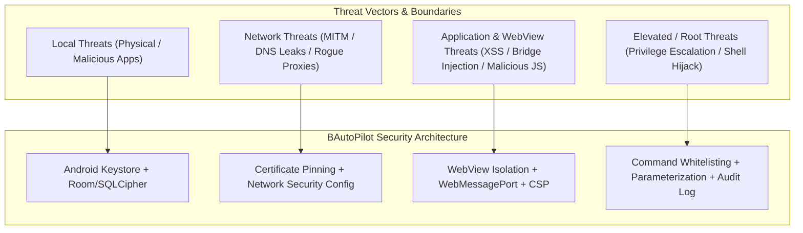
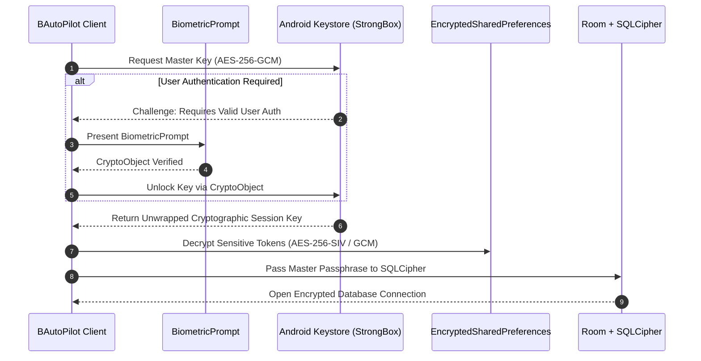
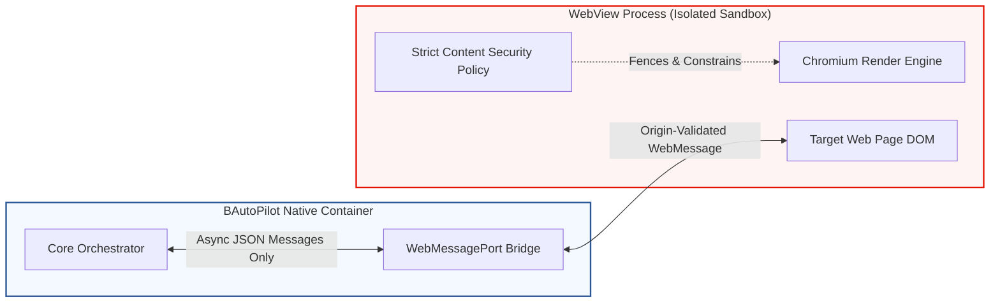
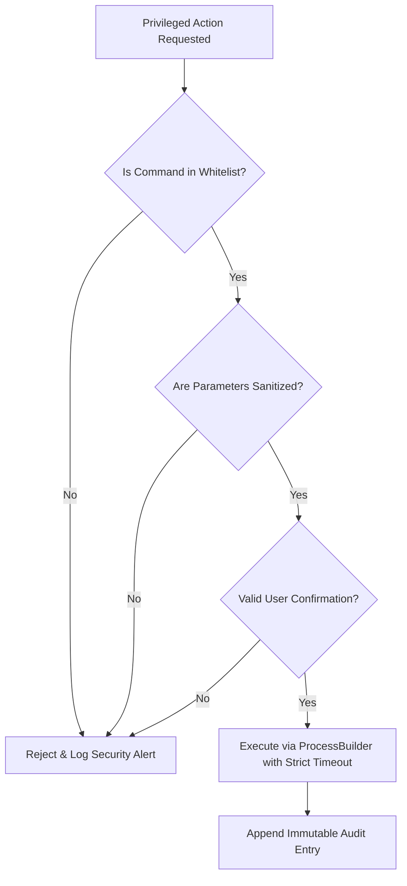
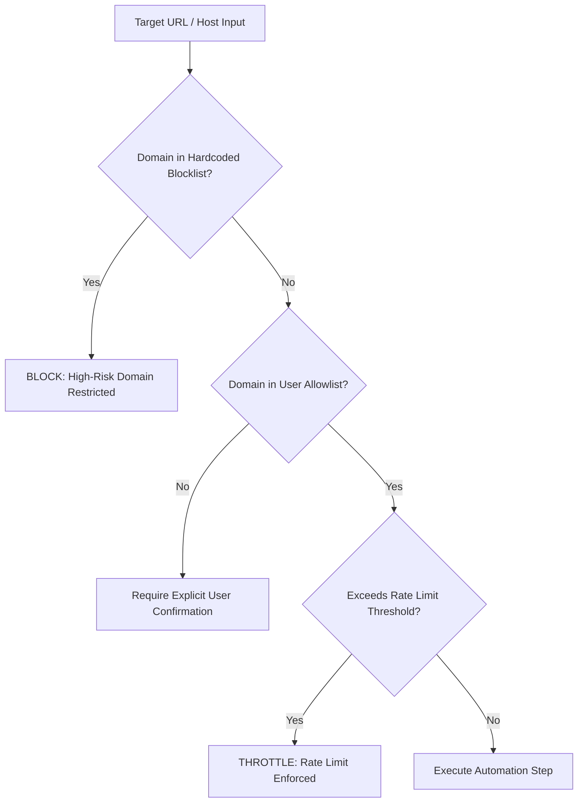

# BAutoPilot Security Architecture & Policy (SECURITY.md)

**Document Version:** 1.0.0  
**Target Platform:** Android (API Level 26+ / Android 8.0+ through Android 15+)  
**Classification:** Public Engineering & Compliance Standard  
**Maintainer:** BAutoPilot Core Security Team  

---

## 1. Executive Summary & Security Philosophy

BAutoPilot is a high-performance Android automation and task execution platform combining embedded WebView runtimes, script orchestration, optional elevated system interactions, and network proxying. Because BAutoPilot executes automated workflows that interact with web properties and local system primitives, security is engineered as a foundational core requirement rather than an afterthought.

The BAutoPilot architecture adheres to the following core security principles:

1. **Defense-in-Depth:** Security controls are layered across cryptographic storage, isolated process sandboxes, strict runtime network controls, and execution fences. A failure in one layer must not compromise host integrity.
2. **Principle of Least Privilege (PoLP):** Automation scripts and embedded web views execute in locked-down, restricted execution contexts with minimal native API exposure.
3. **Zero Trust Local Architecture:** Local inputs, web-delivered scripts, network frames, and external URLs are treated as untrusted and potentially hostile.
4. **Privacy-by-Design & Local-First:** All automation logic, state data, credentials, and telemetry remain strictly on the user's device unless explicitly exported via authenticated user action.
5. **Ethical Operation:** The platform strictly prohibits malicious automation, credential harvesting, anti-bot/CAPTCHA circumvention, and denial-of-service activities.

---

## 2. Threat Model

BAutoPilot utilizes an asset-centric threat model evaluating four distinct attack surfaces: **Local System**, **Network & Transport**, **Application & WebView**, and **Root & Elevated Privileges**.



### 2.1 Local System & Host Threats
* **Malicious Co-located Applications:** Other applications installed on the same device attempting to read BAutoPilot internal databases, shared preferences, cache directories, or memory allocations.
* **Physical Device Theft / Unlocked Device Access:** Unauthorized third parties gaining physical access to an unlocked or locked device to extract stored session cookies, passwords, or workflow data.
* **Malicious Backup Restoration:** Exploitation of Android Debug Bridge (`adb backup`) or cloud backup vectors to extract unencrypted application state.
* **Memory Inspection / Debugger Attachment:** Insecure debug flags allowing runtime code instrumentation or memory dumping of sensitive credentials.

### 2.2 Network & Communication Threats
* **Man-in-the-Middle (MITM) Interception:** Adversaries tampering with network traffic, injecting malicious payloads into downloaded automation scripts, or eavesdropping on unencrypted proxy channels.
* **DNS Leaks over Proxies / VPNs:** DNS lookups bypassing intended SOCKS5/HTTP proxy tunnels, leaking browsing history and target endpoints to local ISPs or malicious network observers.
* **Rogue Proxy Infrastructure:** Untrusted proxy nodes modifying traffic, injecting rogue scripts into HTTP responses, or capturing plaintext authentication tokens.
* **SSL Stripping & Rogue Certificate Authorities:** User-installed rogue root CA certificates attempting to inspect and modify traffic routed through BAutoPilot.

### 2.3 Application & WebView Threats
* **Cross-Site Scripting (XSS) in Target Pages:** Compromised or malicious target web pages executing injected JavaScript within the embedded WebView.
* **Native Bridge Exploitation (`@JavascriptInterface`):** Malicious JavaScript attempting reflection, arbitrary Java method execution, or escaping WebView sandboxing into native code execution.
* **Local File Scheme Access (`file://`):** Malicious web content traversing local storage directories via `file://` URIs to read SQLite databases, shared preferences, or private application assets.
* **Cross-Frame / Iframe Bridge Access:** Untrusted third-party advertising or analytics iframes within a target page invoking injected native interface bindings.
* **Universal Cross-Site Scripting (UXSS) / Zero-Day Browser Exploits:** Exploitation of underlying Chromium rendering engine vulnerabilities to break out of the browser sandbox.

### 2.4 Root, Privilege Escalation & Compromised Environment Threats
* **Arbitrary Shell Command Injection:** Malicious automation parameters containing shell metacharacters (`;`, `&&`, `|`, `` ` ``, `$()`) that execute unintended commands when operating with root privileges (`su`).
* **Privilege Escalation:** Exploiting setuid binaries, insecure file permissions, or unvalidated IPC intents to execute unauthorized privileged operations.
* **Malicious Magisk / Kernel Modules:** Hostile root hooks intercepting native functions, unpinning certificates via runtime memory tampering, or accessing SQLite keys directly in RAM.

### 2.5 Threat Matrix

| Threat Category | Specific Threat Scenario | Severity | Primary Mitigation |
| :--- | :--- | :--- | :--- |
| **Local** | DB extraction from rooted device or backup | High | Android Keystore backed SQLCipher (AES-256) + `android:allowBackup="false"` |
| **Local** | Unauthorized local UI interaction | Medium | Hardware-backed Biometric Authentication (`BiometricPrompt` + `CryptoObject`) |
| **Network** | MITM traffic inspection | Critical | Static & dynamic Certificate Pinning + Android Network Security Config |
| **Network** | Proxy DNS leakage | High | Process-level network binding + explicit DoH/DoT resolver routing |
| **Application**| Native RCE via WebView bridge | Critical | Deprecate `@JavascriptInterface`; enforce `WebMessagePort` + isolate bridge |
| **Application**| Reading internal files via `file://` | High | `setAllowFileAccess(false)` + disable universal/file URL access |
| **Application**| Infinite loop / DoS script in WebView | Medium | Strict script watchdog timers + memory thresholds |
| **Root** | Root shell command injection | Critical | Zero arbitrary shell execution; strict command whitelist + parameterization |
| **Root** | Unaudited privilege usage | High | Append-only encrypted audit log with non-tamperable timestamps |

---

## 3. Credential Protection & Cryptographic Storage

BAutoPilot enforces strict hardware-backed cryptographic separation for all persistent credentials, session tokens, and database stores.



### 3.1 Hardware-Backed Security: Android Keystore & StrongBox
* All symmetric encryption keys are generated and stored inside the **Android Keystore system**.
* Where supported by hardware (API 28+), keys are generated within **StrongBox Keymaster** (dedicated Secure Element with tamper-resistant hardware).
* Keys are marked with `PURPOSE_ENCRYPT | PURPOSE_DECRYPT`, utilizing `KeyProperties.KEY_ALGORITHM_AES` with `BLOCK_MODE_GCM` and `ENCRYPTION_PADDING_NONE`.
* Keys are configured with `setUserAuthenticationRequired(true)` for sensitive administrative actions, ensuring keys cannot be used without explicit user verification.

```kotlin
// Master Key Generation with StrongBox Fallback
val masterKey = MasterKey.Builder(context, MasterKey.DEFAULT_MASTER_KEY_ALIAS)
    .setKeyScheme(MasterKey.KeyScheme.AES256_GCM)
    .setRequestStrongBoxBacked(context.packageManager.hasSystemFeature(PackageManager.FEATURE_STRONGBOX_KEYSTORE))
    .build()
```

### 3.2 Key Generation, Derivation, and Lifecycle
* **Master Encryption Keys:** Generated directly inside the Keystore hardware security module; raw private/secret key material is never exposed to user-space application memory.
* **Secondary Key Derivation:** When user-supplied master passwords are used (e.g., for portable encrypted backups), BAutoPilot uses **Argon2id** (memory: 64MB, iterations: 4, parallelism: 2) or **PBKDF2WithHmacSHA512** (minimum 600,000 iterations) with a cryptographically secure 128-bit random salt generated via `SecureRandom`.
* **Zeroing Sensitive Memory:** All intermediate byte arrays representing passwords or cryptographic keys are immediately overwritten with zeros (`Arrays.fill(bytes, 0.toByte())`) immediately after use.

### 3.3 EncryptedSharedPreferences
* Application configuration containing sensitive data (tokens, API secrets, proxy credentials) must not use standard `SharedPreferences`.
* Storage is managed exclusively via Jetpack Security `EncryptedSharedPreferences`:
  * **Keys:** Encrypted with deterministic `AES256_SIV`.
  * **Values:** Encrypted with authenticated `AES256_GCM`.

```kotlin
val securePreferences = EncryptedSharedPreferences.create(
    context,
    "b_autopilot_secure_prefs",
    masterKey,
    EncryptedSharedPreferences.PrefKeyEncryptionScheme.AES256_SIV,
    EncryptedSharedPreferences.PrefValueEncryptionScheme.AES256_GCM
)
```

### 3.4 Encrypted Database: Room with SQLCipher
* All structured local data (workflow definitions, execution logs, target metadata) is persisted in a SQLite database encrypted using **SQLCipher for Android**.
* Database encryption uses **256-bit AES** in CBC/GCM mode.
* Key management:
  * The database encryption passphrase is randomly generated (256-bit high-entropy token via `SecureRandom`), encrypted using the Android Keystore Master Key, and stored in `EncryptedSharedPreferences`.
  * The SQLite connection factory is initialized using `SupportOpenHelperFactory(passphrase)`.
  * Page size is configured to 4096 bytes with PBKDF2 iteration count set to a minimum of 256,000.

```kotlin
val openHelperFactory = SupportFactory(dbPassphraseBytes)
val database = Room.databaseBuilder(context, AppDatabase::class.java, "bautopilot.db")
    .openHelperFactory(openHelperFactory)
    .build()
```

### 3.5 Biometric Authentication
* Sensitive operations—including viewing plaintext credentials, exporting encrypted profiles, or initiating privileged execution—require verification via `androidx.biometric.BiometricPrompt`.
* Configuration enforces `BiometricManager.Authenticators.BIOMETRIC_STRONG`.
* Cryptographic Binding: Authentication must unlock an active `BiometricPrompt.CryptoObject` initialized with an Android Keystore cipher. If the device biometric enrollment changes (e.g., a new fingerprint is enrolled), the Keystore key is automatically invalidated via `.setInvalidatedByBiometricEnrollment(true)`.

### 3.6 Proxy Credential Encryption & Origin Isolation (DEF-402, DEF-403)
* **Zero Deterministic Fallback Keys in Production (DEF-402):**
  * `ProxyCredentialEncryptor` enforces hardware-backed AES-256-GCM encryption using `AndroidKeyStoreProvider`.
  * Production binaries contain zero deterministic/hardcoded fallback encryption keys.
  * Dependency inversion is enforced via `interface KeyProvider`: test harnesses inject explicit ephemeral mock keys (`TestKeyProvider`), while production strictly initializes against `"AndroidKeyStore"`.
  * If Android KeyStore initialization, key generation, or cipher operations fail, encryption methods fail-closed and return `null`. Plaintext credentials are never stored, and encryption is never silently downgraded.
* **Origin Challenge Isolation (DEF-403):**
  * When executing authenticated HTTP proxies, `WebViewClient.onReceivedHttpAuthRequest()` intercepts proxy authentication challenges (HTTP 407 `Proxy-Authenticate`).
  * To prevent proxy credential leakage to visited origin servers (HTTP 401 `WWW-Authenticate`), the engine verifies `host.equals(activeProxy.host, ignoreCase = true)`.
  * If the challenge originates from the active proxy host, credentials are submitted via `handler.proceed(username, password)`.
  * If the challenge originates from any other host (including visited websites), the request is immediately rejected via `handler.cancel()`, ensuring proxy credentials never leak to external origins.

---

## 4. WebView Hardening & Isolation

The embedded WebView runtime is the primary execution interface for browser automation. It represents the highest-risk attack surface and is hardened against remote code execution, cross-context information leakage, and script injection.



### 4.1 Strict Disabling of File & Content Schemes
To prevent local file traversal and cross-origin data theft, all file and content access primitives are explicitly disabled on every `WebSettings` instance:

```kotlin
webSettings.apply {
    // Completely disable local filesystem access
    allowFileAccess = false
    allowContentAccess = false
    
    // Prevent file-scheme based cross-origin exploits (legacy safety)
    allowFileAccessFromFileURLs = false
    allowUniversalAccessFromFileURLs = false
}
```

### 4.2 Content Security Policy (CSP) Enforcement
* All locally injected wrapper pages and UI overlays must define and enforce a strict Content Security Policy.
* For injected automation scripts, policies enforce cryptographic nonces:
  ```http
  Content-Security-Policy: default-src 'self'; script-src 'nonce-{RANDOM_HEX_32}' 'strict-dynamic'; object-src 'none'; base-uri 'none'; frame-ancestors 'none';
  ```
* Evaluated automation scripts cannot load remote third-party scripts dynamically unless the domain is present in the user-verified Domain Allowlist.

### 4.3 Native Bridge Security & `@JavascriptInterface` Audit
* **Vulnerability History:** The legacy `@JavascriptInterface` annotation previously exposed methods to object injection and reflection attacks. While API 17+ restricts access to annotated methods, it remains vulnerable to bridge manipulation and cross-frame leakage.
* **Audit & Migration Policy:**
  1. Direct usage of `addJavascriptInterface` is strictly restricted and audited.
  2. Native bridge methods must accept **only primitive or string types**. Objects, handles, or class loaders are never accepted as arguments or returned.
  3. No native method exposed to JavaScript may execute shell commands, read local files, or alter persistent application settings directly.

### 4.4 Mixed Content Blocking
* Active and passive mixed content is strictly prohibited.
* `WebSettings.setMixedContentMode(WebSettings.MIXED_CONTENT_NEVER_ALLOW)` is unconditionally set.
* Insecure `http://` resources within an `https://` automation target are blocked without user prompt.

### 4.5 Strict SSL/TLS Certificate Validation
* BAutoPilot **strictly forbids** bypassing SSL/TLS certificate errors.
* Overriding `WebViewClient.onReceivedSslError` to invoke `handler.proceed()` is prohibited by automated lint checks and CI/CD static analysis.
* All SSL errors immediately invoke `handler.cancel()`, terminate the automation session, and log a critical security event.

```kotlin
override fun onReceivedSslError(view: WebView?, handler: SslErrorHandler?, error: SslError?) {
    // Zero-tolerance policy: always abort on certificate validation failure
    handler?.cancel()
    SecurityLogger.logSecurityIncident(
        type = IncidentType.SSL_VALIDATION_FAILURE,
        details = "SSL error code ${error?.primaryError} on URL: ${error?.url}"
    )
}
```

### 4.6 Process Isolation
* BAutoPilot configures out-of-process WebView rendering:
  * In `AndroidManifest.xml`, WebView components run within dedicated sandboxed render processes utilizing Android's `isolatedProcess="true"`.
  * In the event of a zero-day exploit in Chromium's Blink rendering or V8 engine, the attacker remains trapped inside a Linux UID sandbox with no permissions (`INTERNET`, storage, and system capabilities are stripped from the isolated process).

### 4.7 Frame Isolation & Limiting Bridge Exposure
* Injected automation bridges must not be exposed globally across all frames or iframes.
* Where iframe interaction is required, origin checks verify that `document.origin` matches the intended target domain.
* Third-party subframes (e.g., ad servers, tracking pixels) are blocked from accessing communication ports.

---

## 5. Script Sandboxing & Execution Runtime

Automation in BAutoPilot is powered by scripts that execute against web DOMs. To maintain application stability and prevent hostile script behavior, execution is contained within strict sandbox fences.

### 5.1 JavaScript Execution Timeout & Watchdogs
* Every script execution triggered via `evaluateJavascript` is monitored by a native coroutine watchdog.
* Maximum synchronous execution time is capped at **10,000 ms** (10 seconds) by default.
* If a script fails to return or enters an infinite loop, the execution watchdog cancels the coroutine, isolates the WebView instance, and resets the JavaScript context.

```kotlin
suspend fun executeScriptWithTimeout(webView: WebView, script: String, timeoutMs: Long = 10_000L): Result<String> {
    return withTimeoutOrNull(timeoutMs) {
        suspendCancellableCoroutine { continuation ->
            webView.evaluateJavascript(script) { result ->
                if (continuation.isActive) continuation.resume(Result.success(result ?: ""))
            }
        }
    } ?: Result.failure(TimeoutException("Script execution exceeded limit of ${timeoutMs}ms"))
}
```

### 5.2 Memory Limits & Resource Quotas
* Injected scripts are constrained to prevent memory exhaustion (DOM tree explosion or memory-leak bomb attacks).
* The runtime enforces payload return limits: strings returned from `evaluateJavascript` exceeding **2 MB** are truncated or rejected.
* Heap usage of the hosting process is continuously monitored; if total memory exceeds 80% of `Runtime.getRuntime().maxMemory()`, automation queues are paused and WebViews are garbage-collected.

### 5.3 Restricted API Surface
* Injected scripts operate inside a minimized sandbox.
* The script environment does not have direct access to:
  * Android OS level capabilities or telephony.
  * Device hardware identifiers (IMEI, MAC address, serial number).
  * Other WebView tabs or persistent cookie jars outside the assigned session.

### 5.4 Input Validation, Sanitization, and AST Parsing
* Automation scripts and user-provided selectors undergo static validation before injection.
* Input strings interpolated into scripts must be parameterized as JSON literals (`JSONObject.quote()`) rather than concatenated as raw strings, preventing script breakout attacks.

```kotlin
// INSECURE:
// webView.evaluateJavascript("document.querySelector('${untrustedInput}').click();", null)

// SECURE: Parameterized JSON payload
val sanitizedInput = JSONObject.quote(untrustedInput)
val safeScript = "document.querySelector($sanitizedInput)?.click();"
webView.evaluateJavascript(safeScript, null)
```

### 5.5 Modern Bridge Architecture: `WebMessagePort`
BAutoPilot deprecates `addJavascriptInterface` in favor of HTML5 postMessage communication using `WebViewCompat.addWebMessageListener` and `WebMessagePort`:

* **Origin Restriction:** Messages are accepted only from explicitly specified origins (no wildcard `*` allowed).
* **Asynchronous Communication:** Eliminates blocking UI thread operations.
* **Structured Data:** Messages must be valid JSON adhering to a strict schema.

```kotlin
val allowedOrigins = setOf("https://example.com", "https://app.example.com")
WebViewCompat.addWebMessageListener(
    webView,
    "bautopilotBridge",
    allowedOrigins
) { view, message, sourceOrigin, isMainFrame, replyProxy ->
    // Verify frame origin and context
    if (isMainFrame && sourceOrigin.toString() in allowedOrigins) {
        BridgeRouter.dispatchMessage(message.data, replyProxy)
    }
}
```

---

## 6. Root & Elevated Privilege Security

On rooted environments (Magisk, KernelSU, APatch), BAutoPilot can optionally execute low-level automation commands (e.g., input event emulation, airplane mode cycling). This capability presents extreme security risks and is governed by strict controls.



### 6.1 Strict Command Whitelist
* BAutoPilot **strictly forbids arbitrary shell execution**. The application never exposes an open `su -c` endpoint.
* Only explicitly whitelisted commands with predetermined binary targets are permissible:

| Allowed Command ID | Underlying Binary | Permitted Arguments / Scope | Purpose |
| :--- | :--- | :--- | :--- |
| `CMD_INPUT_TAP` | `/system/bin/input` | `tap <x: Int> <y: Int>` | Emulate physical screen tap |
| `CMD_INPUT_SWIPE` | `/system/bin/input` | `swipe <x1> <y1> <x2> <y2> <dur>` | Emulate swipe gesture |
| `CMD_INPUT_KEY` | `/system/bin/input` | `keyevent <keyCode: Int>` | Trigger hardware key event |
| `CMD_AIRPLANE_MODE` | `/system/bin/cmd` | `connectivity airplane-mode <enable/disable>` | Reset IP via airplane toggle |
| `CMD_DUMP_WINDOW` | `/system/bin/uiautomator`| `dump /data/local/tmp/window_dump.xml` | Capture accessibility hierarchy |

### 6.2 Parameterized Commands & Injection Prevention
* Execution must use `java.lang.ProcessBuilder` with separate argument lists.
* String concatenation involving shell interpreters (`sh -c "input tap " + x`) is prohibited to prevent shell metacharacter injection.

```kotlin
fun executeRootTap(x: Int, y: Int): CommandResult {
    require(x in 0..10000 && y in 0..10000) { "Coordinates out of bounds" }
    
    // Parameterized argument list passed directly to the binary
    val command = listOf("su", "-c", "/system/bin/input", "tap", x.toString(), y.toString())
    return RootExecutor.runCommand(command, timeoutMs = 3000L)
}
```

### 6.3 Prohibition of Arbitrary Execution
* No user interface element, workflow script, or remote trigger may pass arbitrary shell commands to `su`.
* Dynamic command generation, eval constructs, and string-to-binary executions are blocked at compile time and runtime.

### 6.4 Execution Timeouts & Process Cleanup
* All elevated subprocesses are spawned with a hard execution ceiling (default: **5 seconds**).
* If a process hangs, BAutoPilot invokes `process.destroyForcibly()` and sends `SIGKILL` to the child PID group to prevent orphaned background processes.

### 6.5 Immutable Audit Logging
* Every root invocation writes an entry to an encrypted audit log table.
* Audit log records include:
  * Timestamp (UTC ISO-8601)
  * Caller identity / Workflow UUID
  * Command ID and sanitized parameter list
  * Process return code and execution duration
  * Cryptographic HMAC signature linking the entry to the previous log entry (hash-chained audit trail).

---

## 7. Network Security & Transport Layer Protections

All network communications—including target site automation, proxy tunneling, and asset loading—must be protected against surveillance and manipulation.

### 7.1 Android Network Security Configuration
BAutoPilot enforces strict transport rules via `res/xml/network_security_config.xml`:
* Cleartext HTTP traffic is disabled across the entire application (`cleartextTrafficPermitted="false"`).
* User-installed CA certificates are untrusted by default, preventing rogue MITM proxying via unauthorized root certificates.

```xml
<?xml version="1.0" encoding="utf-8"?>
<network-security-config>
    <base-config cleartextTrafficPermitted="false">
        <trust-anchors>
            <!-- Trust only official system-level Certificate Authorities -->
            <certificates src="system" />
        </trust-anchors>
    </base-config>
</network-security-config>
```

### 7.2 Strict Certificate Pinning
* For critical internal API endpoints (e.g., license verification, secure backup sync), BAutoPilot enforces Public Key Pinning (HPKP) using OkHttp's `CertificatePinner`.
* Multiple pins (primary + at least one backup pin) are configured to prevent bricking during certificate rotation.

```kotlin
val certificatePinner = CertificatePinner.Builder()
    .add("api.bautopilot.net", "sha256/AAAAAAAAAAAAAAAAAAAAAAAAAAAAAAAAAAAAAAAAAAA=") // Primary
    .add("api.bautopilot.net", "sha256/BBBBBBBBBBBBBBBBBBBBBBBBBBBBBBBBBBBBBBBBBBB=") // Backup
    .build()

val secureHttpClient = OkHttpClient.Builder()
    .certificatePinner(certificatePinner)
    .build()
```

### 7.3 Proxy Credential Encryption
* BAutoPilot supports routing traffic through residential and datacenter proxies (HTTP, HTTPS, SOCKS5).
* Proxy authentication credentials (usernames and passwords) are encrypted using Android Keystore keys before persisting to the database.
* Plaintext credentials only exist ephemerally in memory within OkHttp `Authenticator` or proxy connection handshakes.

### 7.4 VPN Integration & DNS Leak Prevention
* When operating over external proxy connections or custom VPN tunnels:
  * Traffic is bound strictly to the active network interface using `ConnectivityManager.bindProcessToNetwork()`.
  * **DNS Leak Protection:** The application resolves hostnames directly through the established proxy tunnel (SOCKS5 with remote DNS resolution) or routes DNS lookups through dedicated DNS-over-HTTPS (DoH) or DNS-over-TLS (DoT) resolvers (e.g., Cloudflare 1.1.1.1, Quad9).
  * System-level fallback to unencrypted local cellular/Wi-Fi DNS resolvers is blocked.

---

## 8. Data Protection, Export, and Storage Hygiene

### 8.1 Encrypted Backups & Exclusion Rules
* Android's default adb backup is explicitly disabled in `AndroidManifest.xml`:
  ```xml
  android:allowBackup="false"
  ```
* Automated Cloud Backup exclusions are defined in `res/xml/backup_rules.xml` to prevent SQLCipher databases, shared preference keys, and Keystore tokens from being transmitted to Google Drive backup storage:
  ```xml
  <?xml version="1.0" encoding="utf-8"?>
  <data-extraction-rules>
      <cloud-backup>
          <exclude path="bautopilot.db" />
          <exclude path="shared_prefs/b_autopilot_secure_prefs.xml" />
      </cloud-backup>
      <device-transfer>
          <exclude path="bautopilot.db" />
          <exclude path="shared_prefs/b_autopilot_secure_prefs.xml" />
      </device-transfer>
  </data-extraction-rules>
  ```

### 8.2 Secure Data Export and Import
* When users export workflows or configuration profiles, exports must be explicitly encrypted:
  * **Format:** Encrypted Container (`.baenc`).
  * **Encryption Algorithm:** **ChaCha20-Poly1305** or **AES-256-GCM**.
  * **Key Derivation:** Master export password converted to an encryption key using Argon2id with a unique 16-byte random salt per export file.
* Plaintext unencrypted export of credentials or active session cookies is prohibited.

### 8.3 Log Redaction & Anti-Leak Controls
* Logging is handled through a centralized security-aware logging facade (`SecurityLogger`).
* In release builds, `Logcat` debug logging is stripped via ProGuard/R8 rules.
* The logging pipeline integrates regular expression filters that automatically redact:
  * Bearer tokens, JWTs, and API keys.
  * Passwords, PINs, and biometric state tokens.
  * Cookie headers (`Cookie:`, `Set-Cookie:`).
  * Personal Identifiable Information (PII) including email addresses, phone numbers, and payment details.

```kotlin
object LogRedactor {
    private val PATTERNS = listOf(
        Regex("""(?i)(password|passwd|pwd|secret|token|apiKey)[\s]*[=:]\s*["']?([^"'&\s]+)"""),
        Regex("""(?i)Bearer\s+([a-zA-Z0-9_\-\.]+)"""),
        Regex("""(?i)(cookie|set-cookie):\s*([^;\r\n]+)""")
    )

    fun sanitize(message: String): String {
        var clean = message
        PATTERNS.forEach { regex ->
            clean = clean.replace(regex) { matchResult ->
                val key = matchResult.groupValues[1]
                "$key=[REDACTED]"
            }
        }
        return clean
    }
}
```

### 8.4 Zero Credential Logging Guarantees
* Automated unit tests and static analysis lint rules verify that no log statement accepts variables tagged `@SensitiveData` or references credential fields.

---

## 9. Privacy Architecture & User Control

BAutoPilot is built on a **Local-First, Privacy-by-Design** standard.

### 9.1 Zero Analytics Without Explicit Opt-In Consent
* BAutoPilot contains **no active third-party analytics or crash reporting SDKs** that collect data by default.
* Telemetry collection is disabled by default. If crash reporting is enabled, it requires explicit, informed opt-in consent from the user via a settings toggle.
* Telemetry packages must never include URLs visited, task scripts, typed text, credentials, or IP addresses.

### 9.2 Local-First / Zero Data Egress Policy
* Automation definitions, captured DOM snapshots, execution metrics, and workflow histories remain stored locally in the device's SQLCipher database.
* No data leaves the device unless explicitly initiated by the user (e.g., initiating a manual export).

### 9.3 Cookie & LocalStorage Partitioning
* Automation workflows support **isolated session sandboxing**.
* Each automation profile maintains an independent, compartmentalized cookie jar and WebStorage database.
* Profiles do not share cookies, cache, or IndexedDB storage, preventing cross-profile tracking and unintentional session contamination.

### 9.4 "Clear on Delete" & Cryptographic Erasure
* When a user deletes a profile, account, or automation session:
  1. Associated cookies are cleared using `CookieManager.getInstance().removeAllCookies()`.
  2. Storage files, WebCache directories, and IndexedDB stores are overwritten and deleted.
  3. Database records are deleted and the SQLite database is re-vacuumed (`VACUUM`) to ensure data is removed from disk pages.
  4. Ephemeral keys associated with the session are deleted from the Android Keystore.

---

## 10. Ethical Safeguards & Compliance

Automation technology carries significant potential for misuse. BAutoPilot implements strict, hardcoded ethical fences to prevent the software from being weaponized for abusive, fraudulent, or malicious purposes.



### 10.1 Domain Allowlisting and Blocklisting
* **Hardcoded Restricted Blocklist:** BAutoPilot maintains an unmodifiable internal blocklist preventing automated execution against high-risk infrastructure:
  * Financial institutions, banking portals, and payment processors.
  * Government administration, tax, and voting portals.
  * Healthcare systems and electronic medical records.
  * Emergency services and infrastructure operations.
* **Domain Allowlist Mode:** Users can configure strict domain allowlists. In this mode, the WebView client will cancel navigation and script execution for any URL outside the allowlist.

### 10.2 Adaptive Rate Limiting & Anti-DoS
* Automation engines enforce adaptive rate limiting (Token Bucket algorithm).
* Navigation events and form submissions are throttled to realistic human thresholds (e.g., minimum 500ms delay between actions).
* High-frequency rapid-fire requests designed to overwhelm web infrastructure or simulate Denial-of-Service (DoS) attacks are blocked at the scheduler level.

### 10.3 User Authorization for Targets
* The platform requires explicit user confirmation before executing workflows that perform transactional or destructive actions (e.g., account deletion, payments, submitting legal forms).
* Headless/silent execution is barred from targeting unverified third-party domains.

### 10.4 Anti-Abuse: Prohibition of CAPTCHA Solving
* **Strict Policy:** BAutoPilot does not include, bundle, or support automated CAPTCHA or bot-detection bypass mechanisms (e.g., OCR bypass, automated third-party CAPTCHA solving APIs, reCAPTCHA/hCaptcha/Turnstile circumvention).
* When a CAPTCHA or bot challenge is detected, the automation execution pauses and prompts the human user to solve the challenge manually via visible UI.

### 10.5 Anti-Fraud: Prohibition of Fake Traffic Generation
* BAutoPilot is engineered for user task automation, testing, and productivity.
* It strictly prohibits features designed to generate synthetic or fraudulent traffic:
  * Ad-click fraud or impression inflation.
  * Artificial social media engagement (fake likes, follower farming).
  * Automated scalping or scraping contrary to target site policies.

### 10.6 Terms of Service & Acceptable Use Policy Acknowledgment
* Upon initial setup and prior to enabling automation execution, users must review and acknowledge the **BAutoPilot Acceptable Use Policy (AUP)**.
* Users contractually affirm that:
  1. They have lawful authorization to access and automate the target systems.
  2. They will not use BAutoPilot to violate applicable laws, regulations, or third-party Terms of Service.
  3. They will not deploy BAutoPilot for harassment, surveillance, unauthorized data harvesting, or network abuse.

---

## 11. Security Governance & Vulnerability Disclosure

### 11.1 Reporting a Security Vulnerability
The BAutoPilot team welcomes responsible disclosure from security researchers and developers. If you discover a vulnerability in BAutoPilot:

1. **Do not create public GitHub issues or public posts.**
2. Send a detailed report via encrypted email to:  
   **`security@bautopilot.local`** (or our designated security contact).
3. Include the following details:
   * Target device model, Android OS version, and BAutoPilot build version.
   * Step-by-step reproduction instructions or proof-of-concept (PoC).
   * Impact assessment and suggested remediation.

### 11.2 Response Timeline
* **Initial Acknowledgment:** Within 48 hours of report receipt.
* **Triage & Severity Assessment:** Within 5 business days.
* **Remediation & Patch Release:** Depending on severity, targeted within 14–30 days.
* **Public Disclosure:** Coordinated disclosure occurs only after an official patch has been deployed to users.

---

## 12. Backup, Diagnostics & Recovery Security Architecture (Phase 5)

Phase 5 introduces comprehensive diagnostics, execution event troubleshooting, and encrypted backup recovery capabilities. These features are hardened according to defense-in-depth principles:

### 12.1 Strict Secret Exclusion in Backups
* **Zero Secret Export**: Android KeyStore private/master keys, encrypted proxy passwords, proxy usernames, and encryption initialization vectors (IVs) are **strictly excluded** from `.autopilot` exports.
* `ProxyEntity` export scrub: `encryptedUsername = null`, `encryptedPassword = null`, `usernameIv = null`, `passwordIv = null`.
* User proxy notes receive a security tag: `[Credentials excluded in backup for security]`. Users must re-enter credentials upon restore.

### 12.2 Authenticated Backup Encryption
* **Algorithm**: AES-256-GCM (`AES/GCM/NoPadding`) with 128-bit authentication tag.
* **Key Derivation**: PBKDF2 with HMAC-SHA256 (`PBKDF2WithHmacSHA256`), upgraded to **250,000 iterations** (`BackupCrypto.PBKDF2_ITERATIONS`) to meet OWASP mobile computational work factor baselines on modern ARM hardware while maintaining sub-300ms responsiveness.
* **Backward Compatibility**: Archives encrypted with legacy 100,000 iterations (`BackupCrypto.LEGACY_PBKDF2_ITERATIONS`) store their iteration count in `manifest.kdfIterations` and decrypt seamlessly.
* **Entropy**:
  * 16-byte random salt per backup via `SecureRandom`.
  * 12-byte random IV/nonce per backup via `SecureRandom`.
  * **Nonce Reuse Prevention**: Unique IV generated on every single encryption call. Nonces are never reused.
* **Tamper Evidence**: Any tampering with ciphertext or manifest yields an immediate `AEADBadTagException` and cancels restore before database execution.

### 12.3 Archive Security & Path Traversal (Zip Slip) Defense
* When inspecting and unzipping `.autopilot` archives, entry names are strictly validated:
  * Any entry containing `..` or leading directory traversal characters (`/` or `\`) throws an immediate `SecurityException`.
  * Target extraction paths are checked with `.canonicalPath` to ensure they reside strictly within the intended temporary directory.
* **Zip Bomb Protection**: Maximum entry count is capped at 50, and uncompressed byte threshold is capped at 50MB.

### 12.4 Diagnostic Privacy & Sanitization
* **Controlled Probes**: Diagnostic network checks target a zero-payload Google endpoint (`https://www.google.com/generate_204`). No user identifiers, cookies, or tokens are transmitted.
* **URL Sanitization**: `ExecutionEventTracker.sanitizeUrl()` scrubs all URL query parameters (`?[query-redacted]`) and strips user credentials.
* **Credential Masking**: `ExecutionEventTracker.sanitizeSensitiveText()` scans for sensitive keywords (`password`, `token`, `secret`, `key`) and redacts values.
* **Zero Content Logging**: HTML page content, DOM trees, cookies, and HTTP auth headers are never recorded in execution event timelines.

### 12.5 Fail-Safe Restoration & Active Session Protection
* **Pre-Transaction Entity Validation**: Structural and range validation (non-blank IDs, non-blank names, port range 1..65535) is performed before modifying the database.
* **Atomic Database Transactions**: All restoration writes are executed inside `database.withTransaction { ... }`, guaranteeing that any constraint failure results in complete rollback.
* **Disabled Schedules Rule**: Restored schedules are forced to `enabled = false` and `status = 'IDLE'` to prevent unreviewed background executions from firing immediately.
* **Pre-Replace Safety Backup**: Before executing a destructive `REPLACE` restore, the system automatically creates a local safety backup archive.
* **Recovery Center Active Session Protection**: `RecoveryManager.resetStuckAutomations()` checks `coordinator.engineState.value` to ensure that legitimately active `RUNNING` and user-initiated `PAUSED` automation sessions are strictly preserved and never wiped. Only genuine zombie states from app crashes/process termination are repaired.

---

*This security specification is maintained under continuous revision to adapt to evolving Android platform capabilities, Chromium security patches, and regulatory frameworks.*

